# Roadmap

Xây dựng theo thứ tự phase; mỗi phase kết thúc khi các service liên quan chạy được end-to-end
với test đầy đủ. Frontend mock-first đi trước backend: UI đã mô phỏng đủ nghiệp vụ, backend
thay dần mock bằng API thật theo từng phase.

```mermaid
flowchart LR
    P0["P0 — Foundation<br/>auth · user · Kong · CI"]
    PT["P0.5 — Tenancy<br/>tenant · billing · RLS · onboarding"]
    P1["P1 — Catalog & Inventory<br/>product · inventory"]
    P2["P2 — Cart, Order, Payment & Shipping<br/>cart · order · payment · shipping · notification"]
    P3["P3 — Blind Box, Drops, Campaigns & Loyalty<br/>promotion · order (pre-order) · user (loyalty)"]
    P4["P4 — Finance & Reports<br/>finance · dashboard admin nối số liệu thật"]
    P5["P5 — Hardening<br/>k6 load test · security review · K8s/Helm"]

    P0 --> PT --> P1 --> P2 --> P3 --> P4 --> P5

    classDef phase fill:#eef2ff,stroke:#4f5bd5,color:#1f2140
    class P0,PT,P1,P2,P3,P4,P5 phase
```

Thứ tự trên là **phụ thuộc nghiệp vụ** (P2 cần P1 có sản phẩm/tồn kho để bán; P3 cần P2 có đơn
hàng để gắn pre-order/drop vào), không phải lịch ngày cụ thể — chưa chốt mốc thời gian nên không
vẽ Gantt để tránh gợi ý một deadline không có thật.

**Từ P0.5 trở đi mọi nghiệp vụ đều theo tenant:** mọi aggregate mang `tenant_id`, mọi truy vấn
chạy trong phạm vi một tenant qua Postgres RLS
([ADR-007](../20-architecture/adrs/ADR-007-multi-tenancy-pooled-rls.md),
[ADR-009](../20-architecture/adrs/ADR-009-tenant-context-propagation.md)).

## P0 — Foundation

- Hạ tầng local: docker-compose (Postgres, Redis, Kafka, Kong, observability stack).
- `auth-service` (NestJS — ADR-011): đăng ký/đăng nhập, JWT, refresh token (chưa gắn tenant —
  bổ sung claim `tid` ở P0.5).
- `user-service` (NestJS — ADR-011): hồ sơ khách hàng, địa chỉ.
- Kong routes + JWT plugin; proto + event registry nền tảng; CI (lint/test/build).

## P0.5 — Tenancy

- `tenant-service` (NestJS, CQRS + Saga): đăng ký tenant, **saga provisioning** (tạo workspace →
  seed catalog mẫu → cấu hình mặc định → phát `tenant.provisioned`), vòng đời tenant
  (`provisioning → active → past_due → suspended → archived`).
- `billing-service` (NestJS): danh mục gói, subscription, đo lượng dùng, hạn mức, webhook nhà
  cung cấp thanh toán, dunning.
- **RLS rollout**: mỗi service đã có (auth, user) + mọi service sau đều thêm cột `tenant_id`,
  policy RLS, unique/index dẫn đầu bằng `tenant_id`.
- `auth-service`: thêm claim `tid` vào JWT, đăng nhập trong phạm vi tenant của host.
- Kong: route theo `Host` (subdomain) → inject `X-Tenant-Id`; route `/tenants`, `/billing`,
  `/onboarding`.
- Frontend: wizard `/start`, console `/platform`, cài đặt thương hiệu + gói trong `/admin`.

## P1 — Catalog & Inventory

- `product-service`: sản phẩm, variant, brand, series, blind box (danh sách figure + tỉ lệ
  secret), review, tìm kiếm (Postgres full-text).
- `inventory-service`: stock theo variant, điều chỉnh có lý do, phiếu nhập hàng, reservation.

## P2 — Cart, Order, Payment & Shipping

- `cart-service`: giỏ hàng (Redis), checkout session.
- `order-service` (NestJS, CQRS + Event Sourcing + Saga): vòng đời đơn hàng, saga checkout
  (ReserveStock → Charge → CreateShipment, có compensation).
- `payment-service`: VNPay/Momo/ZaloPay sandbox + COD; hoàn tiền.
- `shipping-service`: tạo vận đơn GHN/GHTK, webhook tracking.
- `notification-service`: email trạng thái đơn.

## P3 — Blind Box, Drops, Campaigns & Loyalty

- `promotion-service`: voucher, flash sale, **drop có lịch** (giới hạn mua/người, chống oversell),
  **pre-order campaign** (đặt cọc), waitlist.
- `order-service`: hỗ trợ trạng thái pre-order (cọc → chờ hàng → thanh toán phần còn lại).
- `user-service`: điểm thưởng, hạng thành viên, early access cho drop.
- `notification-service`: nhắc drop, thông báo waitlist.

## P4 — Finance & Reports

- `finance-service`: sổ cái ghi từ event (đơn hàng, thanh toán, nhập hàng), giá vốn
  (moving average), báo cáo P&L, doanh thu, bán chạy, tồn kho chậm luân chuyển.
- Dashboard admin nối số liệu thật.

## P5 — Hardening

- Load test k6 kịch bản drop (spike); tối ưu chống oversell.
- Security review, rate limiting, backup/restore, alerting.
- Kubernetes/Helm cho staging/production.

> Trạng thái hiện tại (2026-08): docs hoàn chỉnh (đã pivot sang nền tảng đa tenant — ADR-007/008/009),
> backend mới có scaffold thư mục (13 service), frontend mock-first (storefront + admin +
> onboarding `/start` + platform console `/platform`) đang là nguồn mô phỏng nghiệp vụ.
