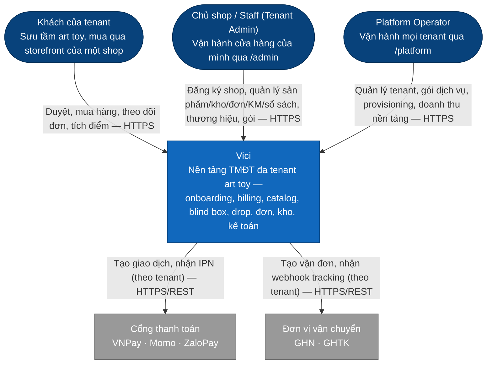
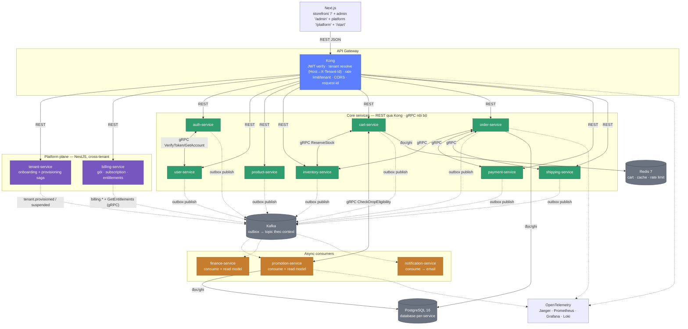

# Tổng quan hệ thống

## C4 — System Context (Level 1)

Góc nhìn xa nhất: Vici là một hệ thống, ai dùng nó, nó nói chuyện với hệ thống ngoài nào.

## C4 — Container (Level 2)

Mở Vici ra: 13 service (8 Go + 5 NestJS: auth, user, order, tenant, billing — ADR-002/008/011), gateway,
frontend, và ba kho state dùng chung theo mô hình database-per-service (không service nào đụng
database của service khác). Mọi service nghiệp vụ cô lập dữ liệu theo tenant bằng `tenant_id` +
RLS (ADR-007); `tenant-service` + `billing-service` là **platform plane** (cross-tenant).

> Cùng lý do như trên: vẽ bằng `flowchart` + `subgraph` (thay `Container_Boundary`) để chắc chắn
> render được, màu theo quy ước C4 (xanh dương = Container nội bộ, xám = System bên ngoài).

```mermaid
flowchart TB
    customer(["Khách của tenant"])
    staff(["Chủ shop / Staff"])
    operator(["Platform Operator"])

    subgraph vici["Vici"]
        fe["Frontend<br/>[Next.js App Router]<br/>Storefront '/' + Admin '/admin' + Platform '/platform' + Onboarding '/start'"]
        kong["API Gateway<br/>[Kong]<br/>JWT verify · tenant resolve (Host→X-Tenant-Id) · rate limit/tenant · CORS · routing"]

        subgraph platform["Platform plane (cross-tenant)"]
            tenant["tenant-service<br/>[NestJS — CQRS/Saga]<br/>Onboarding, provisioning saga, vòng đời tenant, thương hiệu"]
            billing["billing-service<br/>[NestJS]<br/>Gói, subscription, hạn mức/entitlements, dunning"]
        end

        subgraph identity["Identity & Customer"]
            auth["auth-service<br/>[NestJS]<br/>Đăng ký/đăng nhập, JWT (claim tid), refresh token"]
            user["user-service<br/>[NestJS]<br/>Hồ sơ khách, điểm thưởng, hạng"]
        end

        subgraph catalog["Catalog & Inventory"]
            product["product-service<br/>[Go]<br/>Sản phẩm, blind box, review, search"]
            inventory["inventory-service<br/>[Go]<br/>Tồn kho, reservation, phiếu nhập"]
        end

        subgraph commerce["Commerce"]
            cart["cart-service<br/>[Go]<br/>Giỏ hàng, checkout session"]
            order["order-service<br/>[NestJS — CQRS/ES/Saga]<br/>Đơn hàng, pre-order, saga checkout"]
            payment["payment-service<br/>[Go]<br/>Giao dịch, IPN, hoàn tiền"]
            shipping["shipping-service<br/>[Go]<br/>Vận đơn, tracking"]
        end

        subgraph growth["Marketing & Ops"]
            promotion["promotion-service<br/>[Go]<br/>Voucher, flash sale, drop, waitlist"]
            finance["finance-service<br/>[Go]<br/>Sổ cái, giá vốn, báo cáo"]
            notification["notification-service<br/>[Go]<br/>Gửi email từ event"]
        end

        pg[("PostgreSQL 16<br/>[Database-per-service]")]
        redis[("Redis 7<br/>[Cache/Session]")]
        kafka[("Kafka<br/>[Event bus]")]
    end

    payGw["Cổng thanh toán<br/>VNPay · Momo · ZaloPay"]
    shipCarrier["Đơn vị vận chuyển<br/>GHN · GHTK"]

    customer -->|"HTTPS, {shop}.vici.shop"| fe
    staff -->|"HTTPS, /admin + /start"| fe
    operator -->|"HTTPS, /platform"| fe
    fe -->|REST/JSON| kong

    kong -->|"REST (cross-tenant)"| tenant
    kong -->|"REST (cross-tenant)"| billing
    kong -->|REST| auth
    kong -->|REST| user
    kong -->|REST| product
    kong -->|REST| inventory
    kong -->|REST| cart
    kong -->|REST| order
    kong -->|REST| payment
    kong -->|REST| shipping

    tenant -.->|"tenant.provisioned / suspended"| kafka
    billing -.->|"billing.payment_failed"| kafka
    kafka -.->|"seed / gate theo tenant"| product
    billing -->|"gRPC GetEntitlements"| product
    tenant -->|"gRPC AttachTenant"| auth

    cart -->|"gRPC ReserveStock"| inventory
    cart -->|"gRPC CheckDropEligibility"| promotion
    order -->|"gRPC Reserve/CommitStock"| inventory
    order -->|"gRPC CreatePayment"| payment
    order -->|"gRPC CreateShipment"| shipping
    auth -->|gRPC| user

    payment -->|"HTTPS/REST — tạo giao dịch, nhận IPN"| payGw
    shipping -->|"HTTPS/REST — tạo vận đơn, webhook"| shipCarrier

    order -.->|outbox| kafka
    payment -.->|outbox| kafka
    inventory -.->|outbox| kafka
    kafka -.-> promotion
    kafka -.-> finance
    kafka -.-> notification
    kafka -.->|order.completed| user

    order -->|"SQL — event store"| pg
    cart -->|Redis protocol| redis

    classDef person fill:#08427b,stroke:#052e56,color:#fff
    classDef container fill:#438dd5,stroke:#2e6295,color:#fff
    classDef db fill:#438dd5,stroke:#2e6295,color:#fff
    classDef ext fill:#999999,stroke:#6b6b6b,color:#fff
    class customer,staff,operator person
    class fe,kong,tenant,billing,auth,user,product,inventory,cart,order,payment,shipping,promotion,finance,notification container
    class pg,redis,kafka db
    class payGw,shipCarrier ext
```

Chỉ vẽ vài cạnh gRPC/DB **tiêu biểu** để đỡ rối — mọi 13 service đều có Postgres riêng và phần
lớn publish/consume Kafka; danh sách RPC/event đầy đủ nằm trong spec từng service ở
[40-services/](../40-services/README.md). Muốn xem chi tiết nội bộ một service (domain/application/
infrastructure) thì đó là C4 Level 3 — xem [03-clean-architecture-ddd.md](03-clean-architecture-ddd.md).

## Góc nhìn giao tiếp (REST · gRPC · Kafka)

Cùng hệ thống, nhìn theo **kiểu giao tiếp** thay vì theo container — hữu ích khi quyết định gọi
đồng bộ hay bất đồng bộ giữa hai service.

Nguyên tắc đọc sơ đồ: mũi tên liền = gọi đồng bộ chờ kết quả (REST/gRPC); mũi tên đứt = phát/nhận
event bất đồng bộ qua Kafka (không chờ). Các cạnh gRPC/PG/Redis/OTel vẽ ở trên chỉ là ví dụ tiêu
biểu (không đầy đủ, mọi service đều có Postgres riêng và publish outbox lên Kafka) — danh sách
RPC đầy đủ nằm trong spec từng service ở [40-services/](../40-services/README.md).

## 13 services

Danh mục đầy đủ kèm cổng và trách nhiệm: [40-services/README.md](../40-services/README.md).
Ranh giới nghiệp vụ: [30-domain/01-bounded-contexts.md](../30-domain/01-bounded-contexts.md).

## Ba kiểu giao tiếp

| Kiểu | Khi nào | Ví dụ |
| --- | --- | --- |
| REST qua Kong | Client (storefront/admin/platform) gọi vào | `GET /products`, `POST /orders`, `POST /tenants` |
| gRPC nội bộ | Cần trả lời đồng bộ giữa services | order → inventory `ReserveStock`; product → billing `GetEntitlements` |
| Kafka event | Thông báo sự kiện đã xảy ra | `order.completed` → finance, loyalty, notification; `tenant.provisioned` → mọi context seed |

Nguyên tắc chọn: mặc định event (loose coupling); chỉ dùng gRPC khi caller **cần kết quả ngay
để đi tiếp** (reserve stock, validate voucher, check entitlement). Không bao giờ gọi REST nội bộ
giữa services.

## Luồng chính: onboarding tenant

1. Chủ shop submit `/start` → `POST /v1/tenants` (Kong route cross-tenant → `tenant-service`).
2. `tenant-service` tạo tenant `status=provisioning` + tài khoản chủ shop (gRPC
   `auth.AttachTenant`), khởi động **saga provisioning**.
3. Saga: tạo subscription (gRPC `billing.CreateSubscription`) → phát `tenant.provisioned` →
   mỗi context (product, inventory, shipping, user, notification…) consume, seed cấu hình +
   catalog mẫu của mình dưới `tenant_id` mới.
4. Đăng ký subdomain vào Kong (route theo `Host`). `status=active`, phát email chào mừng.
5. Bước fail → compensation ngược; tenant `provisioning_failed`, cho retry.

## Luồng chính: checkout

1. `cart-service` tạo checkout session, gRPC `inventory.ReserveStock` (TTL 15').
2. Khách xác nhận → `order-service` tạo order (event-sourced aggregate), saga bắt đầu.
3. Saga: `payment.CreatePayment` (gRPC) → chờ event `payment.succeeded` (Kafka từ IPN) →
   `inventory.CommitReservation` → `shipping.CreateShipment`.
4. Bước nào fail → compensation: nhả reservation, refund nếu đã thu tiền, đơn `cancelled`.
5. `order.completed` → finance (ghi sổ + doanh thu), user (cộng điểm), notification (email).

## Luồng chính: drop mở bán

1. `promotion-service` giữ **allocation** của drop (số lượng, giới hạn/khách) trong Redis +
   Postgres; trước giờ G sản phẩm bị khoá mua.
2. Giờ G (hoặc sớm hơn cho hạng Gold/Collector): add-to-cart phải qua
   `promotion.CheckDropEligibility` (gRPC) — atomic, chống vượt giới hạn.
3. Phần còn lại đi luồng checkout chuẩn; reservation TTL ngắn hơn (5') để nhả hàng nhanh.
