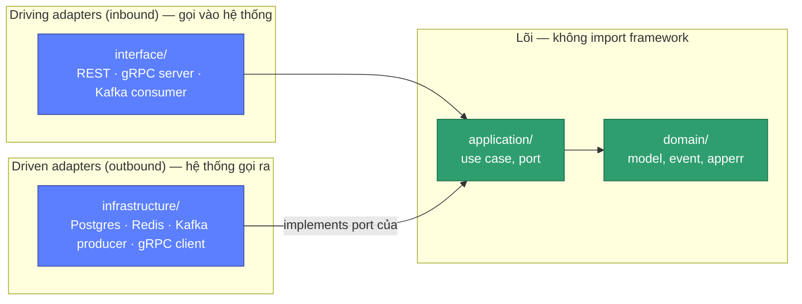
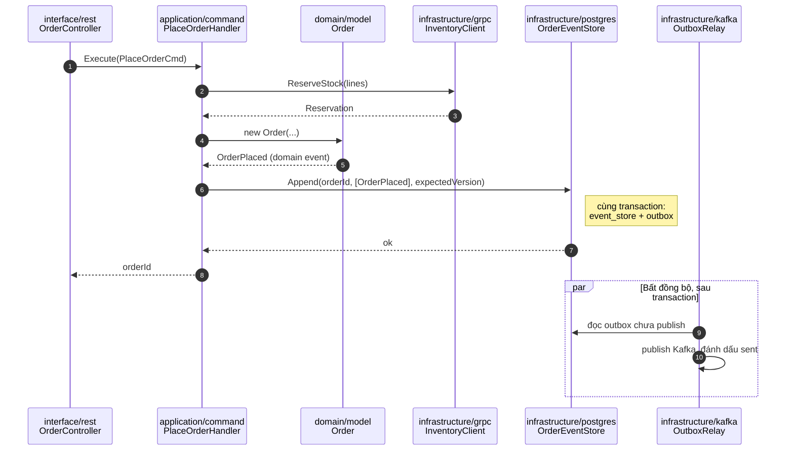

# Clean Architecture (Hexagonal) + DDD — áp dụng vào Vici

Quy tắc style/cấu trúc thư mục chi tiết nằm ở
[.claude/conventions/architecture.md](../../.claude/conventions/architecture.md) (dùng bởi Claude
khi code) — tài liệu này giải thích **vì sao** chọn kiến trúc này và **áp dụng vào domain thật của
Vici** ra sao, để bất kỳ dev nào (người hoặc AI) bắt tay viết service đầu tiên đều hình dung
được sản phẩm cuối, không chỉ quy tắc trừu tượng.

## 1. Vì sao Hexagonal + DDD cho một hệ 13 services

- **13 services, 1 kỷ luật kiến trúc.** Mỗi service có thể do người khác nhau viết (hoặc AI code
  từng phase khác nhau theo roadmap). Nếu không có một khuôn cứng, 13 service sẽ trôi thành 13
  phong cách khác nhau. Hexagonal cho một khuôn duy nhất: domain ở giữa, mọi thứ khác adapter vào.
- **auth/user/order/tenant/billing dùng NestJS, 8 service còn lại dùng Go** (ADR-002, ADR-008,
  ADR-011) — hai ngôn ngữ khác hẳn nhau. Cần một mô hình kiến trúc **không phụ thuộc ngôn ngữ**
  để áp dụng đồng nhất; Ports & Adapters làm được vì nó là một quy tắc phụ thuộc (dependency
  rule), không phải framework.
- **Domain nghiệp vụ art-toy phức tạp và dễ đổi** (blind box, drop, pre-order, giá vốn moving
  average, hạng thành viên) — nếu logic này lẫn vào SQL/HTTP, mỗi lần chỉnh chính sách kinh doanh
  sẽ phải mò trong code hạ tầng. Domain layer thuần (không import framework) giữ logic này ở một
  chỗ, test được mà không cần Postgres/Kafka/gRPC chạy thật.
- **Đổi hạ tầng không phải viết lại nghiệp vụ.** Ví dụ cụ thể của dự án: `02-tech-stack.md` đã
  loại Elasticsearch, chọn Postgres full-text cho `FR-CAT-09`. Nếu sau này catalog vượt quá khả
  năng Postgres và cần Elasticsearch thật, chỉ viết `infrastructure/search/elastic_repo.go` mới
  implement port `domain/port.ProductSearcher` — domain và use case `SearchProducts` không đổi
  một dòng.

## 2. Quy tắc phụ thuộc (nhắc lại, xem chi tiết ở architecture.md)



Mọi mũi tên chỉ **vào trong**: `domain` không biết `application` gọi mình thế nào, càng không biết
`infrastructure` implement port ra sao — `infrastructure` phụ thuộc vào interface do `application`/
`domain` khai báo (port), không phải ngược lại (đảo phụ thuộc — Dependency Inversion). Test domain
và application **không cần Postgres/Redis/Kafka chạy** — đó là lý do "Unit test = zero I/O" trong
`coding-conventions-go.md` khả thi.

## 3. Ví dụ đầy đủ một aggregate qua 4 lớp: `Order`

Lấy `order-service` vì đây là service phức tạp nhất (event-sourced, CQRS, saga — ADR-002), dùng
làm ví dụ để bất kỳ service Go nào khác soi theo cho đơn giản hơn.

```text
domain/model/order.go
  type Order struct { id, customerID, kind, status OrderStatus, lines []LineItem, … , version int }
  func (o *Order) Confirm() (event.OrderConfirmed, error)   // enforce: chỉ từ pending_payment
  func (o *Order) Cancel(reason string) (event.OrderCancelled, error) // enforce: chưa packing
  → Không import pgx, không import net/http, không gọi time.Now() trực tiếp (nhận qua tham số).
  → Ngoại lệ duy nhất cho lõi (ADR-013, chỉ TypeScript): `date-fns` (mọi phép tính/so sánh thời
    gian; thời điểm vẫn là `Date` thuần) và `uuid` (`v7`) — thuần, không I/O, không đọc config,
    không thêm kiểu riêng nào phải chuyển đổi ở biên. `Clock` vẫn là port. Go dùng `time` +
    `github.com/google/uuid` của stdlib/hệ sinh thái nên không cần ngoại lệ.

domain/port/order_repository.go
  type OrderRepository interface {
      Load(ctx, id) (*Order, error)          // replay event stream
      Append(ctx, id, events []DomainEvent, expectedVersion int) error   // optimistic concurrency
  }
  type InventoryPort interface { ReserveStock(ctx, lines) (Reservation, error) }
  type PaymentPort interface { CreatePayment(ctx, req) (PaymentRef, error) }
  → application/command định nghĩa các port này (consumer-side), infrastructure implement.

application/command/place_order.command.go
  PlaceOrderHandler{ orders OrderRepository, inventory InventoryPort, payment PaymentPort, outbox OutboxWriter }
  Execute(ctx, cmd) → tạo Order mới → gọi inventory.ReserveStock → orders.Append(OrderPlaced) →
  outbox.Write(OrderPlaced) trong CÙNG transaction → publisher (infra) relay sang Kafka.
  → Đây là nơi saga (application/saga/checkout.saga.ts bên NestJS) điều phối nhiều bước.

application/query/get-order.handler.ts (chỉ NestJS/CQRS — Go dùng application/query tương tự)
  Đọc từ read model (projection), KHÔNG replay event stream mỗi lần đọc.

infrastructure/postgres/order_event_store.go
  implements OrderRepository — bảng event_store (append-only) + bảng orders_projection (read model)
infrastructure/grpc/inventory_client.go
  implements InventoryPort — gọi thật sang inventory-service qua gRPC + otelgrpc interceptor
infrastructure/kafka/outbox_relay.go
  Đọc bảng outbox chưa publish → publish Kafka → đánh dấu sent (tách khỏi transaction ghi domain)

interface/rest/order_controller.go (hoặc .ts)
  POST /orders → decode request → PlaceOrderHandler.Execute(cmd) → map lỗi domain → HTTP status
  → Controller KHÔNG chứa nghiệp vụ, chỉ dịch request/response.
```

Cùng ví dụ, nhìn theo **thứ tự gọi thật** qua 4 lớp — chú ý outbox relay chạy **tách khỏi** giao
dịch ghi domain (publish Kafka không nằm trong transaction ghi event):



Áp dụng tương tự cho service Go thường (không event-sourced, ví dụ `inventory-service`):
`domain/model/stock_item.go` có method `Reserve(qty, ttl) (Reservation, error)` enforce
`available >= qty`; `infrastructure/postgres/stock_repo.go` implement bằng
`UPDATE … WHERE on_hand - reserved >= $qty` (optimistic, không lock bi quan) — xem chi tiết
invariant ở spec từng service trong [40-services/](../40-services/README.md).

## 4. Aggregate, Value Object, Domain Event theo từng context

Bảng dưới chính thức hoá tactical pattern DDD cho **13 bounded context thật** của Vici (mở
rộng từ [30-domain/01-bounded-contexts.md](../30-domain/01-bounded-contexts.md) và
[30-domain/04-data-models.md](../30-domain/04-data-models.md)) — dùng làm điểm bắt đầu khi viết
`domain/model/` của mỗi service, tránh mỗi người đặt tên/aggregate root khác nhau.

| Context | Aggregate root | Entity con | Value Object | Domain Event chính |
| --- | --- | --- | --- | --- |
| Tenant | `Tenant` | `ProvisioningTask`, `CustomDomain` | `Subdomain`, `TenantId`, `Branding` | `TenantProvisioned`, `TenantSuspended`, `TenantArchived` |
| Billing | `Subscription` | `Invoice`, `UsageCounter` | `Plan`, `Money`, `Entitlements` | `SubscriptionCreated`, `SubscriptionChanged`, `PaymentFailed` |
| Identity | `Account` | `RefreshToken` | `Email`, `PasswordHash` | `AccountRegistered`, `PasswordChanged` |
| Customer | `Customer` | `Address` | `Tier`, `PointBalance` | `TierChanged`, `PointsEarned`, `PointsAdjusted` |
| Catalog | `Product` | `Variant`, `Review` | `Money`, `Sku`, `FigureLineup` | `ProductPublished`, `ProductArchived` |
| Inventory | `StockItem` | `Reservation` | `Sku`, `Quantity` | `StockReserved`, `StockCommitted`, `StockReleased`, `StockLow` |
| Cart | `Cart` | `CartLine` | `Money` | `CartCheckedOut` |
| Ordering | `Order` (event-sourced) | `LineItem`, `ReturnRequest` | `Money`, `Address` (snapshot), `OrderStatus` | `OrderPlaced`, `OrderConfirmed`, `OrderCancelled`, `OrderCompleted` |
| Payment | `PaymentTransaction` | — | `Money`, `GatewayRef` | `PaymentSucceeded`, `PaymentFailed`, `PaymentRefunded` |
| Shipping | `Shipment` | `TrackingEvent` | `TrackingCode` | `ShipmentCreated`, `ShipmentStatusChanged` |
| Promotion | `Voucher`, `Drop`, `PreOrderCampaign` | `DropAllocation`, `WaitlistEntry` | `Money`, `DateRange` | `VoucherRedeemed`, `DropOpened`, `AllocationExhausted` |
| Finance | `JournalEntry` (append-only) | `JournalLine` | `Money`, `Account` (mã kế toán) | — (chỉ consume event, không phát nghiệp vụ) |
| Notification | `Delivery` | — | `Channel`, `Template` | `NotificationSent`, `NotificationFailed` |

Quy tắc: **repository theo aggregate root**, không có repository cho entity con (`Address` không
có `AddressRepository` — load/save qua `Customer`). Value Object không có định danh, so sánh bằng
giá trị (`Money{amount, currency}` không có `id`).

### 4.1. `tenant_id` sống ở đâu (ADR-007 / ADR-009)

- **Domain**: mỗi aggregate của service nghiệp vụ có field `tenantID TenantId` (value object,
  validate là UUID hợp lệ), gán **một lần lúc tạo**, không có setter. Method domain không nhận
  `tenant_id` như tham số — nó đã nằm trong aggregate.
- **Application**: không đọc `tenant_id` từ đâu cả — nhận `context.Context` (Go) /
  request-scoped provider (NestJS) do `interface/` nạp từ header `X-Tenant-Id` / metadata
  `x-tenant-id`. Command tạo aggregate lấy `TenantId` từ context, không từ payload client.
- **Infrastructure**: repository mở transaction bằng `SET LOCAL app.tenant_id = $1` (đọc từ
  context) **trước** mọi câu lệnh; RLS lo phần chặn. Repository **không** tự thêm
  `WHERE tenant_id = ...` — đó là việc của RLS, thêm tay là thừa và dễ quên chỗ khác.
- **`tenant-service` / `billing-service`**: là platform plane — `Tenant`/`Subscription` chính là
  aggregate root, `tenant_id` là **khoá** chứ không phải cột lọc; chạy bằng DB role có quyền
  cross-tenant, không set `app.tenant_id`.
- **Litmus test**: đổi từ RLS sang một cơ chế cô lập khác chỉ nên đụng `infrastructure/` (cách
  repo mở transaction) — `domain/` và `application/` không đổi một dòng.

## 5. CQRS + Event Sourcing + Saga — `order-service`, `tenant-service`, `billing-service`

Trong 5 service NestJS, chỉ **3 service này** áp CQRS/ES/Saga. **`auth-service` và `user-service`
dùng NestJS nhưng CRUD + repository thường** (ADR-011) — chọn NestJS vì hệ sinh thái
(`@nestjs/passport`, guard, `class-validator`), không phải vì cần event store hay process
manager. Hai service này **không** cài `@nestjs/cqrs`, không có command bus/event store.

> **Đặt tên (quan trọng để không nhầm với CQRS):** service CRUD thường đặt use case ở
> `application/use-case/<verb-noun>.use-case.ts` — `class <VerbNoun>UseCase { execute(input) }`,
> controller gọi thẳng. Input/output ở `application/dto/<verb-noun>.io.ts` (`<VerbNoun>Input` /
> `<VerbNoun>Result`). **Không** dùng `application/command/`, `*.handler.ts`, hay `*Command` —
> đó là từ vựng của CQRS (`command bus`, `@CommandHandler`), chỉ dùng ở 3 service phía dưới.
> `auth-service` là mẫu tham chiếu.

`order-service` cần: (a) **audit trail
đầy đủ** mọi thay đổi trạng thái đơn (event store), (b) **command và query khác nhu cầu mở
rộng** — ghi đơn ít hơn nhiều so với đọc lịch sử đơn/tra cứu admin, và (c) **saga đa bước xuyên
service** (reserve → charge → ship) cần process manager theo dõi được đang ở bước nào.
`tenant-service` cần đúng loại (c) cho **saga provisioning** (tạo workspace → seed → cấu hình →
mở subdomain, có compensation); `billing-service` dùng CQRS cho tách write (subscription state
machine, dunning) khỏi read (entitlements, MRR).

- **Command side**: `application/command/*.handler.ts` — nhận lệnh (`PlaceOrder`, `CancelOrder`),
  load aggregate bằng cách replay event stream, gọi method domain, append event mới (optimistic
  concurrency qua cột `version`).
- **Query side**: `application/query/*.handler.ts` — đọc từ **projection** (bảng
  `orders_read_model` cập nhật bởi event handler nội bộ), không bao giờ replay aggregate để trả
  lời một API đọc.
- **Saga**: `application/saga/checkout.saga.ts` dùng `@nestjs/cqrs` `Saga` — lắng nghe
  `OrderPlaced` → phát lệnh `ReserveStock` → lắng nghe kết quả → phát lệnh tiếp theo. Mỗi bước có
  compensation (xem bảng saga ở
  [30-domain/02-order-lifecycle.md](../30-domain/02-order-lifecycle.md) và luồng chi tiết ở
  [05-key-flows.md](05-key-flows.md)).
- **8 service Go + auth/user (NestJS) KHÔNG dùng CQRS/ES** — dùng CRUD + repository thường (như
  ví dụ `StockItem` ở mục 3). Đừng bê pattern này sang service khác chỉ vì "order-service làm
  vậy" — đó chính là lý do ADR-002/008/011 tồn tại, đọc ADR trước khi cân nhắc áp dụng thêm nơi khác.

## 6. Test theo lớp (chi tiết: coding-conventions-go.md / coding-conventions.md §11 / §6)

| Lớp | Loại test | I/O | Vị trí |
| --- | --- | --- | --- |
| `domain/` | Unit, table-driven | Không | `*_test.go` cạnh code |
| `application/` | Unit, fake port qua interface | Không | `*_test.go` hoặc `test/unit/` |
| `infrastructure/` | Integration, Testcontainers | Có (Postgres/Redis/Kafka thật) | `test/integration/` |
| Toàn service | E2E (vài kịch bản chính) | Có | `test/e2e/` |

## 7. Checklist khi bắt đầu một service mới

1. Đọc spec service tương ứng ở [40-services/](../40-services/README.md) (viết theo
   [service-spec-template.md](../40-services/service-spec-template.md)).
2. Dùng skill `new-service` để scaffold đúng cấu trúc thư mục.
3. Viết `domain/model` + `domain/port` trước, theo bảng mục 4 — chưa viết một dòng SQL/HTTP nào.
4. Viết unit test cho invariant domain (zero I/O) — TDD, test trước khi implement `application/`.
5. Viết `infrastructure/` implement port, kèm integration test (Testcontainers).
6. Viết `interface/` (REST/gRPC/event consumer) mỏng, map lỗi domain → status code ở đây.
7. Wire tất cả trong `main.go` (constructor injection thủ công, không DI container ở Go).
