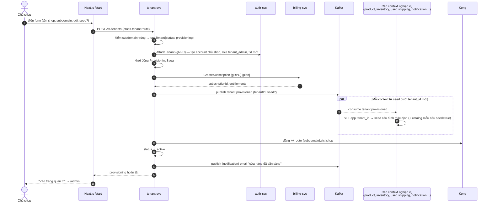
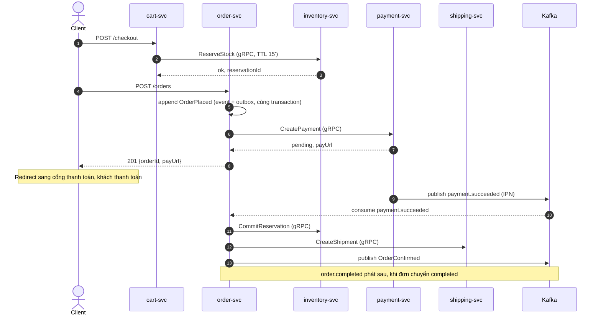
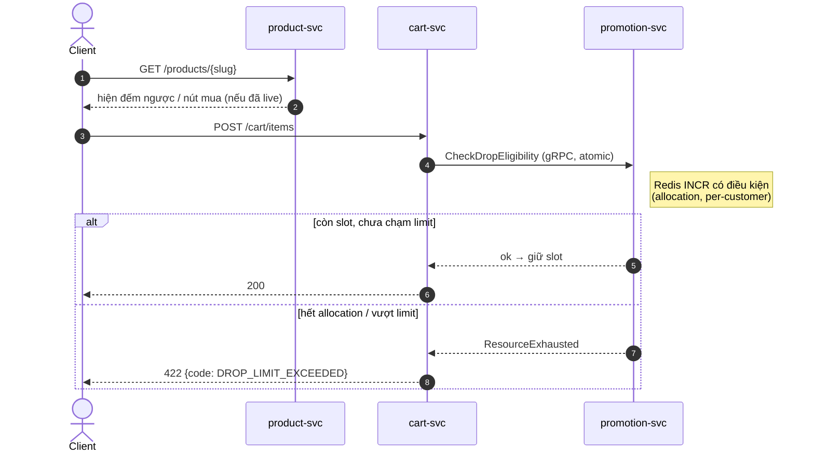
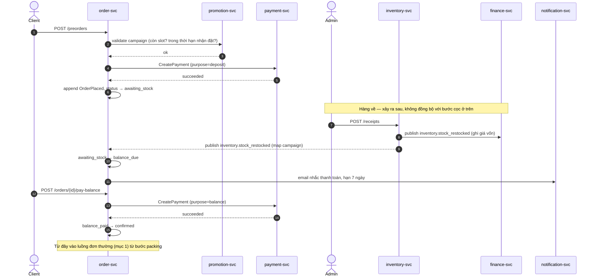
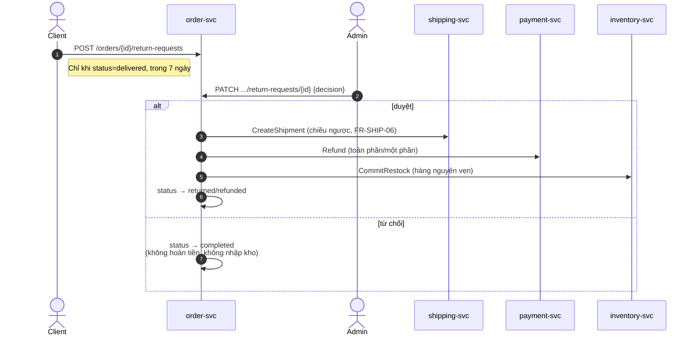
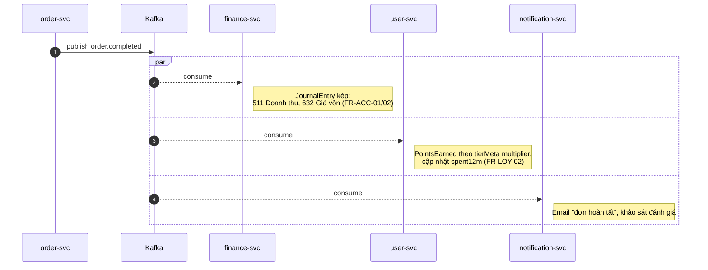

# Luồng chính xuyên service (sequence diagram)

Bổ sung chi tiết cho tóm tắt ở [01-system-overview.md](01-system-overview.md) — dùng khi implement
saga/consumer, tên RPC/event theo đúng [04-service-contracts-conventions.md](04-service-contracts-conventions.md).

> **Tenant context** (ADR-009): mọi luồng dưới đây chạy trong phạm vi một tenant — Kong đã gắn
> `X-Tenant-Id` từ claim `tid`/`Host`; mỗi hop gRPC mang metadata `x-tenant-id`; mỗi event mang
> `tenantId` + header Kafka `tenant-id`. Không vẽ lại trên từng mũi tên cho đỡ rối. Luồng 0 là
> ngoại lệ: nó **tạo ra** tenant, chạy ở platform plane.

## 0. Onboarding tenant + saga provisioning

Compensation (bước fail → lùi, tenant về `provisioning_failed`, cho retry — NFR-14):

| Fail tại | Compensation |
| --- | --- |
| `AttachTenant` lỗi | Xoá bản ghi Tenant vừa tạo; báo lỗi form ngay (email đã dùng?) |
| `CreateSubscription` lỗi | Xoá account chủ shop + Tenant; `provisioning_failed` |
| Một context không seed được | Retry có backoff; quá số lần → đánh dấu task lỗi, tenant `active` một phần, Platform Operator xử tay (context seed idempotent theo `tenantId`) |
| Đăng ký subdomain trùng (race) | Yêu cầu chủ shop chọn subdomain khác, giữ nguyên phần đã seed |

`ProvisioningSaga` là process manager trong `tenant-service` (`application/saga/provisioning.saga.ts`,
`@nestjs/cqrs`) — song song với `checkout.saga.ts` của order-service.

## 1. Checkout đơn thường (happy path)

Compensation (bước nào fail thì lùi lại, không để nửa vời):

| Fail tại | Compensation |
| --- | --- |
| `CreatePayment` lỗi/timeout | `ReleaseReservation` → đơn `cancelled`, báo lỗi cho client ngay |
| `payment.succeeded` không tới trong timeout (VD 30') | `payment.expired` → `ReleaseReservation` → đơn quay `pending_payment`, cho thử phương thức khác (FR-PAY-07) |
| `CommitReservation`/`CreateShipment` lỗi sau khi đã thu tiền | `payment.Refund` + `ReleaseReservation` → đơn `cancelled`, không để mất tiền khách mà không có hàng |

Saga là process manager trong `order-service` (`application/saga/checkout.saga.ts`,
`@nestjs/cqrs`) — không service nào khác giữ state của saga.

## 2. Mua hàng trong Drop (điểm nóng concurrency, NFR-02)

- Counter allocation giữ trong **Redis** (nhanh, atomic `INCR`/Lua script), chốt lại bằng
  **reservation Postgres** khi checkout thật sự bắt đầu (tránh giữ slot mãi nếu khách không bao
  giờ bấm mua) — TTL reservation ngắn hơn checkout thường (5' thay vì 15', xem
  [01-system-overview.md](01-system-overview.md)).
- Huỷ đơn drop sau khi đã mua **không** hoàn allocation về pool (chống bot giữ-nhả — xem
  [30-domain/03-blind-box-and-drops.md](../30-domain/03-blind-box-and-drops.md)).
- Early access: `CheckDropEligibility` nhận kèm `tier` của khách (từ JWT claim hoặc gRPC
  `user.GetTier`), so với `earlyAccessMinutes` của drop.
- Counter Redis mang tiền tố `tenant:{tid}:drop:{id}` — hai tenant chạy drop cùng lúc không
  đụng nhau. Drop chỉ bật khi `billing.GetEntitlements` cho tenant cho phép tính năng drop.

## 3. Pre-order: cọc → hàng về → thanh toán nốt

Quá hạn 7 ngày chưa trả nốt → job quét deadline (cron trong order-service) chuyển `cancelled`,
xử lý cọc theo `PreOrderCampaign.forfeitPolicy` (mất/hoàn một phần — **phải enforce đúng**, xem
ghi chú trong [04-order.md](../10-requirements/04-order.md) về gap này ở FE mock).

## 4. Đổi trả & hoàn tiền

## 5. `order.completed` → hạch toán, cộng điểm, thông báo (fan-out)

Một event, ba consumer độc lập — mỗi consumer tự chịu trách nhiệm idempotency theo `eventId`
(xem [04-service-contracts-conventions.md](04-service-contracts-conventions.md) §3). Nếu một
consumer lỗi, hai consumer còn lại không bị chặn (không phải saga, đây là fan-out thuần).
