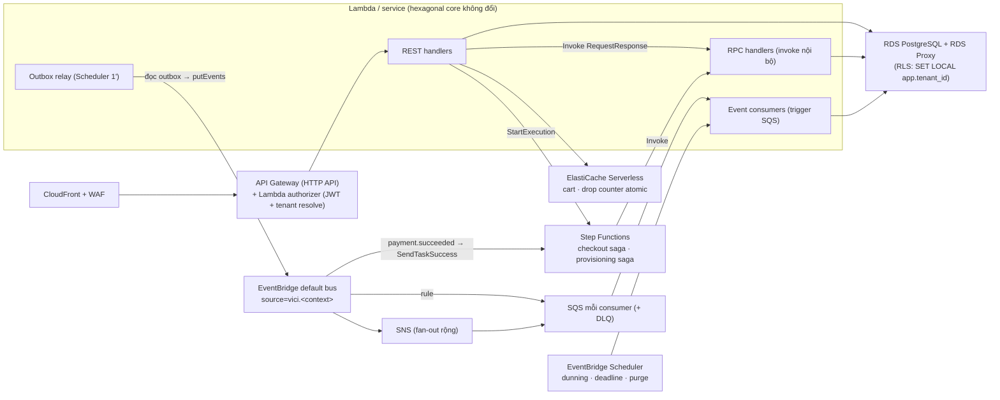
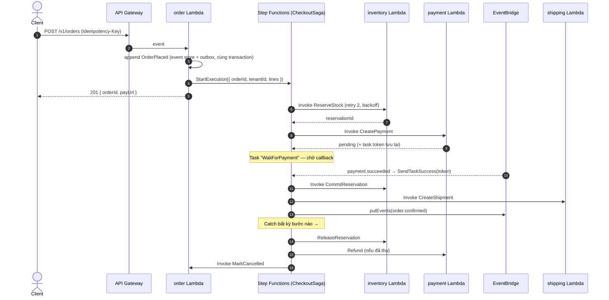
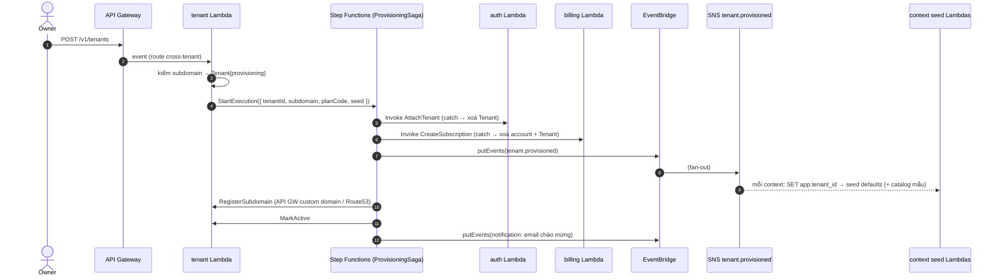
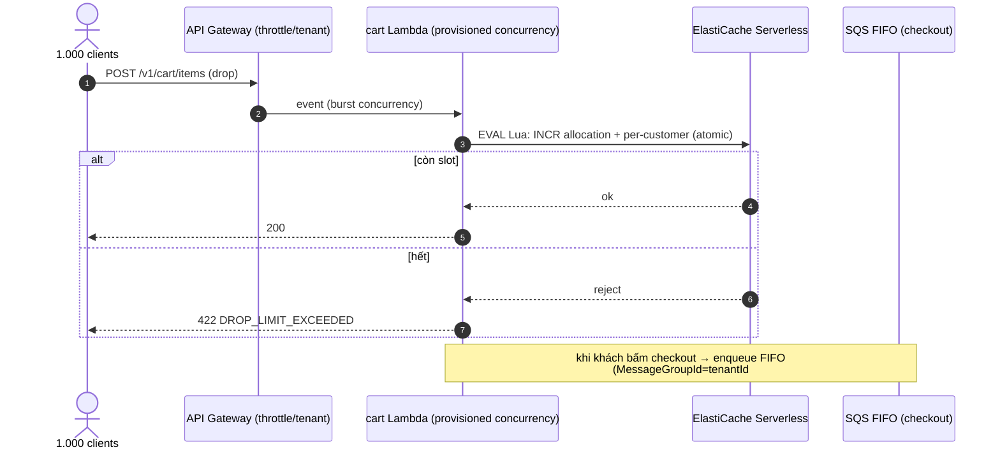

# Serverless AWS — luồng đề xuất (kèm ADR-010)

> Trạng thái: **đề xuất**, đi kèm [ADR-010](adrs/ADR-010-serverless-aws-delivery.md) (Proposed).
> Compute = **Lambda**; async = **EventBridge → SQS**, fan-out rộng = **SNS**; saga =
> **Step Functions**; edge = **API Gateway HTTP API** (thay Kong). Tenant context ADR-009 giữ
> nguyên, đổi phương tiện (authorizer context / `detail.tenantId` / SQS message attribute).

## 0. Bản đồ tổng



## 1. Request REST công khai (storefront `GET /products`)

```mermaid
sequenceDiagram
    autonumber
    actor Client
    participant CF as CloudFront
    participant GW as API Gateway HTTP API
    participant Auth as Lambda authorizer
    participant Fn as product Lambda
    participant Proxy as RDS Proxy
    participant PG as product_db (RLS)

    Client->>CF: GET https://{shop}.vici.shop/v1/products
    CF->>GW: forward (Host giữ nguyên)
    GW->>Auth: authorize (Authorization?, Host)
    Auth->>Auth: JWT hợp lệ → tid; hoặc ResolveTenantByHost(Host)
    Auth-->>GW: allow + context.tenantId
    GW->>Fn: event (context.authorizer.tenantId)
    Fn->>Proxy: BEGIN; SET LOCAL app.tenant_id = $tid
    Proxy->>PG: SELECT ... (RLS lọc theo tenant)
    PG-->>Fn: rows
    Fn-->>Client: 200 { data, meta }
```

Rate limit: **usage plan / throttle theo API key ảo = tenant** (thay `rate-limiting` plugin Kong).

## 2. Saga checkout (Step Functions + callback task token)



- **Timeout thanh toán**: state `WaitForPayment` có `TimeoutSeconds` (vd. 1800) → nhánh
  compensation, đơn về `pending_payment` (FR-PAY-07).
- Saga state (đang ở bước nào) do **Step Functions** giữ — không service nào giữ hộ.

## 3. Fan-out `order.completed` (EventBridge → SQS → Lambda)

```mermaid
sequenceDiagram
    autonumber
    participant Relay as order outbox relay Lambda
    participant EB as EventBridge (vici.order / order.completed)
    participant Qf as SQS finance
    participant Qu as SQS user
    participant Qn as SQS notification
    participant Fin as finance consumer Lambda
    participant Usr as user consumer Lambda
    participant Not as notification consumer Lambda

    Relay->>EB: putEvents(detail={ tenantId, orderId, ... })
    par rule → 1 queue mỗi consumer
        EB->>Qf: message (attr tenant-id)
        EB->>Qu: message (attr tenant-id)
        EB->>Qn: message (attr tenant-id)
    end
    Qf->>Fin: batch (SET app.tenant_id → ghi sổ; dedupe eventId)
    Qu->>Usr: batch (cộng điểm)
    Qn->>Not: batch (email theo thương hiệu tenant)
    Note over Fin,Not: lỗi 1 item → ReportBatchItemFailures;<br/>hết retry → DLQ + alarm
```

- **Thứ tự cần thiết** (vd. các event của cùng một `order_id`): dùng **SQS FIFO** với
  `MessageGroupId = orderId`, `MessageDeduplicationId = eventId`.
- **Fan-out rất rộng** (`tenant.provisioned` → ~7 context): EventBridge → **SNS** → SQS mỗi
  context (tránh giới hạn 5 target/rule và dễ thêm subscriber).

## 4. Onboarding + provisioning saga



Bước seed **idempotent theo `tenantId`** (Step Functions có thể retry); toàn saga < 5' (NFR-14) —
Step Functions Standard đo được bằng execution duration.

## 5. Drop spike (NFR-02)



- **Provisioned concurrency** cho `cart` + `order` trong khung giờ drop (EventBridge Scheduler
  bật/tắt trước/sau giờ G).
- Counter atomic ở **ElastiCache** (không phải DynamoDB) vì cần độ trễ sub-ms + Lua.

## 6. Cron (EventBridge Scheduler → Lambda)

| Lịch | Lambda | Việc |
| --- | --- | --- |
| mỗi 1' | `*-outbox-relay` (mỗi service) | đọc `outbox` chưa gửi → `PutEvents` EventBridge → đánh dấu `sent_at` |
| mỗi giờ | `billing-dunning` | quét invoice `past_due` tới hạn retry → charge → phát `billing.*` |
| mỗi giờ | `order-preorder-deadline` | đơn pre-order quá 7 ngày chưa trả nốt → `cancelled` + forfeit policy |
| hằng ngày | `tenant-purge` | tenant `archived` > 90 ngày → `tenant.purge_requested` |

## Dev & IaC

- **AWS SAM + LocalStack** thay `docker compose` cho local (Lambda, API GW, SQS, SNS,
  EventBridge, Step Functions Local); Postgres/Redis vẫn container local.
- Terraform mở rộng: `infra/terraform/modules/{lambda,eventbridge}` đã có sẵn scaffold — thêm
  `apigateway`, `stepfunctions`, `sqs`, `sns`, `rds-proxy`.
- OTel: **ADOT Lambda layer** → collector hiện tại (Jaeger/Prometheus/Grafana/Loki không đổi).
