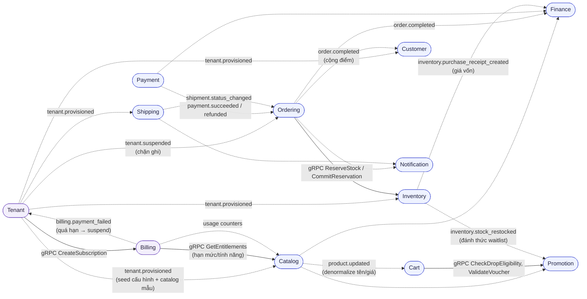

# Bounded Contexts

13 contexts, mỗi context một service, một database. Dữ liệu chéo context lấy qua contract
(gRPC/event) — không bao giờ đọc database của nhau.

**Hai tầng:** *platform plane* (Tenant, Billing — cross-tenant, không có `tenant_id` trên
aggregate root của chúng) và *tenant plane* (11 context còn lại — mọi aggregate mang `tenant_id`,
cô lập bằng Postgres RLS, [ADR-007](../20-architecture/adrs/ADR-007-multi-tenancy-pooled-rls.md)).

| Context | Service | Sở hữu | Ngôn ngữ chung (thuật ngữ chính) |
| --- | --- | --- | --- |
| **Tenant** | tenant-service | Cửa hàng trên nền tảng, onboarding, provisioning, thương hiệu, tên miền | `Tenant`, `Subdomain`, `ProvisioningTask`, `CustomDomain`, `Branding` |
| **Billing** | billing-service | Gói dịch vụ, subscription, hoá đơn, hạn mức, lượng dùng | `Plan`, `Subscription`, `Invoice`, `Entitlements`, `UsageCounter` |
| Identity | auth-service | Tài khoản đăng nhập, credential, token, role (kèm `tid`) | `Account`, `Session`, `Role` |
| Customer | user-service | Hồ sơ khách, địa chỉ, **điểm thưởng, hạng thành viên** | `Customer`, `Address`, `PointLedger`, `Tier` |
| Catalog | product-service | Sản phẩm, variant, brand, series, **blind box**, review, search | `Product`, `Variant`, `Series`, `FigureLineup`, `Review` |
| Inventory | inventory-service | Tồn kho, reservation, biến động tồn, phiếu nhập | `StockItem`, `Reservation`, `StockMovement`, `PurchaseReceipt` |
| Cart | cart-service | Giỏ hàng, checkout session | `Cart`, `CheckoutSession` |
| Ordering | order-service | Đơn hàng (event-sourced), pre-order, saga checkout, đổi trả | `Order`, `PreOrder`, `ReturnRequest` |
| Payment | payment-service | Giao dịch, cổng thanh toán, hoàn tiền | `PaymentTransaction`, `Refund` |
| Shipping | shipping-service | Vận đơn, phí ship, tracking | `Shipment`, `ShippingRate`, `TrackingEvent` |
| Promotion | promotion-service | Voucher, flash sale, **drop, allocation, waitlist**, pre-order campaign | `Voucher`, `FlashSale`, `Drop`, `DropAllocation`, `WaitlistEntry`, `PreOrderCampaign` |
| Finance | finance-service | Sổ cái, giá vốn, chi phí, P&L, **read model báo cáo** | `JournalEntry`, `CostLot`, `Expense`, `ReportSnapshot` |
| Notification | notification-service | Template, gửi email, preference | `NotificationTemplate`, `Delivery` |

## Quan hệ giữa các contexts (chính)

Mũi tên liền = gọi đồng bộ (gRPC, caller chờ kết quả). Mũi tên đứt = event Kafka bất đồng bộ
(publisher không chờ, không biết ai tiêu thụ).

## Quy tắc cứng

1. Cùng một từ có thể khác nghĩa giữa contexts: `Order` trong Ordering là aggregate đầy đủ;
   trong Finance chỉ là tham chiếu (`order_id`, tổng tiền) trên bút toán. **Không share type.**
2. Context chỉ expose: proto (`backend/libs/proto/`), event Avro (`backend/libs/events/`),
   REST qua Kong. Mọi cách khác là vi phạm.
3. Cần dữ liệu context khác để hiển thị/tính toán → consume event, giữ bản sao denormalized
   trong database của mình (chấp nhận eventual consistency).
4. **`Tenant` là tham chiếu ở mọi context tenant plane** — các context khác chỉ biết `tenant_id`
   (nhận từ context request / header event), **không** gọi sang tenant-service để hỏi chi tiết
   tenant trong luồng nóng. Thông tin thương hiệu cần cho storefront được denormalize qua
   `tenant.branding_updated`.
5. **Đếm lượng dùng** là việc của Billing: các context chỉ phát event nghiệp vụ
   (`product.created`, `order.placed`…), billing-service tổng hợp — context không tự biết hạn
   mức, chỉ hỏi `GetEntitlements` khi cần chặn.
