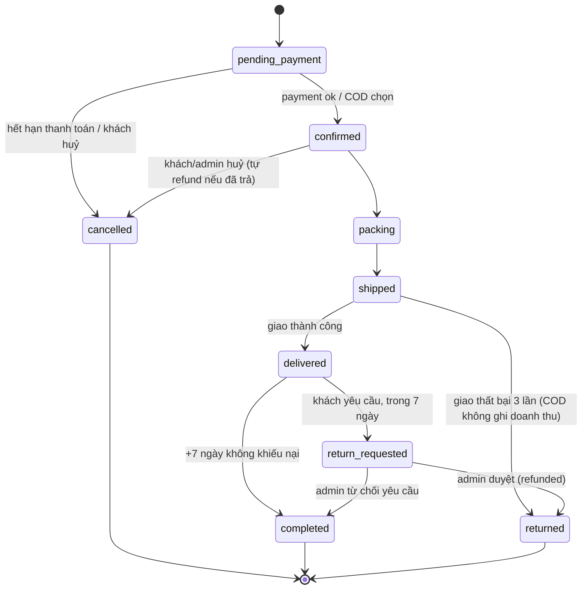
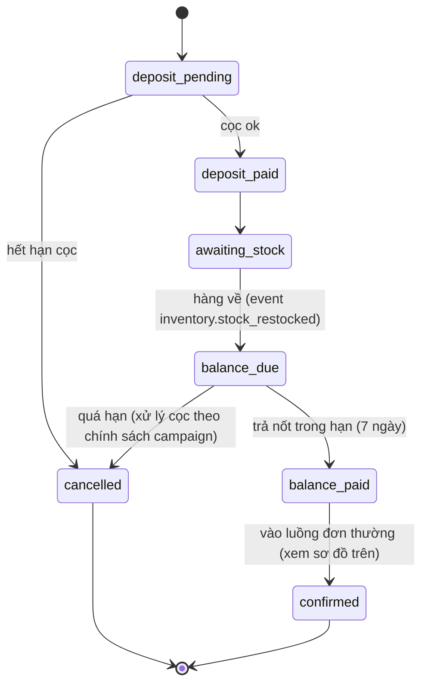

# Vòng đời đơn hàng

Order là aggregate event-sourced trong context Ordering. Mọi chuyển trạng thái là một event
quá khứ (`OrderConfirmed`, `OrderShipped`…); trạng thái hiện tại derive từ chuỗi event.

## Đơn hàng thường

Quy tắc:

- Chỉ huỷ được trước `packing`. Sau `shipped` muốn trả hàng phải đi nhánh `return_requested`.
- Admin có thể **từ chối** yêu cầu đổi trả: `return_requested → completed` (không hoàn tiền,
  không nhập kho lại) — nhánh này song song với `return_requested → returned` (duyệt).
- `completed` là điểm ghi nhận doanh thu (Finance) và cộng điểm (Customer) — không phải
  `delivered`, để chừa cửa sổ đổi trả.
- Giao thất bại 3 lần (Shipping báo) → `returned`, COD không ghi doanh thu.

## Pre-order

Trước khi vào vòng đời thường, đơn pre-order có giai đoạn cọc:

- Một đơn pre-order có **hai payment**: cọc và phần còn lại — mỗi khoản một
  `PaymentTransaction` độc lập (FR-PAY-06).
- `awaiting_stock → balance_due` kích hoạt bởi event `inventory.stock_restocked` map với
  pre-order campaign (order-service publish tiếp `order.balance_due`); notification gửi email
  nhắc kèm deadline — chi tiết RPC/event:
  [40-services/order-service.md](../40-services/order-service.md),
  [05-key-flows.md](../20-architecture/05-key-flows.md#3-pre-order-cọc--hàng-về--thanh-toán-nốt).

## Saga checkout (happy path & compensation)

| Bước | Gọi | Compensation khi bước sau fail |
| --- | --- | --- |
| 1. Reserve stock | gRPC `inventory.ReserveStock` | `ReleaseReservation` |
| 2. Ghi nhận thanh toán | gRPC `payment.CreatePayment` → chờ event `payment.succeeded` | `payment.Refund` |
| 3. Commit tồn + tạo vận đơn | gRPC `inventory.CommitReservation`, `shipping.CreateShipment` | (bước cuối — fail thì refund + release) |

Saga là process manager trong `application/saga` của order-service (`@nestjs/cqrs`); timeout
mỗi bước và retry có giới hạn; kết cục luôn là một trong hai: đơn `confirmed` trọn vẹn hoặc
`cancelled` với mọi side effect đã bù trừ.
