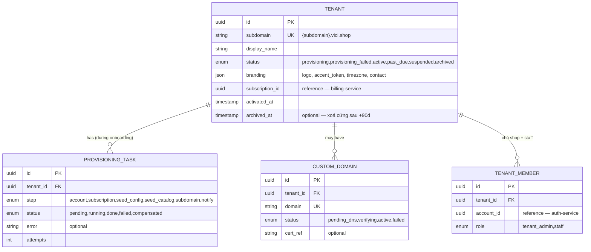
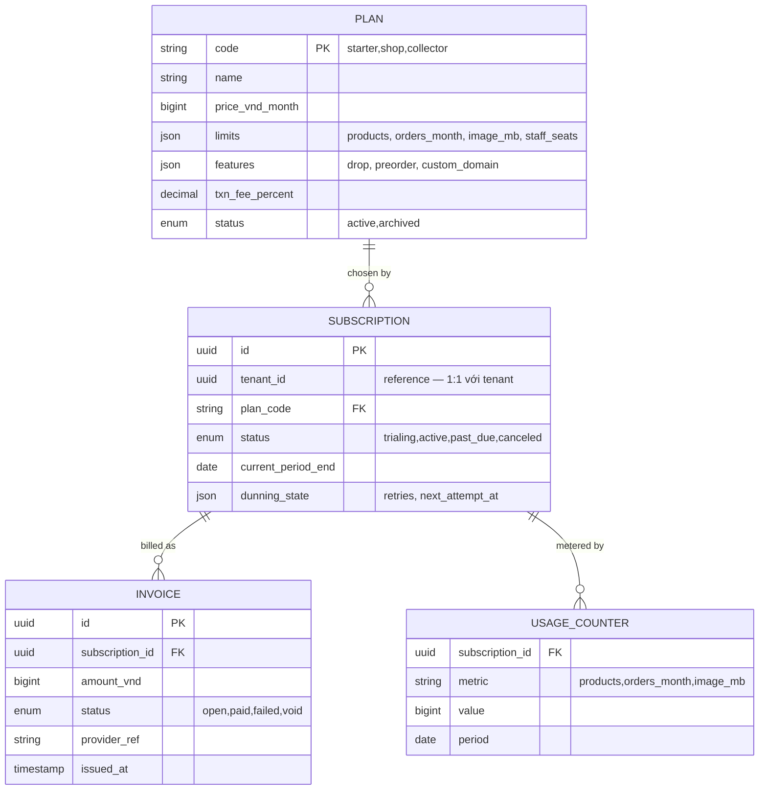
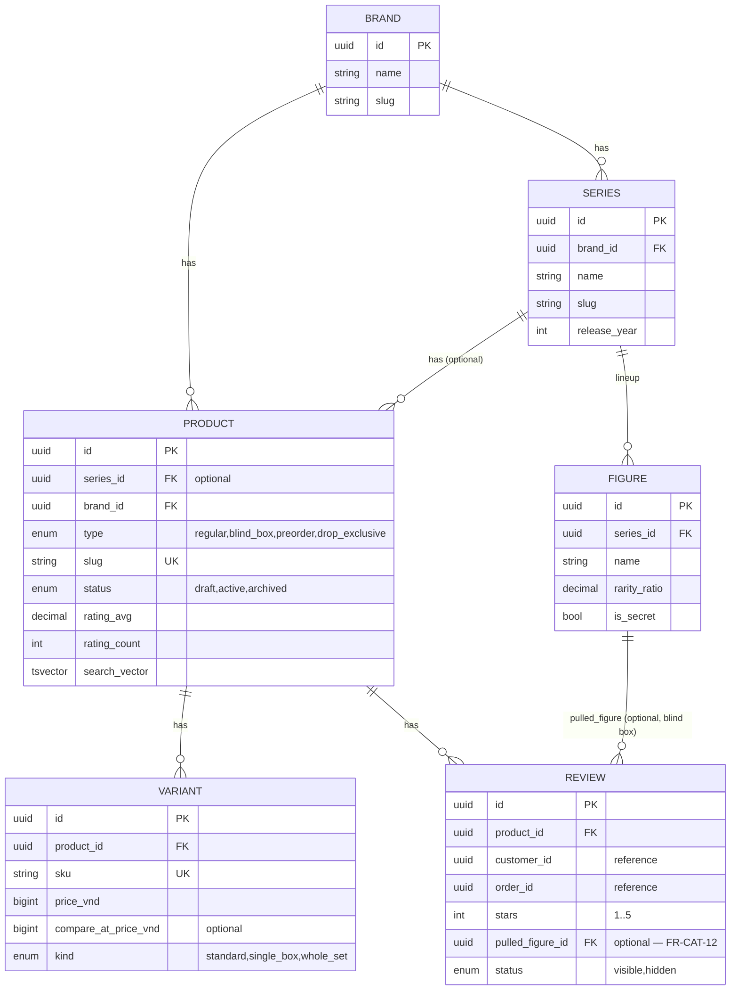
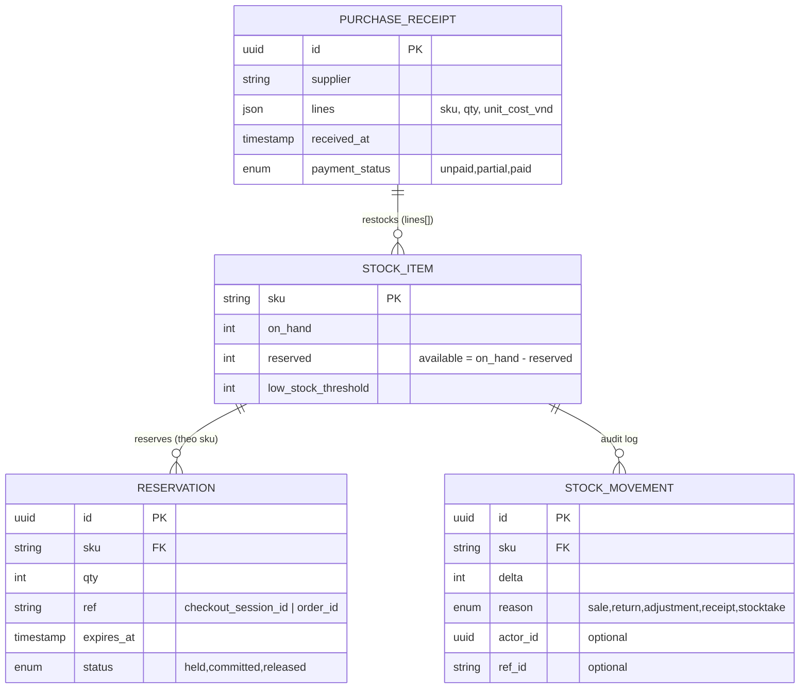
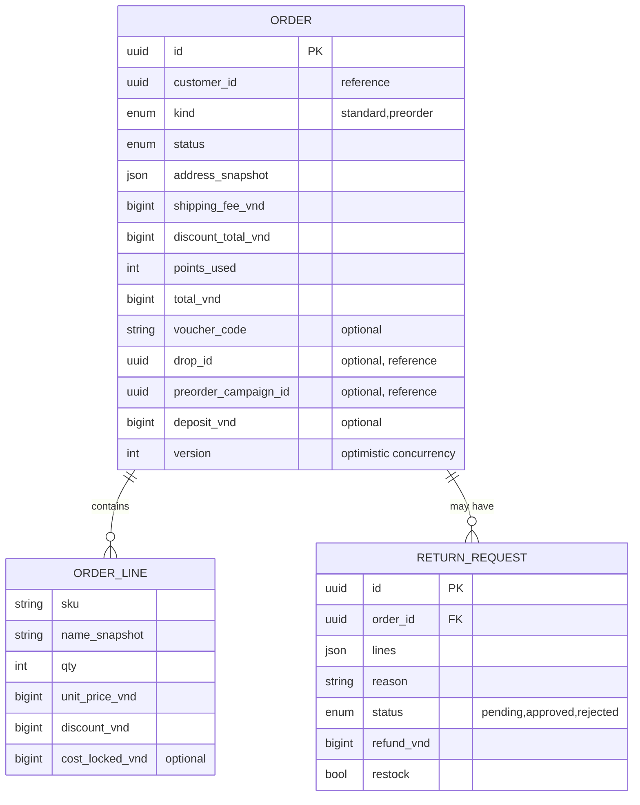
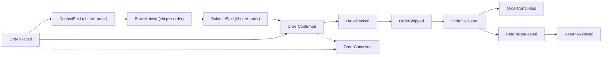
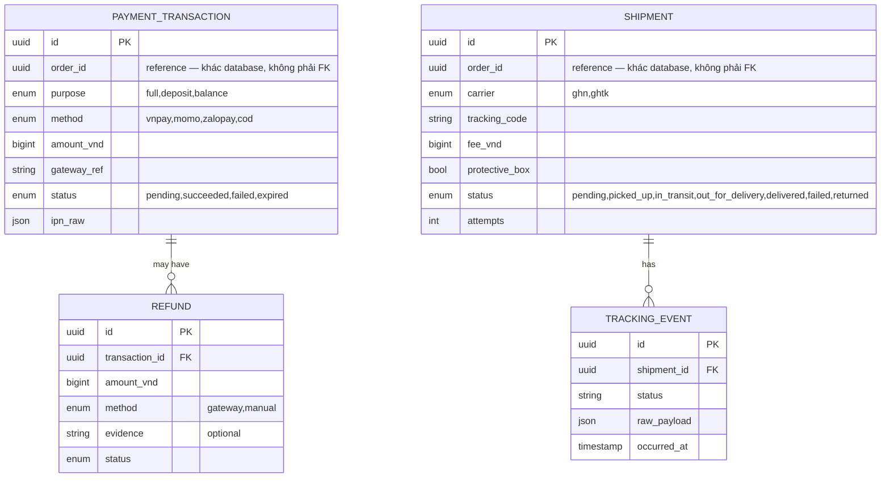
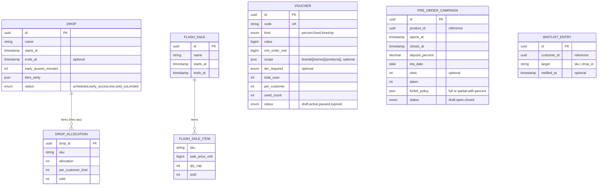
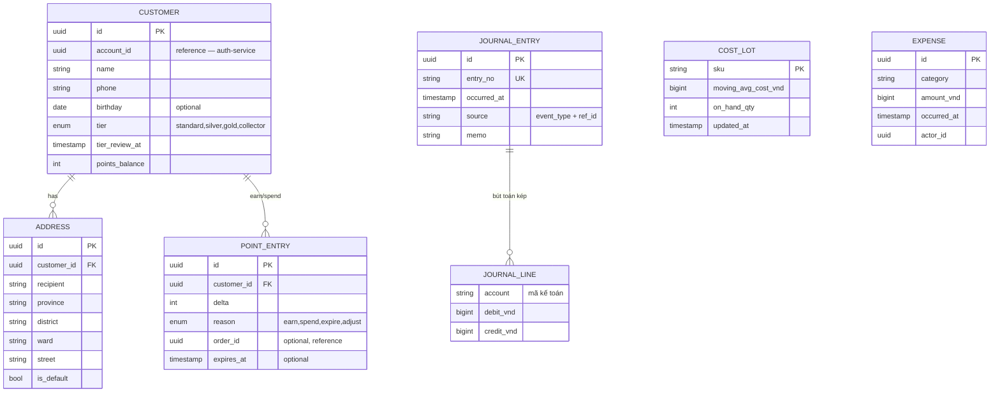

# Data Models (aggregate chính theo context)

Mức khái niệm — đủ để thiết kế schema và types; chi tiết cột/index nằm trong spec từng service.
Quy ước chung: khoá chính UUID; tiền VND kiểu số nguyên; timestamp UTC (`created_at`,
`updated_at`); soft-archive bằng trạng thái, không xoá vật lý dữ liệu nghiệp vụ.

> **`tenant_id` ngầm định trên MỌI bảng tenant plane** (Catalog, Inventory, Ordering, Payment,
> Shipping, Promotion, Customer, Finance, Notification, Cart, Identity): cột `tenant_id uuid
> NOT NULL`, RLS bật, index và unique constraint **dẫn đầu bằng `tenant_id`** (`slug`, `sku`,
> `entry_no`, `voucher.code`… chỉ unique trong một tenant). Các ER dưới đây **không vẽ lại** cột
> này cho gọn — xem [ADR-007](../20-architecture/adrs/ADR-007-multi-tenancy-pooled-rls.md). Bảng
> của Tenant/Billing (platform plane) thì `tenant_id` là **khoá tham chiếu**, không phải cột lọc.

## Tenant (tenant-service) — platform plane

## Billing (billing-service) — platform plane

`Entitlements` (không phải bảng — là DTO gRPC `GetEntitlements` trả về): `limits` + `features`
của plan hiện hành, các service cache ngắn và enforce cục bộ (`QUOTA_EXCEEDED`).

## Catalog (product-service)

## Inventory (inventory-service)

## Ordering (order-service — event-sourced)

`Order` là aggregate **event-sourced** — bảng trên là hình chiếu (projection) đọc được từ chuỗi
event, không phải nguồn sự thật. Nguồn sự thật là chuỗi event append-only:

## Payment / Shipping

`order_id` trong `PaymentTransaction`/`Shipment` là **tham chiếu chéo context** (denormalized ID
nhận từ event/gRPC), không phải khoá ngoại vật lý — Payment và Shipping có database riêng, không
join thẳng sang Ordering (ADR-001, xem [architecture.md §5](../../.claude/conventions/architecture.md)).

## Promotion (promotion-service)

## Customer & Finance

## Cấu hình vận hành (mỗi service sở hữu khoá của mình)

Không có một aggregate "Settings" dùng chung — mỗi service tự sở hữu tham số nghiệp vụ của nó
(tránh context nào cũng phải biết toàn bộ config). Bảng dưới ánh xạ từng khoá cấu hình đang tồn
tại trong FE mock (`Settings` gộp chung ở đó vì mock chỉ có một "database" duy nhất) sang service
thật sẽ sở hữu nó:

| Khoá (FE mock) | Service sở hữu | Ghi chú |
| --- | --- | --- |
| `freeShipThresholdVnd` | shipping-service | FR-SHIP-07, **theo tenant** (bảng `settings` có `tenant_id`) |
| `holdMinutes` | inventory-service | TTL reservation, FR-INV-02, theo tenant |
| `pointEarnRate`, `pointValueVnd`, `maxPointPercent` | user-service | FR-LOY-01/03, theo tenant |
| `tenant.displayName`, `branding`, `subdomain`, `customDomain` | tenant-service | FR-TEN-11/12 |
| `plan`, `limits`, lượng dùng | billing-service | FR-BIL, hỏi qua `GetEntitlements` |

Mỗi khoá là bảng `settings` 1-dòng **mỗi tenant** trong service tương ứng — **không** một service
trung tâm giữ hết config của toàn hệ thống (vi phạm bounded context). Cấu hình cấp nền tảng
(danh mục plan, subdomain reserved) thuộc platform plane.
