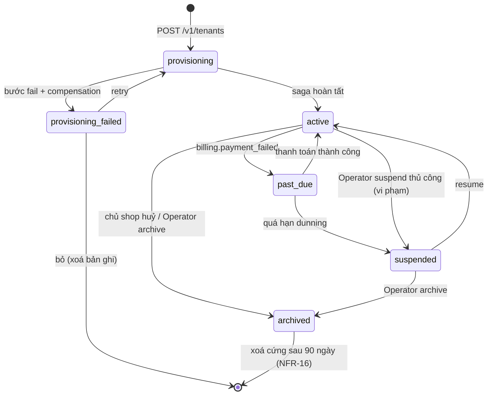
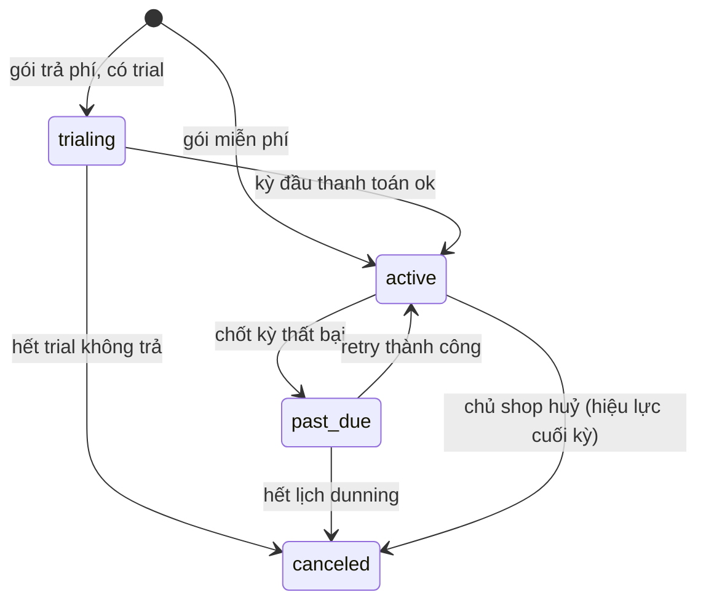

# Vòng đời Tenant & Subscription

Nghiệp vụ cấp nền tảng: một tenant sinh ra như thế nào, đi qua những trạng thái nào, và dữ liệu
của nó được giữ/xoá ra sao. Owner: `tenant-service` (vòng đời) + `billing-service` (subscription).
Xem [ADR-007](../20-architecture/adrs/ADR-007-multi-tenancy-pooled-rls.md),
[FR-TEN](../10-requirements/13-tenant.md), [FR-BIL](../10-requirements/14-billing.md).

## State machine — Tenant

| Trạng thái | Storefront | `/admin` | Ghi dữ liệu |
| --- | --- | --- | --- |
| `provisioning` | trang "đang khởi tạo" | chưa vào được | saga seed |
| `active` | bình thường | đầy đủ | có |
| `past_due` | bình thường (còn ân hạn) | banner nhắc thanh toán | có |
| `suspended` | "cửa hàng tạm ngưng" | chỉ trang thanh toán/gói | **chặn** (`TENANT_SUSPENDED`) |
| `archived` | 404 / trang đã đóng | chỉ export | **chỉ đọc**, rồi xoá |

Chuyển trạng thái phát event: `tenant.provisioned`, `tenant.suspended`, `tenant.resumed`,
`tenant.archived` — các context tenant plane consume để bật/tắt cổng ghi và (khi archived) dọn
dữ liệu của `tenant_id` đó trong database của mình.

## Saga provisioning

Các bước (mỗi bước một `ProvisioningTask`, idempotent theo `tenant_id`, có compensation):

| # | Step | Làm gì | Compensation |
| --- | --- | --- | --- |
| 1 | `account` | gRPC `auth.AttachTenant` — tạo account chủ shop, role `tenant_admin`, `tid` | xoá account |
| 2 | `subscription` | gRPC `billing.CreateSubscription` với gói đã chọn | cancel subscription |
| 3 | `seed_config` | phát `tenant.provisioned` → mỗi context seed `settings` mặc định | context xoá theo `tenant_id` |
| 4 | `seed_catalog` | (nếu chọn) product/inventory tạo brand + series + sản phẩm demo | xoá bản ghi seed |
| 5 | `subdomain` | đăng ký route `{subdomain}.vici.shop` ở Kong | gỡ route |
| 6 | `notify` | email "cửa hàng đã sẵn sàng" | — (không cần) |

Đạt **NFR-14**: toàn saga < 5 phút p95. Chi tiết sequence: [05-key-flows.md §0](../20-architecture/05-key-flows.md).

## Subscription & gói

- **Gói mẫu v1**: *Khởi đầu* (miễn phí — hạn mức thấp, không drop/pre-order), *Cửa hàng*,
  *Nhà sưu tầm* (đầy đủ tính năng, hạn mức cao). Định nghĩa hạn mức: số sản phẩm active,
  đơn/tháng, dung lượng ảnh, số staff, cờ `drop`/`preorder`/`custom_domain`, phí giao dịch %.
- **Đổi gói**: nâng — hiệu lực ngay, pro-rata; hạ — hiệu lực kỳ sau, **chặn nếu lượng dùng vượt
  hạn mức gói mới** (FR-BIL-04).
- **Enforcement**: `billing.GetEntitlements(tenant_id)` là nguồn sự thật; service nghiệp vụ cache
  ngắn, trả `QUOTA_EXCEEDED` khi vượt. `billing-service` tổng hợp lượng dùng từ event các context
  (không context nào tự đếm hạn mức).

## Lưu trữ & xoá dữ liệu (NFR-16)

- `archived`: mọi context chuyển dữ liệu `tenant_id` sang chỉ-đọc; giữ 90 ngày để chủ shop đổi ý
  hoặc export.
- Sau 90 ngày (hoặc theo yêu cầu xoá sớm): job nền phát `tenant.purge_requested`; mỗi context
  `DELETE ... WHERE tenant_id = $1` (RLS tạm mở cho job role), ghi log xoá. Bản ghi `Tenant`
  giữ lại tối thiểu (id, subdomain, ngày xoá) để không tái dùng subdomain nhầm.
- **Export**: `tenant-service` điều phối, mỗi context cung cấp endpoint export nội bộ; gói kết
  quả JSON/CSV cho chủ shop tải (FR-TEN-14).
