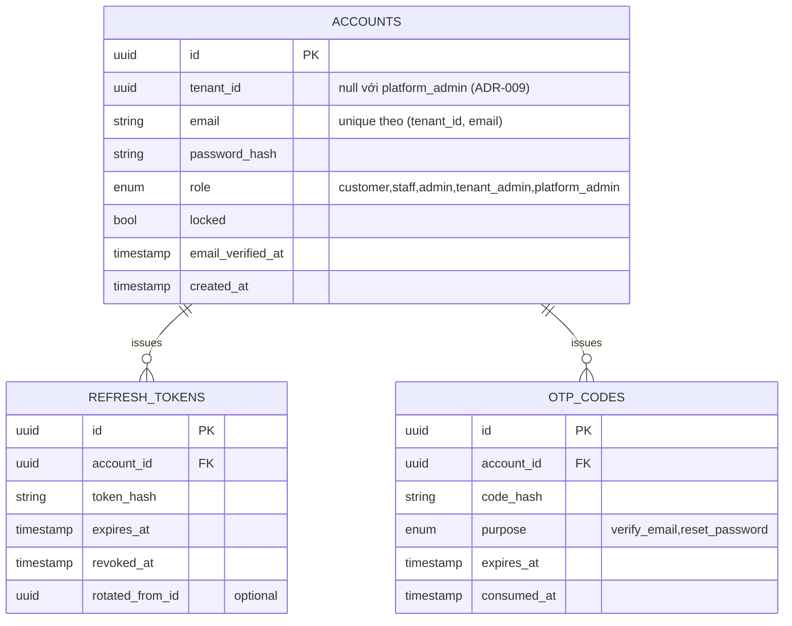

# auth-service — Service Spec

Ngôn ngữ: **TypeScript/NestJS** (ADR-011 — hệ sinh thái `@nestjs/passport`, `@nestjs/jwt`,
guard cho RBAC, OAuth; **không** CQRS/ES/Saga — CRUD thường) · REST `3001` · gRPC `50051` ·
style [coding-conventions.md](../../.claude/conventions/coding-conventions.md) ·
FR: [FR-AUTH-01..05](../10-requirements/11-auth-users.md)

> **Trạng thái triển khai (2026-09-04):** code đầu tiên của backend. Đã hiện thực **trọn vẹn 1
> endpoint làm mẫu** cho service NestJS CRUD (auth/user): `POST /v1/auth/register` (FR-AUTH-01)
> — use case ở `application/use-case/*.use-case.ts` (KHÔNG `@nestjs/cqrs`, không `command/`), hexagonal
> + DDD, TypeORM + RLS (ADR-007/009), outbox `auth.otp_requested` (ADR-004), Kong route + rate
> limit, khoá truy cập trực tiếp (ADR-012: không publish port + `GatewayOnlyGuard`), 75 test
> (unit/integration Testcontainers/e2e). Xem `backend/services/auth-service/README.md`.
> `verify-email`, `login`,
> `refresh`, OAuth, gRPC, và `user-service` là các task tiếp theo (chưa code) — liệt kê ở cuối
> README.

> **Phạm vi tenant (ADR-007/009):** auth-service là **nguồn của claim `tid`** — JWT mang `tid` +
> `sub` + `role`. `Account` (credential) có `tenant_id`: một email đăng ký độc lập ở mỗi tenant.
> `platform_admin` là account **không** có `tenant_id` (token không `tid`). RPC `AttachTenant`
> (tenant-service gọi khi provisioning) và `IssueImpersonationToken` (`tid` mục tiêu, `exp ≤ 30'`,
> audit) là hai điểm cross-tenant duy nhất. Bảng credential + refresh token scoped RLS theo `tenant_id`.

## 1. Trách nhiệm & ranh giới

- Bounded context: **Identity** ([30-domain/01-bounded-contexts.md](../30-domain/01-bounded-contexts.md)).
- Sở hữu: `Account` (email, password hash, trạng thái khoá), `RefreshToken`. **Không** sở hữu hồ
  sơ khách (tên, điện thoại, địa chỉ, điểm, hạng) — đó là `user-service`; auth-service chỉ phát
  `AccountRegistered` để user-service tạo `Customer` tương ứng.
- FR cover: FR-AUTH-01, 02, 03 (phần cấp/verify token), 04, 05.

## 2. API

### REST (qua Kong)

| Method | Path | Mô tả | Auth |
| --- | --- | --- | --- |
| POST | /v1/auth/register | Đăng ký email + password, gửi OTP verify | public |
| POST | /v1/auth/verify-email | Xác minh OTP/link | public |
| POST | /v1/auth/login | Đăng nhập, trả access + refresh token | public |
| POST | /v1/auth/refresh | Đổi refresh token lấy access token mới (rotate) | public (refresh token) |
| POST | /v1/auth/logout | Thu hồi refresh token hiện tại | customer |
| POST | /v1/auth/forgot-password | Gửi email reset password | public |
| POST | /v1/auth/reset-password | Đặt lại password bằng token reset | public |
| GET | /v1/auth/oauth/google | Redirect OAuth Google (FR-AUTH-04) | public |
| GET | /v1/auth/oauth/google/callback | Callback OAuth, tạo/đăng nhập account | public |

### gRPC (nội bộ)

| RPC | Request → Response | Ai gọi |
| --- | --- | --- |
| `VerifyToken` | `{accessToken}` → `{accountId, role, valid}` | Kong JWT plugin (hoặc middleware dùng chung nếu Kong verify bằng JWKS thay vì gọi RPC — quyết định khi implement, mặc định Kong tự verify chữ ký JWT không cần round-trip) |
| `GetAccount` | `{accountId}` → `{email, role, locked}` | user-service (khi cần xác nhận trạng thái khoá) |
| `LockAccount` | `{accountId, reason}` → `{}` | user-service (FR-AUTH-08, khi admin khoá khách vi phạm) |

### Events

| Phát (topic) | Payload | Khi nào |
| --- | --- | --- |
| `auth.otp_requested` | `{accountId, email, otpPurpose: verify_email\|reset_password, code}` | Ngay sau khi sinh OTP — notification-service consume để gửi email chứa mã (auth-service không tự gửi email, xem mục 4) |
| `auth.account_registered` | `{accountId, email}` | Sau khi verify email thành công |
| `auth.password_changed` | `{accountId}` | Đổi mật khẩu — trigger thu hồi mọi refresh token |

| Tiêu thụ (topic) | Xử lý | Idempotency |
| --- | --- | --- |
| — | auth-service không tiêu thụ event của service khác | — |

## 3. Data model

Index: `accounts (tenant_id, email)` unique (một email đăng ký riêng ở mỗi tenant — ADR-007);
`refresh_tokens (account_id, expires_at)` cho cleanup job.

## 4. Nghiệp vụ cốt lõi

- **Đăng ký**: hash password (bcrypt/argon2), tạo `account` (email chưa verify), sinh OTP, publish
  `auth.otp_requested` (không tự gửi email — đúng nguyên tắc chung, xem
  [04-service-contracts-conventions.md](../20-architecture/04-service-contracts-conventions.md)).
- **Login**: so `password_hash`; `locked=true` → `403 FORBIDDEN` (`ACCOUNT_LOCKED`); sai quá 5 lần
  trong 15' → tạm khoá theo FR-AUTH-05 (đếm bằng Redis, không phải cột DB).
- **Refresh rotate**: mỗi lần dùng refresh token, revoke token cũ + phát token mới
  (`rotated_from_id` trỏ về token cũ) — phát hiện reuse token đã revoke thì thu hồi **toàn bộ**
  chuỗi (dấu hiệu token bị đánh cắp).
- **Đổi mật khẩu / reset**: thu hồi mọi `refresh_tokens` của account (FR-AUTH-02).
- Invariant: JWT access token sống 15 phút, refresh token 30 ngày; claims tối thiểu
  `sub, role, iat, exp` (không nhét PII vào claims).

## 5. Config (env)

| Biến | Bắt buộc | Mặc định | Ghi chú |
| --- | --- | --- | --- |
| `DB_URL` | có | — | Postgres riêng của auth-service |
| `JWT_PRIVATE_KEY` / `JWT_PUBLIC_KEY` | có | — | RS256, public key share cho Kong JWT plugin |
| `ACCESS_TOKEN_TTL` | không | `15m` | |
| `REFRESH_TOKEN_TTL` | không | `720h` | 30 ngày |
| `LOGIN_MAX_ATTEMPTS` | không | `5` | FR-AUTH-05 |
| `LOGIN_LOCKOUT_MINUTES` | không | `15` | |
| `GOOGLE_OAUTH_CLIENT_ID` / `_SECRET` | có (nếu bật FR-AUTH-04) | — | |
| `REDIS_URL` | có | — | Đếm login attempt |

## 6. Kiểm thử

- Unit: password hash/verify, JWT sign/verify, refresh-rotate-reuse-detection, lockout counter
  logic (fake clock, fake Redis port).
- Integration (Testcontainers Postgres + Redis): full register → verify → login → refresh →
  logout; concurrent login-attempt lockout.

## 7. Observability

- Span: `Register`, `Login`, `RefreshToken`. Metric riêng: `auth_login_failures_total{reason}`,
  `auth_lockouts_total`. Log milestone: đăng ký thành công, khoá tài khoản (không log password/OTP).
