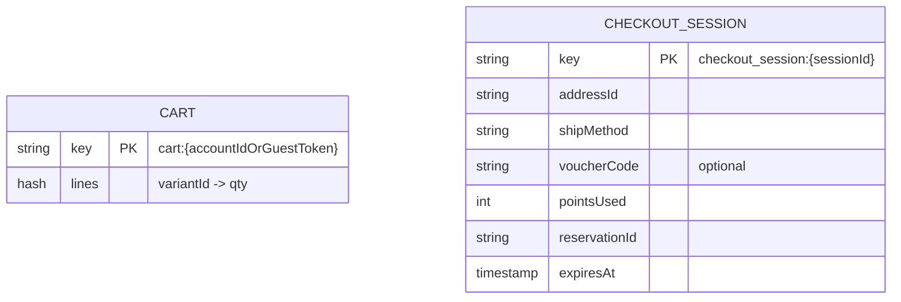

# cart-service — Service Spec

Ngôn ngữ: Go · REST `3005` · gRPC `50055` · FR: [FR-CART-01..08](../10-requirements/03-cart-checkout.md)

> **Phạm vi tenant (ADR-007/009):** key Redis giỏ/checkout session mang tiền tố `tenant:{tid}:`;
> mọi gRPC downstream (inventory `ReserveStock`, promotion `CheckDropEligibility`) truyền metadata
> `x-tenant-id`. Giỏ của cùng một người ở hai tenant là hai giỏ tách biệt. Bảng checkout session
> (nếu lưu Postgres) có `tenant_id` + RLS.

## 1. Trách nhiệm & ranh giới

- Bounded context: **Cart**.
- Sở hữu: `Cart` (Redis, TTL dài — vd. 30 ngày, không phải nghiệp vụ mà là dọn rác), giữ bản
  copy denormalized tên/giá/ảnh sản phẩm (consume `product.updated`) để hiển thị giỏ nhanh không
  cần gọi product-service mỗi lần.
- **Không** sở hữu tồn kho, không tính giá cuối cùng độc lập — mọi số tiền hiển thị lấy từ
  `computeTotals` (xem mục 4) và **luôn tính lại phía server** khi tạo đơn thật (order-service
  không tin số tiền client gửi lên, tự gọi lại cart-service hoặc tính lại).
- FR cover: toàn bộ FR-CART. Checkout session điều phối gọi inventory/promotion/user/shipping
  nhưng **không tạo Order** — tạo Order là việc của order-service (FR-ORD-01).

## 2. API

### REST (qua Kong)

| Method | Path | Mô tả | Auth |
| --- | --- | --- | --- |
| GET | /v1/cart | Xem giỏ hàng (tính lại giá/tồn khả dụng mỗi lần đọc) | customer (+ guest qua cookie, FR-CART-01) |
| POST | /v1/cart/items | Thêm sản phẩm (check tồn + drop eligibility) | customer/guest |
| PATCH | /v1/cart/items/{variantId} | Sửa số lượng | customer/guest |
| DELETE | /v1/cart/items/{variantId} | Xoá khỏi giỏ | customer/guest |
| POST | /v1/cart/merge | Merge guest cart vào cart tài khoản sau đăng nhập (FR-CART-01) | customer |
| POST | /v1/checkout-sessions | Bắt đầu checkout: reserve tồn kho, trả `expiresAt` (FR-CART-05) | customer |
| PATCH | /v1/checkout-sessions/{id} | Cập nhật địa chỉ/phương thức ship/voucher/điểm dùng (FR-CART-04/06/07) | customer |
| GET | /v1/checkout-sessions/{id} | Xem tổng kết hiện tại (FR-CART-08) | customer |
| DELETE | /v1/checkout-sessions/{id} | Huỷ chủ động (nhả reservation) | customer |

### gRPC (nội bộ)

| RPC | Request → Response | Ai gọi |
| --- | --- | --- |
| `GetCheckoutSessionSnapshot` | `{sessionId}` → `{lines[], totals, addressId, shipMethod, voucherCode, pointsUsed}` | order-service khi khách bấm "đặt hàng" — order-service **tự tính lại** totals từ snapshot này, không tin số tiền FE gửi |

### Events

| Phát (topic) | Payload | Khi nào |
| --- | --- | --- |
| — | | cart-service không phát domain event nghiệp vụ (giỏ hàng chưa phải fact đã xảy ra) |

| Tiêu thụ (topic) | Xử lý | Idempotency |
| --- | --- | --- |
| `product.updated` | Cập nhật bản copy tên/giá/ảnh trong cart items đang giữ | Ghi đè theo `productId`, tự nhiên idempotent |
| `inventory.reservation_expired` | Đánh dấu checkout session hết hạn, dọn Redis key | Theo `reservationId` trong payload |

## 3. Data model

Redis (không phải bảng SQL — cart là ephemeral state):

Không phải bảng SQL — cả hai là **Redis hash**, không có FK vật lý; sơ đồ trên chỉ mô tả hình dạng
dữ liệu để dễ hình dung khi implement.

Không cần Postgres cho cart-service trừ khi cần audit checkout-session đã hết hạn (tuỳ chọn,
không bắt buộc v1).

## 4. Nghiệp vụ cốt lõi

- **Guest cart + merge** (FR-CART-01): giỏ guest khoá theo cookie `guest_token` (random, set khi
  request đầu tiên không có JWT); đăng nhập xong FE gọi `POST /cart/merge` — cộng dồn số lượng
  trùng `variantId`, giữ số lượng cao hơn nếu vượt tồn khả dụng thì cắt về mức khả dụng (không
  lỗi cứng, chỉ báo warning).
- **`computeTotals`** (FR-CART-08, logic đã có sẵn và đúng ở FE mock
  `frontend/src/lib/mock/store.ts:187-221` — port thẳng logic này sang Go, không viết lại từ đầu):
  `subtotal → shipFee (theo ngưỡng freeship hoặc phương thức đã chọn) → voucherDiscount (theo
  loại % / fixed / freeship) → pointsDiscount (giới hạn theo maxPointPercent trên phần sau
  voucher) → total`.
- **Bắt đầu checkout** (FR-CART-05): gọi `inventory.ReserveStock` cho toàn bộ item trong giỏ,
  TTL từ inventory-service trả về; lưu `reservationId` vào `checkout_session`. Hết hạn (nhận
  event `inventory.reservation_expired` hoặc TTL Redis tự hết) → xoá session, FE nhận `409
  RESERVATION_EXPIRED` lần request kế tiếp, tự động điều hướng về giỏ (đúng như thông báo trong
  FR-CART-05, hiện chưa có ở FE mock — xem ghi chú trong file FR).
- **Validate voucher/điểm**: gọi `promotion.ValidateVoucher` và `user.GetPointsBalance` /
  `ReservePoints` mỗi lần `PATCH checkout-session` — không cache kết quả cũ, luôn hỏi lại real-time
  vì điều kiện có thể đổi (voucher hết lượt do người khác dùng).

## 5. Config (env)

| Biến | Bắt buộc | Mặc định | Ghi chú |
| --- | --- | --- | --- |
| `REDIS_URL` | có | — | |
| `GUEST_CART_TTL_DAYS` | không | `30` | |
| `CHECKOUT_SESSION_TTL_SECONDS` | không | theo `ReserveStock` trả về | Khớp TTL reservation, không tự đặt riêng |
| `FREE_SHIP_THRESHOLD_VND` | không | `500000` | Hiển thị ước tính — số thật do shipping-service tính (FR-SHIP-07) |

## 6. Kiểm thử

- Unit: `computeTotals` mọi tổ hợp voucher/điểm/freeship (table-driven, port test case trực tiếp
  từ hành vi FE mock hiện có làm golden case).
- Integration: merge guest→account cart; checkout session hết hạn do reservation hết hạn (giả lập
  event `inventory.reservation_expired`) → session bị xoá đúng.

## 7. Observability

- Span: `AddToCart`, `StartCheckout`. Metric: `cart_checkout_sessions_expired_total`,
  `cart_abandonment_rate` (session tạo nhưng không dẫn tới order trong X phút).
