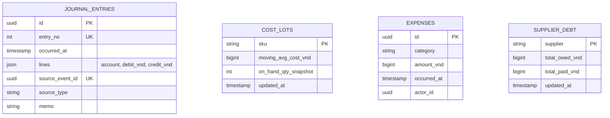
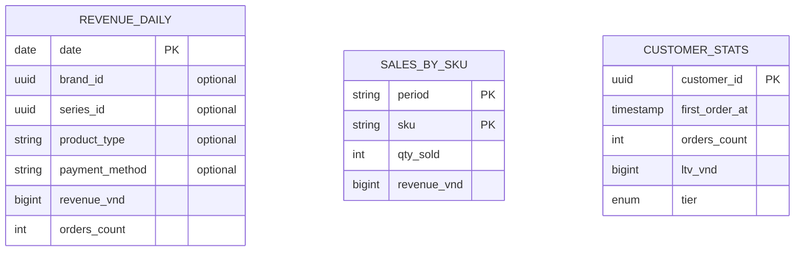

# finance-service — Service Spec

Ngôn ngữ: Go · REST `3010` · gRPC `50060` ·
FR: [FR-ACC-01..07](../10-requirements/09-accounting.md), [FR-REP-01..08](../10-requirements/10-reporting.md)

> **Phạm vi tenant (ADR-007/009):** sổ cái, `CostLot`, `Expense`, read model báo cáo đều có
> `tenant_id` + RLS; mỗi tenant có sổ riêng, `entry_no` riêng. Consumer set `app.tenant_id` từ
> header Kafka `tenant-id` **trước** khi ghi. Báo cáo chủ shop chỉ thấy tenant mình — báo cáo
> cross-tenant (MRR, doanh thu nền tảng) thuộc billing-service, không phải service này.

## 1. Trách nhiệm & ranh giới

- Bounded context: **Finance** — gộp hai module trong cùng service vì cùng nguồn dữ liệu (event
  từ order/payment/inventory) nhưng **tách bảng**: sổ cái kế toán (ghi, bất biến) và read model
  báo cáo (đọc, có thể rebuild) không dùng chung schema.
- Sở hữu: `JournalEntry` (bút toán kép, append-only), `CostLot` (giá vốn moving-average theo
  SKU — **finance-service sở hữu, không phải inventory-service**, xem
  [inventory-service.md §1](inventory-service.md#1-trách-nhiệm--ranh-giới)), `Expense`, các bảng
  read model báo cáo (doanh thu, bán chạy, tồn kho chậm luân chuyển…).
- **Không** ghi số liệu bán hàng thủ công — mọi bút toán doanh thu/giá vốn sinh **từ event**, chỉ
  chi phí vận hành (FR-ACC-03) nhập tay.
- FR cover: toàn bộ FR-ACC, FR-REP.

## 2. API

### REST (qua Kong)

| Method | Path | Mô tả | Auth |
| --- | --- | --- | --- |
| GET | /v1/admin/ledger | Sổ cái, lọc theo kỳ/nguồn | admin |
| POST | /v1/admin/expenses | Nhập chi phí vận hành (FR-ACC-03) | admin |
| GET | /v1/admin/reports/pnl | P&L theo tháng/quý, drill-down bút toán gốc (FR-ACC-04) | admin |
| GET | /v1/admin/reports/reconciliation | Đối soát COD & cổng thanh toán (FR-ACC-05) | admin |
| GET | /v1/admin/reports/supplier-debt | Công nợ NCC (FR-ACC-06) | admin |
| GET | /v1/admin/dashboard | Doanh thu hôm nay/tuần/tháng so cùng kỳ, SLA đóng gói (FR-REP-01/08) | staff, admin |
| GET | /v1/admin/reports/revenue | Doanh thu theo brand/series/loại/phương thức (FR-REP-02) | admin |
| GET | /v1/admin/reports/best-sellers | Top bán chạy, sold-through drop (FR-REP-03) | staff, admin |
| GET | /v1/admin/reports/inventory | Giá trị tồn, hàng chậm luân chuyển, vòng quay (FR-REP-04) | staff, admin |
| GET | /v1/admin/reports/customers | Mới/quay lại, phân bố hạng, LTV top khách (FR-REP-05) | admin |
| GET | /v1/admin/reports/campaigns | Hiệu quả voucher/flash sale/drop, tỉ lệ waitlist→mua (FR-REP-06) | admin |
| GET | /v1/admin/reports/{name}/export | Xuất CSV (FR-ACC-07/FR-REP-07) | admin |

### gRPC (nội bộ)

| RPC | Request → Response | Ai gọi |
| --- | --- | --- |
| `GetCurrentCost` | `{sku}` → `{avgCostVnd}` | order-service (khoá `cost_locked_vnd` lúc `PlaceOrder`, [order-service.md §4](order-service.md#4-nghiệp-vụ-cốt-lõi)) |

### Events

| Phát (topic) | Payload | Khi nào |
| --- | --- | --- |
| — | | finance-service là "lá" của đồ thị event — chỉ consume, không có consumer nào cần nó phát lại (dashboard đọc trực tiếp qua REST) |

| Tiêu thụ (topic) | Xử lý | Idempotency |
| --- | --- | --- |
| `order.completed` | Bút toán kép: Nợ 111 Tiền / Có 511 Doanh thu (subtotal − discount) + Có 3388 Thu hộ ship; Nợ 632 Giá vốn / Có 156 Hàng hoá (Σ `cost_locked_vnd * qty` — đọc thẳng từ payload event, **không** query lại `CostLot` hiện tại vì giá vốn đã khoá lúc đặt hàng) | Unique `(source_event_id)` trên `journal_entries`, bỏ qua nếu đã ghi |
| `order.cancelled` / `order.returned` | Bút toán đảo (nếu đơn đã từng ghi doanh thu ở `completed` rồi mới bị trả) | idem |
| `payment.succeeded` (purpose=deposit) | Bút toán: Nợ 111 Tiền / Có 131 Khách trả trước (chưa phải doanh thu — FR-ACC-01) | idem |
| `inventory.purchase_receipt_created` | Cập nhật `CostLot` moving-average: `newAvg = (oldAvg*oldQty + unitCost*qty) / (oldQty+qty)`; bút toán Nợ 156 Hàng hoá / Có 331 Phải trả NCC | idem, cộng dồn `supplier_debt` theo NCC |
| `shipment.status_changed` (delivered/failed) | Cập nhật số liệu đối soát COD (FR-ACC-05) | idem |

## 3. Data model

`journal_entries`, `cost_lots`, `expenses`, `supplier_debt` là **sổ cái** — ghi từ event, append-only,
không sửa/xoá. Bốn bảng dưới là **read model báo cáo**, rebuild được từ sổ cái + event gốc, tách
riêng để tối ưu truy vấn dashboard (không join sổ cái mỗi lần đọc báo cáo):

## 4. Nghiệp vụ cốt lõi

- **Giá vốn moving-average** (FR-ACC-02): công thức chuẩn ở trên, cập nhật **duy nhất** khi
  consume `inventory.purchase_receipt_created` — đây là điểm khác biệt quan trọng so với FE mock
  (mock tính moving-average ngay trong action nhập kho, trộn lẫn trách nhiệm Inventory/Finance).
  Giữ đúng port này khi implement thật để không vi phạm bounded context.
- **`cost_locked_vnd` chứ không phải giá vốn recompute lúc `completed`** (FR-ACC-02 hệ luỵ): khi
  consume `order.completed`, finance-service đọc COGS **từ chính payload event** (order-service
  đã khoá `cost_locked_vnd` lúc đặt hàng qua `GetCurrentCost`) — không tra `cost_lots` tại thời
  điểm `completed`, vì giá vốn có thể đã đổi giữa lúc đặt và lúc hoàn tất đơn (khoảng cách vài
  ngày do cửa sổ đổi trả).
- **Đối soát** (FR-ACC-05): so khớp Σ `payment.succeeded(method=cod)` đã "được xác nhận giao" với
  tiền thực chuyển khoản từ đối tác vận chuyển (nhập tay số liệu đối tác theo kỳ) — liệt kê chênh
  lệch (đơn có trong hệ thống nhưng đối tác chưa chuyển tiền, hoặc ngược lại).
- **P&L** (FR-ACC-04): doanh thu thuần (511) − giá vốn (632) − phí ship chịu (nếu shop bao ship) −
  phí cổng thanh toán (% theo method, cấu hình) − chi phí vận hành (Σ `expenses` trong kỳ). Mỗi
  dòng P&L link được xuống `journal_entries` gốc qua `source_event_id`.
- **Dashboard so cùng kỳ** (FR-REP-01, gap so FE mock): `revenue_daily` cho phép query
  `SUM(revenue_vnd) WHERE date BETWEEN … ` cho cả kỳ hiện tại và kỳ liền trước cùng độ dài, tính
  `%` chênh lệch ở tầng application, không ở SQL.
- **SLA đóng gói** (FR-REP-08): đọc trực tiếp từ order-service (`GET /v1/admin/orders?status=
  confirmed`) tính `now() - confirmedAt > 4h` — finance-service **không cần** own dữ liệu này,
  chỉ hiển thị trên cùng dashboard cho tiện admin (gọi REST nội bộ hoặc gRPC nếu cần, quyết định
  khi code: ưu tiên order-service tự expose sẵn con số này qua một RPC nhỏ `GetPackingSlaStats`
  thay vì finance-service tính lại).

## 5. Config (env)

| Biến | Bắt buộc | Mặc định | Ghi chú |
| --- | --- | --- | --- |
| `DB_URL` | có | — | |
| `KAFKA_BROKERS` | có | — | |
| `PAYMENT_GATEWAY_FEE_PERCENT` | không | theo từng method, seed tĩnh | Dùng tính P&L |
| `PACK_SLA_HOURS` | không | `4` | FR-REP-08 |

## 6. Kiểm thử

- Unit: công thức moving-average (table-driven nhiều lần nhập liên tiếp), bút toán kép luôn cân
  (Σ debit = Σ credit mọi `journal_entries`), P&L tổng hợp đúng từ các nguồn.
- Integration: consume `order.completed` hai lần với cùng `source_event_id` → chỉ một bút toán;
  consume `inventory.purchase_receipt_created` cập nhật đúng `cost_lots` và `supplier_debt`.

## 7. Observability

- Span: `RecordJournalEntry`, `RecalculateCostLot`. Metric: `finance_journal_imbalance_total`
  (phải luôn = 0, alert nếu > 0 — bất biến kế toán vỡ), `finance_report_query_duration_seconds`.
  Log milestone: mỗi bút toán ghi (Info, kèm `sourceEventId`, không log số dư tài khoản cá nhân
  khách hàng ra ngoài phạm vi cần thiết).
