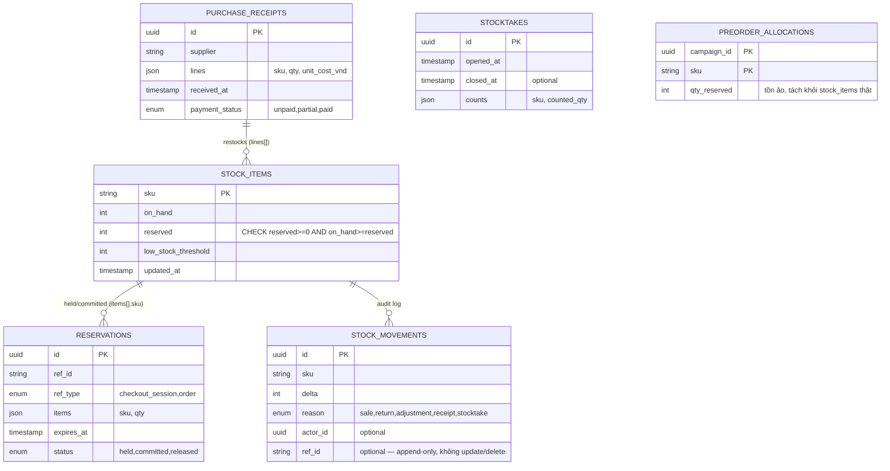

# inventory-service — Service Spec

Ngôn ngữ: Go · REST `3004` · gRPC `50054` · FR: [FR-INV-01..08](../10-requirements/02-inventory.md)

> Đây là service có gap lớn nhất so với FE mock (xem đầu
> [02-inventory.md](../10-requirements/02-inventory.md)): reservation TTL/atomic hold **phải cài
> đúng thật**, mock chỉ mô phỏng UI. Đọc kỹ mục 4 trước khi bắt tay code.

> **Phạm vi tenant (ADR-007/009):** `StockItem`, `Reservation`, `StockMovement`,
> `PurchaseReceipt` có `tenant_id` + RLS; `sku` unique **trong một tenant** (`(tenant_id, sku)`).
> gRPC `ReserveStock`/`CommitReservation`/`ReleaseReservation` nhận tenant qua metadata
> `x-tenant-id` (thiếu → `InvalidArgument`). Consumer `tenant.provisioned` seed `settings` (TTL
> hold) mặc định; `tenant.archived` → dữ liệu chỉ-đọc.

## 1. Trách nhiệm & ranh giới

- Bounded context: **Inventory**.
- Sở hữu: `StockItem` (on_hand/reserved theo SKU), `Reservation`, `StockMovement` (audit
  append-only), `PurchaseReceipt` (số lượng + đơn giá **nhập**, không phải giá vốn đang dùng).
- **Không** sở hữu **giá vốn moving-average** (`CostLot`) — đó là **finance-service**, tính bằng
  cách consume `inventory.purchase_receipt_created`. inventory-service chỉ biết số lượng, không
  biết "giá vốn hiện tại của SKU X là bao nhiêu" (hỏi finance-service qua gRPC nếu cần hiển thị).
- FR cover: toàn bộ FR-INV.

## 2. API

### REST (qua Kong)

| Method | Path | Mô tả | Auth |
| --- | --- | --- | --- |
| GET | /v1/admin/stock | Tồn theo SKU, mức độ, ngưỡng cảnh báo | staff, admin |
| POST | /v1/admin/stock/{sku}/adjust | Điều chỉnh tồn kèm lý do bắt buộc (FR-INV-04) | staff, admin |
| GET | /v1/admin/stock/{sku}/movements | Lịch sử biến động (audit) | staff, admin |
| POST | /v1/admin/receipts | Tạo phiếu nhập hàng (FR-INV-05) | staff, admin |
| GET | /v1/admin/receipts | Danh sách phiếu nhập | staff, admin |
| POST | /v1/admin/stocktakes | Mở phiên kiểm kê (FR-INV-08) | admin |
| POST | /v1/admin/stocktakes/{id}/count | Nhập số đếm thực tế cho một SKU | staff, admin |
| POST | /v1/admin/stocktakes/{id}/close | Đóng phiên, sinh điều chỉnh chênh lệch tự động | admin |

### gRPC (nội bộ)

| RPC | Request → Response | Ai gọi |
| --- | --- | --- |
| `ReserveStock` | `{items[]: {sku, qty}, refId, ttlSeconds}` → `{reservationId}` \| `RESOURCE_EXHAUSTED` | cart-service lúc bắt đầu checkout ([05-key-flows.md](../20-architecture/05-key-flows.md) mục 1) |
| `CommitReservation` | `{reservationId}` → `{}` | order-service khi thanh toán thành công |
| `ReleaseReservation` | `{reservationId}` → `{}` | order-service khi checkout huỷ/hết hạn/compensation |
| `GetAvailability` | `{skus[]}` → `{sku: available}` | product-service (badge còn hàng), cart-service |
| `MapPreorderAllocation` | `{campaignId, sku, qty}` → `{}` | promotion-service khi mở campaign (FR-INV-07, tồn ảo) |

### Events

| Phát (topic) | Payload | Khi nào |
| --- | --- | --- |
| `inventory.stock_low` | `{sku, available, threshold}` | `available <= threshold` sau bất kỳ biến động nào (FR-INV-06) |
| `inventory.stock_restocked` | `{sku, qtyAdded, receiptId}` | Sau khi nhập hàng — order-service (pre-order `awaiting_stock → balance_due`), promotion-service (đánh thức waitlist) consume |
| `inventory.purchase_receipt_created` | `{receiptId, supplier, lines[]: {sku, qty, unitCostVnd}}` | Ngay sau khi lưu phiếu nhập — finance-service consume để tính giá vốn moving-average (FR-ACC-02) |
| `inventory.reservation_expired` | `{reservationId, refId}` | TTL hết mà chưa `CommitReservation`/`ReleaseReservation` chủ động — cart/order-service consume để báo khách quay lại giỏ (FR-CART-05) |

## 3. Data model

## 4. Nghiệp vụ cốt lõi

- **`ReserveStock` là atomic, optimistic**: `UPDATE stock_items SET reserved = reserved + $qty
  WHERE sku = $sku AND on_hand - reserved >= $qty` — 0 row affected thì `RESOURCE_EXHAUSTED`
  (`INSUFFICIENT_STOCK`). Không dùng lock bi quan (`SELECT … FOR UPDATE`) trên toàn bảng, chỉ dựa
  vào điều kiện `WHERE` để Postgres tự serialize theo row.
- **TTL hết hạn tự nhả**: một job (goroutine ticker hoặc `pg_cron`) quét `reservations WHERE
  status='held' AND expires_at < now()` → `reserved -= qty`, `status='released'`, phát
  `inventory.reservation_expired`. TTL mặc định 15' (checkout thường, FR-CART-05) hoặc 5' (drop,
  xem [03-blind-box-and-drops.md](../30-domain/03-blind-box-and-drops.md)) — cấu hình theo `refType`
  hoặc truyền `ttlSeconds` tường minh trong request.
- **`CommitReservation`**: trong một transaction, `on_hand -= qty`, `reserved -= qty`, ghi
  `stock_movements(reason=sale)`, đổi `reservations.status='committed'`. Đây là điểm duy nhất
  `on_hand` thật sự giảm — khác với FE mock hiện trừ thẳng `on_hand` lúc `placeOrder` mà bỏ qua
  bước reserve (xem cảnh báo đầu file).
- **Điều chỉnh tồn** (FR-INV-04): bắt buộc `note` khác rỗng và `actor_id`; không cho `on_hand +
  delta < 0`.
- **Pre-order → tồn thật** (FR-INV-07): khi nhập hàng khớp SKU có `preorder_allocations`, số lượng
  đó ưu tiên chuyển thành `reservations` thật cho các đơn `awaiting_stock` **trước khi** phần dư
  được coi là tồn bán tự do — tránh hàng về bị bán mất cho khách vãng lai trong khi khách pre-order
  đang chờ.
- **Kiểm kê** (FR-INV-08): đóng phiên so `counted_qty` với `on_hand` hiện tại, sinh
  `stock_movements(reason=stocktake)` cho phần chênh lệch, không cho sửa sau khi đóng.

## 5. Config (env)

| Biến | Bắt buộc | Mặc định | Ghi chú |
| --- | --- | --- | --- |
| `DB_URL` | có | — | |
| `RESERVATION_TTL_DEFAULT_SECONDS` | không | `900` (15') | Checkout thường — khoá `holdMinutes` sở hữu ở đây (xem [30-domain/04-data-models.md](../30-domain/04-data-models.md)) |
| `RESERVATION_TTL_DROP_SECONDS` | không | `300` (5') | Drop mở bán |
| `LOW_STOCK_DEFAULT_THRESHOLD` | không | `5` | Khi SKU mới chưa set riêng |
| `KAFKA_BROKERS` | có | — | |

## 6. Kiểm thử

- Unit: `ReserveStock` không cho âm `available`; TTL hết hạn nhả đúng số lượng; điều chỉnh tồn từ
  chối khi thiếu lý do hoặc gây âm kho.
- Integration (Testcontainers): **concurrency test bắt buộc** — N goroutine `ReserveStock` cùng
  một SKU với tổng vượt `available`, assert đúng số lượng request thành công = `available`, không
  request nào đọc sai (race condition này là NFR-02, điểm nóng nhất hệ thống — viết test trước
  khi viết code).

## 7. Observability

- Span: `ReserveStock`, `CommitReservation`. Metric: `inventory_reservation_conflicts_total`,
  `inventory_stock_low_events_total`. Log milestone: mọi `stock_movements` ghi log Info kèm
  `reason` + `sku` + `delta` (đây chính là audit trail, log và DB phải khớp nhau).
