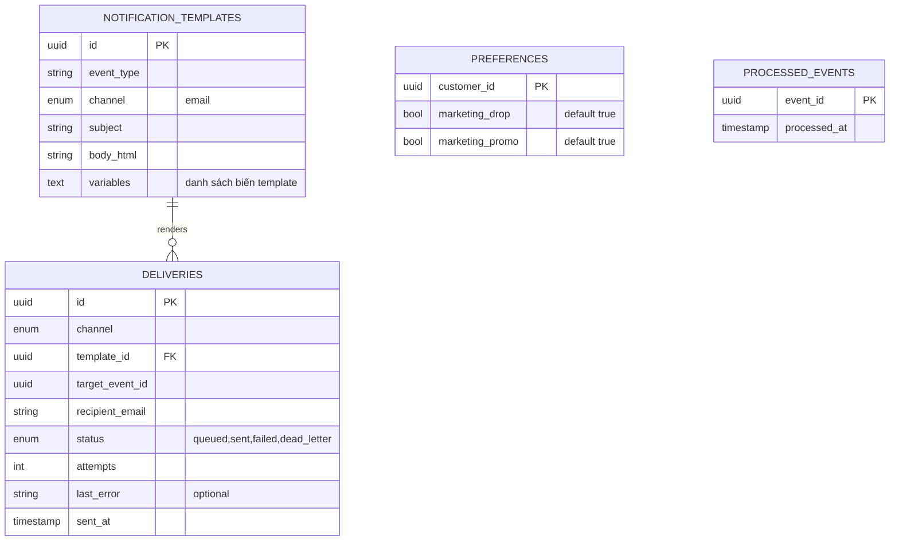

# notification-service — Service Spec

Ngôn ngữ: Go · REST `3011` · gRPC — (không có, service này chỉ tiêu thụ event, không phục vụ RPC
đồng bộ cho service khác) · FR: [FR-NOTI-01..06](../10-requirements/12-notification.md)

> **Phạm vi tenant (ADR-007/009):** `NotificationTemplate`, `Delivery`, `Preference` có
> `tenant_id` + RLS. **Danh tính người gửi** (tên hiển thị, reply-to, sau này domain gửi) là
> theo tenant — email khách của tenant A mang thương hiệu A (denormalize qua
> `tenant.branding_updated`). Consumer set `app.tenant_id` từ header `tenant-id`. Email cấp nền
> tảng (chào mừng tenant, cảnh báo hạn mức, dunning) dùng template hệ thống, người gửi Vici.

## 1. Trách nhiệm & ranh giới

- Bounded context: **Notification**.
- Sở hữu: `NotificationTemplate`, `Delivery` (log gửi + trạng thái), preference bật/tắt marketing
  của khách (denormalized từ `customerId`, không sở hữu hồ sơ khách).
- **Không service nào khác tự gửi email** — đây là nguyên tắc cứng của hệ thống (mọi email đi qua
  đây, kích hoạt bằng event). Kênh v1: email; kiến trúc chừa chỗ Zalo ZNS/push (không implement
  v1).
- FR cover: toàn bộ FR-NOTI.

## 2. API

### REST (qua Kong)

| Method | Path | Mô tả | Auth |
| --- | --- | --- | --- |
| GET | /v1/me/notification-preferences | Xem preference marketing hiện tại (FR-NOTI-05) | customer |
| PATCH | /v1/me/notification-preferences | Bật/tắt từng nhóm (nhắc drop, khuyến mãi) | customer |
| GET | /v1/admin/notification-templates | Danh sách template | admin |
| PATCH | /v1/admin/notification-templates/{id} | Sửa nội dung template | admin |
| GET | /v1/admin/deliveries | Lịch sử gửi, lọc trạng thái (debug khi khách báo không nhận được mail) | staff, admin |

### gRPC

Không có — notification-service không phục vụ RPC đồng bộ (không service nào cần "hỏi" nó điều
gì để đi tiếp, đúng nguyên tắc "mặc định event" ở
[01-system-overview.md](../20-architecture/01-system-overview.md)).

### Events

| Phát (topic) | Payload | Khi nào |
| --- | --- | --- |
| `notification.sent` | `{deliveryId, channel, templateId, targetEventId}` | Gửi thành công (dùng cho admin xem, không service nào khác cần consume) |

| Tiêu thụ (topic) | Xử lý | Idempotency |
| --- | --- | --- |
| `auth.otp_requested` | Gửi email chứa mã OTP/link xác minh (FR-NOTI-01) | `processed_events(eventId)` |
| `auth.account_registered` | Gửi email chào mừng sau khi verify thành công | idem |
| `order.placed` / `order.confirmed` / `order.cancelled` | Email xác nhận đặt/đơn thành công/huỷ | idem |
| `payment.succeeded` / `payment.failed` | Email kết quả thanh toán | idem |
| `shipment.status_changed` (shipped/delivered) | Email cập nhật vận chuyển | idem |
| `payment.refunded` | Email hoàn tiền | idem |
| `order.balance_due` | Email nhắc trả nốt phần còn lại pre-order kèm deadline (FR-ORD-08) | idem |
| `promotion.drop_opened` | Email cho khách đã waitlist drop đó | idem |
| `promotion.waitlist_notified` (xem [promotion-service.md](promotion-service.md)) | Email "hàng đã về"/"drop sắp mở" theo thứ tự đăng ký | idem |
| `inventory.stock_low` | Thông báo nội bộ cho admin (FR-NOTI-06, kênh riêng — Slack/email nội bộ, không phải email khách) | idem |

## 3. Data model

`preferences`: email giao dịch (đơn hàng, OTP…) luôn gửi, không có cờ tắt (FR-NOTI-05) — hai cột
trên chỉ kiểm soát email marketing. `processed_events`: bảng idempotency dùng chung cho mọi
consumer trong service, không liên kết trực tiếp với các bảng còn lại.

## 4. Nghiệp vụ cốt lõi

- **Không consumer nào tự soạn nội dung email trong code Go rải rác** — mọi nội dung qua
  `notification_templates`, biến số điền theo `event_type` (VD template `order.confirmed` nhận
  biến `{{customerName}}, {{orderCode}}, {{totalVnd}}`).
- **Marketing preference** (FR-NOTI-05): trước khi gửi email thuộc nhóm marketing (nhắc drop,
  khuyến mãi), check `preferences` — email giao dịch (xác nhận đơn, thanh toán, vận chuyển) **luôn
  gửi bất kể preference**.
- **Retry + DLQ** (FR-NOTI-04): gửi thất bại (SMTP lỗi/rate limit nhà cung cấp) → retry backoff
  (VD 1'/5'/30', tối đa 3 lần) → hết retry vẫn fail → `status=dead_letter`, đẩy sang
  `notification.dlq` để admin xem/gửi lại thủ công. Không bao giờ rơi âm thầm.
- **Idempotency theo `eventId`** áp dụng chung cho **mọi** consumer trong service này (bảng
  `processed_events` dùng chung) — nhận trùng event (Kafka redelivery) thì bỏ qua, không gửi email
  hai lần.
- **Thông báo nội bộ cho admin** (FR-NOTI-06): kênh khác với email khách (có thể cùng cơ chế
  email nhưng recipient là hộp thư vận hành, hoặc Slack webhook nếu cấu hình) — tách
  `notification_templates.channel` hoặc thêm giá trị enum khi cần kênh thứ hai.

## 5. Config (env)

| Biến | Bắt buộc | Mặc định | Ghi chú |
| --- | --- | --- | --- |
| `DB_URL` | có | — | |
| `KAFKA_BROKERS` | có | — | |
| `SMTP_HOST` / `SMTP_PORT` / `SMTP_USER` / `SMTP_PASSWORD` | có | — | Hoặc SDK nhà cung cấp email transactional (SES/SendGrid) — chọn khi implement, ghi ADR nếu đổi khỏi SMTP thuần |
| `RETRY_BACKOFF_SCHEDULE` | không | `1m,5m,30m` | FR-NOTI-04 |
| `ADMIN_ALERT_EMAIL` | có | — | FR-NOTI-06 |

## 6. Kiểm thử

- Unit: chọn template đúng theo `event_type`, render biến, check preference trước khi gửi
  marketing email, retry schedule.
- Integration: consumer nhận trùng `eventId` không gửi email hai lần; hết retry đúng số lần rơi
  vào `dead_letter`.

## 7. Observability

- Span: `HandleEvent{eventType}`, `SendEmail`. Metric: `notification_send_failures_total{reason}`,
  `notification_dlq_total`. Log milestone: gửi thành công/thất bại (Info/Warn), không log nội
  dung email đầy đủ nếu chứa PII vượt cần thiết (chỉ log `deliveryId`, `templateId`, `eventType`).
