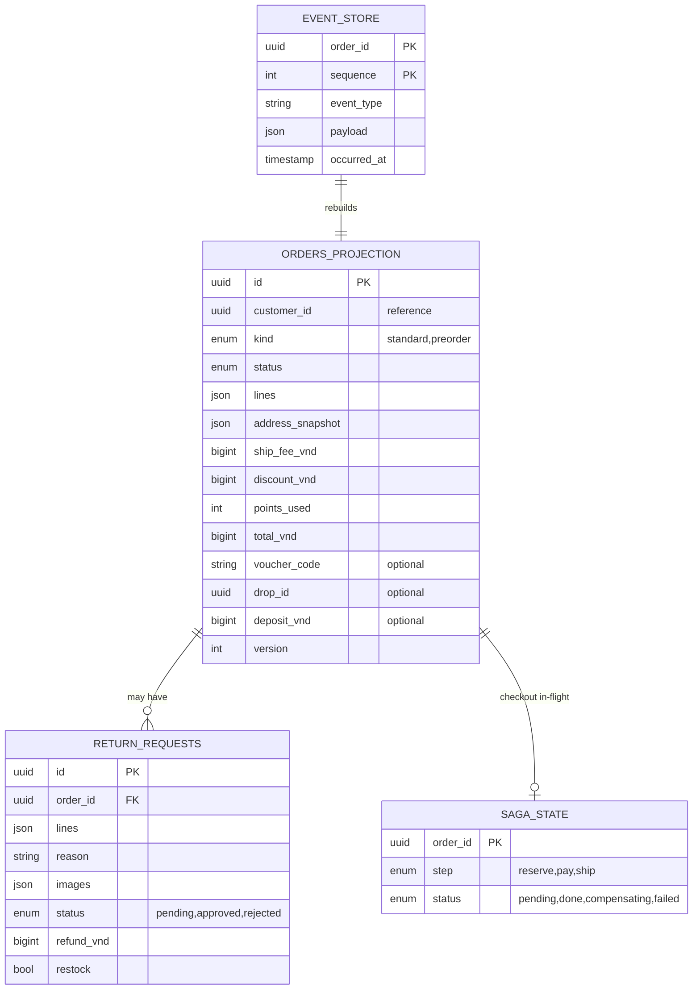

# order-service — Service Spec

Ngôn ngữ: **TypeScript/NestJS** (ADR-002, `@nestjs/cqrs`) · REST `3006` · gRPC `50056` ·
FR: [FR-ORD-01..10](../10-requirements/04-order.md)

Đây là service phức tạp nhất hệ thống — CQRS + Event Sourcing + Saga, dùng làm ví dụ chi tiết ở
[20-architecture/03-clean-architecture-ddd.md §3](../20-architecture/03-clean-architecture-ddd.md#3-ví-dụ-đầy-đủ-một-aggregate-qua-4-lớp-order),
sequence đầy đủ ở [05-key-flows.md](../20-architecture/05-key-flows.md). Đọc hai file đó trước.

> **Phạm vi tenant (ADR-007/009):** mỗi event trong event store mang `tenant_id`; stream id =
> `(tenant_id, order_id)`; projection + outbox scoped RLS. Mã đơn (`VC-1001`) unique trong một
> tenant. Saga checkout truyền metadata `x-tenant-id` xuống payment/inventory/shipping. Consumer
> `tenant.suspended` → chặn tạo đơn mới (`TENANT_SUSPENDED`).

## 1. Trách nhiệm & ranh giới

- Bounded context: **Ordering** ([30-domain/02-order-lifecycle.md](../30-domain/02-order-lifecycle.md)).
- Sở hữu: `Order` (aggregate event-sourced), `ReturnRequest`. Order **snapshot** mọi dữ liệu cần
  (tên/giá/địa chỉ) tại thời điểm đặt — không phụ thuộc product/user-service còn dữ liệu gốc hay
  không (FR-ORD-01).
- **Không** sở hữu: tồn kho thật (inventory-service), giá vốn hiện tại (finance-service — chỉ
  **khoá lại** `cost_locked_vnd` trên từng dòng lúc đặt hàng bằng cách gọi
  `finance.GetCurrentCost`), thanh toán (payment-service), vận đơn (shipping-service). order-service
  là **nhạc trưởng** (saga) chứ không làm thay việc của các service khác.
- FR cover: toàn bộ FR-ORD.

## 2. API

### REST (qua Kong)

| Method | Path | Mô tả | Auth |
| --- | --- | --- | --- |
| POST | /v1/orders | Tạo đơn từ checkout session (FR-ORD-01/03) | customer |
| POST | /v1/preorders | Tạo đơn pre-order từ campaign (FR-ORD-07) | customer |
| GET | /v1/orders/{id} | Chi tiết đơn (khách chỉ xem đơn của mình) | customer |
| GET | /v1/orders | Lịch sử đơn của khách hiện tại | customer |
| POST | /v1/orders/{id}/cancel | Huỷ đơn (FR-ORD-04) | customer |
| POST | /v1/orders/{id}/pay-balance | Trả nốt phần còn lại pre-order (FR-ORD-08) | customer |
| POST | /v1/orders/{id}/return-requests | Tạo yêu cầu đổi trả (FR-ORD-05) | customer |
| GET | /v1/admin/orders | Danh sách đơn, lọc trạng thái/ngày/khách (FR-ORD-06) | staff, admin |
| POST | /v1/admin/orders/{id}/advance | Chuyển trạng thái theo state machine | staff, admin |
| PATCH | /v1/admin/orders/{id}/note | Ghi chú nội bộ | staff, admin |
| POST | /v1/admin/return-requests/{id}/decision | Duyệt/từ chối đổi trả (FR-ORD-05) | staff, admin |

### gRPC (nội bộ)

| RPC | Request → Response | Ai gọi |
| --- | --- | --- |
| `HasPurchased` | `{customerId, productId}` → `{purchased bool, orderId?}` | product-service (điều kiện viết review, FR-CAT-10) |
| `GetPreorderProgress` | `{campaignId}` → `{taken, slots}` | promotion-service (hiển thị "còn X suất") |

### Events

| Phát (topic) | Payload | Khi nào |
| --- | --- | --- |
| `order.placed` | `{orderId, customerId, lines[], totalVnd}` | Ngay sau khi aggregate ghi `OrderPlaced` |
| `order.confirmed` | `{orderId}` | Saga hoàn tất bước 3 (mục 4) |
| `order.cancelled` | `{orderId, refundedVnd}` | Huỷ (khách/admin/hết hạn) |
| `order.completed` | `{orderId, customerId, lines[]: {sku, qty, unitPriceVnd, costLockedVnd}, subtotalVnd, discountVnd, shipFeeVnd}` | +7 ngày kể từ `delivered` không khiếu nại (job) hoặc admin xác nhận sớm |
| `order.returned` | `{orderId, restock bool}` | Đổi trả được duyệt |
| `order.balance_due` | `{orderId, customerId, campaignId, balanceVnd, dueAt}` | Pre-order chuyển `awaiting_stock → balance_due` (nhận `inventory.stock_restocked`) — notification-service consume để nhắc hạn trả nốt (FR-ORD-08) |

| Tiêu thụ (topic) | Xử lý | Idempotency |
| --- | --- | --- |
| `payment.succeeded` | Advance saga: `pending_payment → confirmed`, tiếp bước `CommitReservation` + `CreateShipment` | Theo `eventId`, saga lưu bước đã xử lý trong state của process manager |
| `payment.failed` / `payment.expired` | Compensation: `ReleaseReservation`, đơn quay `pending_payment` hoặc `cancelled` tuỳ nguyên nhân | idem |
| `shipment.status_changed` | Map `picked_up/in_transit/out_for_delivery/delivered/failed` vào timeline đơn; `delivered` → bắt đầu đếm 7 ngày; `failed` lần 3 → `returned` (FR-SHIP-04) | Theo `eventId` |
| `inventory.stock_restocked` | Map SKU → campaign đang `awaiting_stock` → chuyển `balance_due`, mở hạn 7 ngày trả nốt, publish `order.balance_due` (FR-ORD-08) | Theo `eventId` |

## 3. Data model

`event_store` là **nguồn sự thật** (append-only) — mọi bảng còn lại là read model/checkpoint,
rebuild được từ đây khi cần (không bao giờ ngược lại). `orders_projection` cập nhật bởi event
handler nội bộ khi có event mới, phục vụ mọi truy vấn đọc (không replay `event_store` mỗi lần
đọc). `saga_state` chỉ tồn tại trong lúc saga checkout đang chạy — dọn sau khi đơn `confirmed`
hoặc `cancelled`.

Event types: `OrderPlaced, DepositPaid, StockArrived, BalancePaid, OrderConfirmed, OrderPacked,
OrderShipped, OrderDelivered, OrderCompleted, OrderCancelled, ReturnRequested, ReturnResolved`
(đầy đủ ở [30-domain/04-data-models.md](../30-domain/04-data-models.md)).

## 4. Nghiệp vụ cốt lõi

### Saga checkout (FR-ORD-03) — chi tiết ở [05-key-flows.md §1](../20-architecture/05-key-flows.md#1-checkout-đơn-thường-happy-path)

1. `PlaceOrderHandler`: lấy snapshot từ `cart.GetCheckoutSessionSnapshot`, **tự tính lại
   totals** (không tin số client gửi), gọi `finance.GetCurrentCost(sku)` cho từng dòng để khoá
   `cost_locked_vnd` (giá vốn tại thời điểm bán — cần cho COGS chính xác dù giá vốn sau đó đổi),
   append `OrderPlaced` — status `pending_payment`.
2. Saga (`application/saga/checkout.saga.ts`) lắng nghe `OrderPlaced` → gọi
   `payment.CreatePayment` → chờ `payment.succeeded`/`failed`/`expired`.
3. `payment.succeeded` → `inventory.CommitReservation` + `shipping.CreateShipment` → append
   `OrderConfirmed` → publish `order.confirmed`.
4. Bất kỳ bước nào fail → compensation đúng bảng ở
   [05-key-flows.md §1](../20-architecture/05-key-flows.md#1-checkout-đơn-thường-happy-path):
   `ReleaseReservation`, `payment.Refund` nếu đã thu tiền, đơn `cancelled`.

### Vòng đời & huỷ/đổi trả (FR-ORD-02/04/05/06)

- State machine đúng theo [02-order-lifecycle.md](../30-domain/02-order-lifecycle.md) (đã cập
  nhật thêm nhánh `return_requested → completed` khi admin từ chối đổi trả). Mọi lệnh
  `advance`/`cancel` validate qua bảng transition trước khi append event — chuyển không hợp lệ
  trả `INVALID_STATE_TRANSITION` (409), **không** để trạng thái sai lẻn vào event store.
- Huỷ (FR-ORD-04): chỉ trước `packing`. COD chưa thu tiền → huỷ thẳng. Đã thu tiền online →
  **tạo yêu cầu hoàn tiền** (gọi `payment.Refund`, chờ xác nhận trước khi đóng đơn hẳn) — khác
  với FE mock hiện tự động hoàn ngay lập tức, xem ghi chú trong
  [04-order.md](../10-requirements/04-order.md).
- `completed` (không phải `delivered`) là điểm ghi nhận doanh thu/điểm — chừa cửa sổ 7 ngày đổi
  trả; job quét đơn `delivered` quá 7 ngày → tự advance `completed`.

### Pre-order (FR-ORD-07..09) — chi tiết [05-key-flows.md §3](../20-architecture/05-key-flows.md#3-pre-order-cọc--hàng-về--thanh-toán-nốt)

- Tạo đơn pre-order: validate campaign còn slot + trong thời hạn nhận đặt (gọi
  `promotion.GetCampaign` hoặc consume dữ liệu denormalized), thu cọc theo `depositPercent`,
  status `awaiting_stock` sau khi cọc thành công.
- `inventory.stock_restocked` map campaign → `balance_due`, mở hạn 7 ngày (job đếm hạn riêng).
- **Quá hạn**: job chuyển `cancelled`, xử lý cọc **đúng theo `forfeitPolicy` của campaign** (mất
  toàn phần/hoàn một phần) — đây là bug thật ở FE mock (hoàn 100% bất kể chính sách) phải sửa khi
  code thật, xem cảnh báo đầu [04-order.md](../10-requirements/04-order.md).

## 5. Config (env)

| Biến | Bắt buộc | Mặc định | Ghi chú |
| --- | --- | --- | --- |
| `DB_URL` | có | — | Event store + projection cùng Postgres, khác schema |
| `KAFKA_BROKERS` | có | — | |
| `RETURN_WINDOW_DAYS` | không | `7` | FR-ORD-05 |
| `PREORDER_BALANCE_DUE_DAYS` | không | `7` | FR-ORD-08/09 |
| `SAGA_STEP_TIMEOUT_MS` | không | `5000` | Timeout mỗi bước gRPC trong saga trước khi coi là fail |

## 6. Kiểm thử

- Unit: mọi transition hợp lệ/không hợp lệ của state machine (table-driven, cover hết bảng ở
  `02-order-lifecycle.md`); tính `totals` không tin input client; khoá `cost_locked_vnd` đúng thời
  điểm.
- Integration: saga đủ 3 bước happy path + 3 kịch bản compensation (fail ở từng bước) dùng fake
  gRPC server cho inventory/payment/shipping; event store append + replay cho ra đúng trạng thái
  hiện tại; optimistic concurrency (`version` conflict khi hai lệnh cùng lúc trên một order).

## 7. Observability

- Span: `PlaceOrder`, `CheckoutSaga` (span cha bao span con từng bước gRPC), `AdvanceOrder`.
  Metric: `order_saga_compensations_total{step}`, `order_state_transition_denied_total`. Log
  milestone: mỗi event append (Info, kèm `orderId`, `eventType`, `version`).
