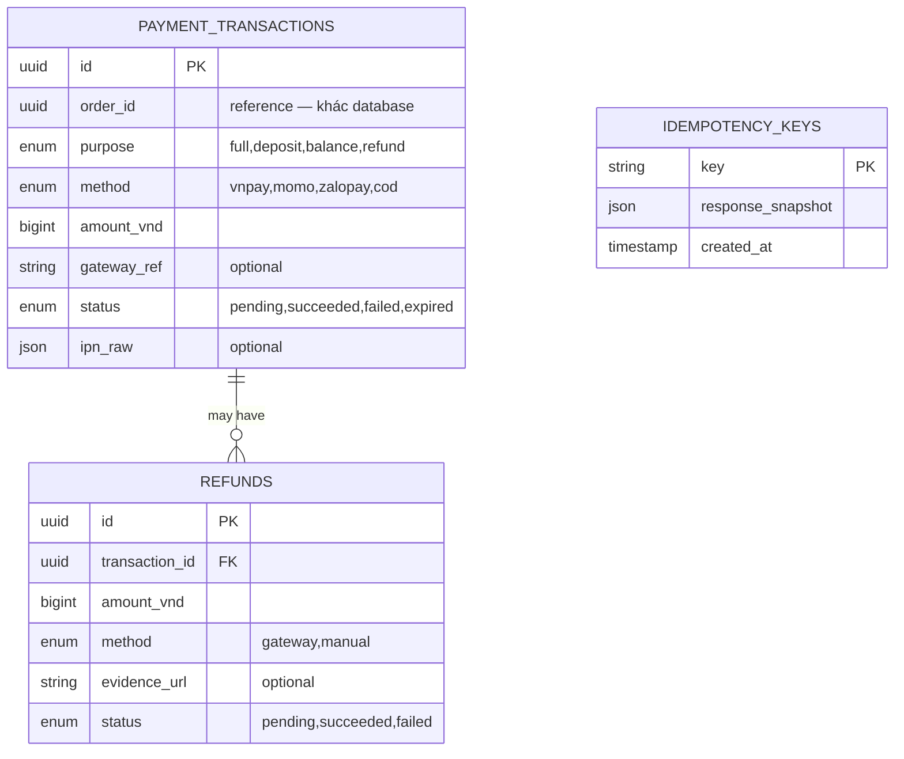

# payment-service — Service Spec

Ngôn ngữ: Go · REST `3007` · gRPC `50057` · FR: [FR-PAY-01..07](../10-requirements/05-payment.md)

> **Phạm vi tenant (ADR-007/009):** `PaymentTransaction`, `Refund` có `tenant_id` + RLS. Cấu
> hình cổng thanh toán (merchant id, secret) là **theo tenant** — lưu ở secret manager khoá theo
> `tenant_id`, không bao giờ trong UI/repo (NFR-06). IPN/webhook phân giải `tenant_id` từ tham
> số giao dịch trước khi set `app.tenant_id` và xử lý.

## 1. Trách nhiệm & ranh giới

- Bounded context: **Payment**.
- Sở hữu: `PaymentTransaction`, `Refund`. Mỗi giao dịch gắn 1 `orderId` + `purpose`
  (`full|deposit|balance|refund`) — **không** biết chi tiết dòng hàng của đơn (order-service
  truyền `orderId` + `amountVnd` + `purpose`, không truyền `lines`).
- FR cover: toàn bộ FR-PAY.

## 2. API

### REST (qua Kong)

| Method | Path | Mô tả | Auth |
| --- | --- | --- | --- |
| POST | /v1/payments/vnpay/ipn | IPN callback VNPay (verify chữ ký) | public (whitelist IP cổng nếu có) |
| POST | /v1/payments/momo/ipn | IPN callback Momo | public |
| POST | /v1/payments/zalopay/ipn | Callback ZaloPay | public |
| GET | /v1/admin/payments | Danh sách giao dịch lọc cổng/trạng thái/ngày (FR-PAY-03) | staff, admin |
| POST | /v1/admin/payments/{id}/refund | Hoàn tiền thủ công kèm chứng từ (FR-PAY-04) | admin |

### gRPC (nội bộ)

| RPC | Request → Response | Ai gọi |
| --- | --- | --- |
| `CreatePayment` | `{orderId, purpose, method, amountVnd}` → `{transactionId, payUrl?}` | order-service (saga bước 2, [05-key-flows.md](../20-architecture/05-key-flows.md) mục 1) |
| `Refund` | `{transactionId, amountVnd, method: gateway\|manual, evidence?}` → `{refundId}` | order-service (huỷ đơn/đổi trả), admin REST handler |
| `GetTransactionsByOrder` | `{orderId}` → `{transactions[]}` | order-service (hiển thị chi tiết đơn) |

### Events

| Phát (topic) | Payload | Khi nào |
| --- | --- | --- |
| `payment.succeeded` | `{transactionId, orderId, purpose, amountVnd, method}` | IPN xác nhận thành công, hoặc COD xác nhận qua `ConfirmCod` |
| `payment.failed` | `{transactionId, orderId, reason}` | IPN báo thất bại |
| `payment.expired` | `{transactionId, orderId}` | Quá 30' chưa nhận IPN (FR-PAY-07) — job quét |
| `payment.refunded` | `{refundId, transactionId, amountVnd}` | Sau `Refund` thành công |

| Tiêu thụ (topic) | Xử lý | Idempotency |
| --- | --- | --- |
| `shipment.status_changed` (chỉ event `delivered`) | COD: `ConfirmCod` nội bộ → transaction COD chuyển `succeeded`, publish `payment.succeeded` (FR-PAY-05) | Theo `eventId`; transaction COD chỉ chuyển 1 lần (`WHERE status='pending'`) |

## 3. Data model

`idempotency_keys` không liên kết trực tiếp với hai bảng trên — dùng chung cho mọi endpoint REST
và IPN webhook để dedup request lặp.

`ipn_raw` lưu **đã redact** thông tin nhạy cảm (không lưu số thẻ/PAN đầy đủ nếu cổng có trả về —
CONSTITUTION Article II.5).

## 4. Nghiệp vụ cốt lõi

- **IPN idempotent** (FR-PAY-02): mỗi cổng có mã tham chiếu riêng (`gateway_ref`) — unique
  constraint `(method, gateway_ref)`; IPN trùng thì no-op, trả lại response thành công cho cổng
  (tránh cổng retry vô hạn) nhưng **không** publish `payment.succeeded` lần hai.
- **Verify chữ ký** mỗi cổng theo tài liệu tích hợp riêng (VNPay HMAC-SHA512, Momo HMAC-SHA256,
  ZaloPay HMAC) — verify **trước khi** đọc `amountVnd`/`orderId` từ payload, sai chữ ký thì log
  Warn + trả `400`, không xử lý tiếp.
- **COD** (FR-PAY-05): không có bước "thanh toán" chủ động — transaction tạo `status=pending`
  ngay khi `CreatePayment(method=cod)`; chỉ chuyển `succeeded` khi nhận
  `shipment.status_changed{status=delivered}`. Giao thất bại (`shipment.status_changed{status=
  failed}` lần 3) → transaction COD giữ nguyên `pending` rồi bị order-service coi là "không ghi
  doanh thu" (không tạo `refund`, vì chưa từng thu tiền).
- **Timeout thanh toán online** (FR-PAY-07): job quét `payment_transactions WHERE status='pending'
  AND method != 'cod' AND created_at < now() - interval '30 minutes'` → `expired`, publish
  `payment.expired` để order-service compensation.
- **Hoàn tiền** (FR-PAY-04): `method=gateway` gọi API hoàn tiền của cổng (đồng bộ, có thể mất vài
  giây — trả `refund.status=pending` trước, cập nhật `succeeded` khi cổng xác nhận); `method=
  manual` yêu cầu `evidence` (ảnh/mã chuyển khoản) trước khi đánh dấu `succeeded`.

## 5. Config (env)

| Biến | Bắt buộc | Mặc định | Ghi chú |
| --- | --- | --- | --- |
| `DB_URL` | có | — | |
| `VNPAY_TMN_CODE` / `VNPAY_HASH_SECRET` | có (bật VNPay) | — | Sandbox trước |
| `MOMO_PARTNER_CODE` / `MOMO_SECRET_KEY` | có (bật Momo) | — | |
| `ZALOPAY_APP_ID` / `ZALOPAY_KEY1` / `_KEY2` | có (bật ZaloPay) | — | |
| `PAYMENT_TIMEOUT_MINUTES` | không | `30` | FR-PAY-07 |
| `KAFKA_BROKERS` | có | — | |

## 6. Kiểm thử

- Unit: verify chữ ký mỗi cổng (fixture request thật từ sandbox), tính idempotent theo
  `gateway_ref`, timeout job.
- Integration: IPN trùng gửi 2 lần chỉ publish event 1 lần; COD confirm chỉ chạy khi đúng event
  `delivered` tới, không chạy khi `out_for_delivery`.

## 7. Observability

- Span: `HandleIpn`, `Refund`. Metric: `payment_ipn_signature_invalid_total{gateway}`,
  `payment_expired_total{method}`. Log milestone: mọi thay đổi status giao dịch (Info, không log
  `ipn_raw` đầy đủ — chỉ log các field đã redact).
