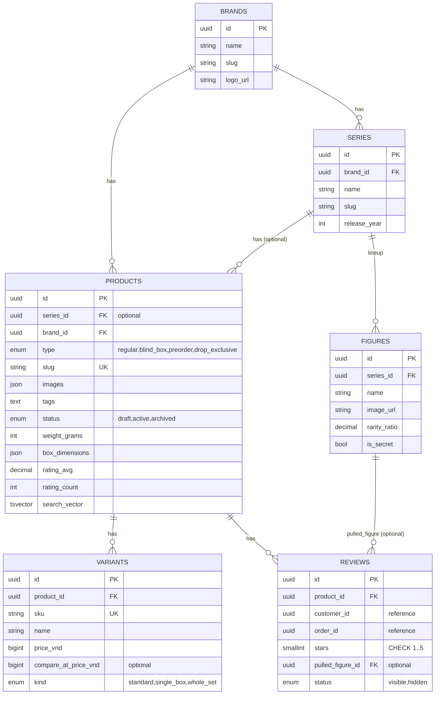

# product-service — Service Spec

Ngôn ngữ: Go · REST `3003` · gRPC `50053` · FR: [FR-CAT-01..12](../10-requirements/01-catalog.md)

## 1. Trách nhiệm & ranh giới

- Bounded context: **Catalog** ([30-domain/01-bounded-contexts.md](../30-domain/01-bounded-contexts.md),
  chi tiết blind box: [30-domain/03-blind-box-and-drops.md](../30-domain/03-blind-box-and-drops.md)).
- Sở hữu: `Brand`, `Series` (kèm `FigureLineup`), `Product`, `Variant`, `Review`. **Không** sở
  hữu tồn kho (chỉ giữ `sku` làm khoá tham chiếu sang inventory-service) và **không** sở hữu giá
  vốn (finance-service).
- FR cover: toàn bộ FR-CAT.

## 2. API

### REST (qua Kong)

| Method | Path | Mô tả | Auth |
| --- | --- | --- | --- |
| GET | /v1/products | Danh sách: lọc brand/series/type/khoảng giá/còn hàng, sort mới nhất/giá/bán chạy, phân trang (FR-CAT-08) | public |
| GET | /v1/products/{slug} | Chi tiết sản phẩm + variant + figure lineup nếu blind box | public |
| GET | /v1/products/{slug}/related | Sản phẩm liên quan cùng series/brand (FR-CAT-11) | public |
| POST | /v1/admin/products | Tạo sản phẩm | staff, admin |
| PATCH | /v1/admin/products/{id} | Sửa sản phẩm/variant | staff, admin |
| POST | /v1/admin/products/{id}/archive | Archive (không xoá) | admin |
| GET | /v1/series | Danh sách series | public |
| POST | /v1/admin/series | Tạo/sửa series + figure lineup | staff, admin |
| GET | /v1/products/{slug}/reviews | Review hiển thị | public |
| POST | /v1/products/{slug}/reviews | Viết review (chỉ khách đã mua, FR-CAT-10) kèm `pulledFigure?` (FR-CAT-12) | customer |
| POST | /v1/admin/reviews/{id}/hide | Ẩn/hiện review vi phạm | staff, admin |
| GET | /v1/brands | Danh sách brand | public |

### gRPC (nội bộ)

| RPC | Request → Response | Ai gọi |
| --- | --- | --- |
| `GetVariantsBySku` | `{skus[]}` → `{variants[]: {sku, name, priceVnd, productId, weightGrams, boxDimensions}}` | cart-service, order-service (snapshot giá + kích thước lúc đặt hàng), shipping-service (tính phí ship FR-SHIP-01) |
| `CheckPurchaseEligibility` | `{customerId, productId}` → `{purchased bool}` | (dùng nội bộ khi validate review, có thể inline hoá bằng gRPC sang order-service thay vì ngược lại — quyết định: **order-service expose** `HasPurchased(customerId, productId)`, product-service gọi sang đó khi nhận request viết review, không phải chiều ngược lại) |

### Events

| Phát (topic) | Payload | Khi nào |
| --- | --- | --- |
| `product.updated` | `{productId, sku[], name, priceVnd, status}` | Tạo/sửa/archive sản phẩm — cart-service, promotion-service, finance-service consume để denormalize tên/giá |

| Tiêu thụ (topic) | Xử lý | Idempotency |
| --- | --- | --- |
| `order.completed` (chỉ field cần) | Cập nhật số liệu bán chạy nội bộ nếu product-service tự cache (tuỳ chọn — mặc định để finance-service làm báo cáo bán chạy, product-service **không cần** consume topic này trừ khi cần "best-seller" cho sort FR-CAT-08) | — |

## 3. Data model

Index: `products.search_vector` GIN (full-text, `unaccent` extension cho tiếng Việt không dấu —
FR-CAT-09); `products(brand_id)`, `products(series_id)`, `variants(sku)` unique; `reviews(product_id,
status)`.

## 4. Nghiệp vụ cốt lõi

- **Archive không xoá** (FR-CAT-01): đơn hàng cũ tham chiếu `productId`/`sku` snapshot tên/giá tại
  thời điểm mua (order-service tự giữ bản sao, không phụ thuộc product-service còn tồn tại record
  hay không).
- **Blind box minh bạch** (FR-CAT-05/06): `figures[]` của series luôn trả đủ kèm `rarity_ratio` —
  không có API nào "ẩn" tỉ lệ; `single_box` và `whole_set` là hai `variant` (hai SKU) riêng, không
  phải flag trên một SKU.
- **Review gắn pulled figure** (FR-CAT-12): validate `pulled_figure_id` thuộc đúng series của sản
  phẩm đang review; chỉ cho phép nếu `product.type = blind_box`.
- **Điều kiện viết review** (FR-CAT-10): gọi `order-service.HasPurchased(customerId, productId)`
  — chỉ true nếu có đơn `delivered`/`completed` chứa sản phẩm. Rating trung bình đệ quy tính lại
  mỗi lần review mới/ẩn (`rating_avg = avg(stars) WHERE status=visible`).
- **Best-seller sort** (FR-CAT-08, gap so với FE mock — mock chưa có): tính bằng cách consume
  `order.completed`, tăng counter `sales_30d` theo `sku`/`product_id` trong bảng riêng, dùng để
  sort — **không** query trực tiếp sang order-service mỗi lần list (tránh coupling đồng bộ cho
  một API đọc tần suất cao).

## 5. Config (env)

| Biến | Bắt buộc | Mặc định | Ghi chú |
| --- | --- | --- | --- |
| `DB_URL` | có | — | |
| `SEARCH_LANG` | không | `vietnamese` (unaccent) | Postgres text search config |
| `KAFKA_BROKERS` | có | — | Publish `product.updated` |

## 6. Kiểm thử

- Unit: rating recompute, validate `pulled_figure_id` thuộc series, slug uniqueness, trạng thái
  archive chặn hiển thị storefront nhưng không chặn đọc bởi order-service.
- Integration: full-text search tiếng Việt không dấu trên dataset seed thật (Testcontainers
  Postgres với extension `unaccent`); filter/sort/pagination kết hợp (FR-CAT-08).

## 7. Observability

- Span: `SearchProducts`, `CreateReview`. Metric: `product_reviews_created_total{hasPulled}`.
  Log milestone: archive sản phẩm (kèm actor).
