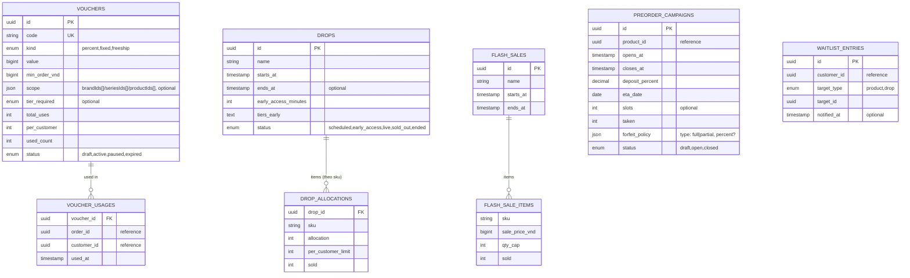

# promotion-service — Service Spec

Ngôn ngữ: Go · REST `3009` · gRPC `50059` · FR: [FR-PROMO-01..08](../10-requirements/07-promotion.md)

> Điểm nóng concurrency của toàn hệ thống (NFR-02) nằm ở đây — mục 4 "Drop eligibility" là phần
> phải viết cẩn thận nhất, có test tải trước khi coi là xong (xem [40-services/README.md](README.md)
> và roadmap P5).

> **Phạm vi tenant (ADR-007/009):** `Voucher`, `FlashSale`, `Drop`, `DropAllocation`,
> `WaitlistEntry`, `PreOrderCampaign` có `tenant_id` + RLS; `voucher.code` unique trong một
> tenant. Counter allocation drop trên Redis mang tiền tố `tenant:{tid}:drop:{id}`. Tính năng
> `drop`/`preorder` chỉ bật khi `billing.GetEntitlements(tenant_id)` cho phép — nếu không →
> `QUOTA_EXCEEDED` khi admin tạo drop.

## 1. Trách nhiệm & ranh giới

- Bounded context: **Promotion** ([30-domain/03-blind-box-and-drops.md](../30-domain/03-blind-box-and-drops.md)).
- Sở hữu: `Voucher`, `FlashSale`, `Drop` (+ `DropAllocation` theo **SKU**, xem ghi chú gap ở
  [03-blind-box-and-drops.md](../30-domain/03-blind-box-and-drops.md)), `PreOrderCampaign`,
  `WaitlistEntry`.
- **Không** sở hữu tồn kho thật — allocation của drop là **counter riêng**, tách khỏi
  `stock_items` của inventory-service (một sản phẩm có thể vừa bán thường vừa có allocation dành
  riêng cho drop).
- FR cover: toàn bộ FR-PROMO.

## 2. API

### REST (qua Kong)

| Method | Path | Mô tả | Auth |
| --- | --- | --- | --- |
| POST | /v1/admin/vouchers | Tạo voucher (FR-PROMO-01) | admin |
| PATCH | /v1/admin/vouchers/{id} | Sửa/tạm dừng voucher | admin |
| POST | /v1/admin/flash-sales | Tạo flash sale (FR-PROMO-03) | admin |
| POST | /v1/admin/drops | Lên lịch drop (FR-PROMO-04) | admin |
| GET | /v1/drops/{id} | Thông tin drop public (đếm ngược, allocation còn lại) | public |
| POST | /v1/admin/preorder-campaigns | Mở pre-order campaign (FR-PROMO-06) | admin |
| POST | /v1/waitlist | Đăng ký nhận thông báo (FR-PROMO-07) | customer |
| DELETE | /v1/waitlist/{id} | Rời waitlist | customer |
| GET | /v1/admin/waitlist | Quy mô waitlist theo sản phẩm (FR-PROMO-08) | staff, admin |

### gRPC (nội bộ)

| RPC | Request → Response | Ai gọi |
| --- | --- | --- |
| `ValidateVoucher` | `{code, customerId, subtotalVnd, lines[]: {sku, brandId, seriesId}}` → `{valid, discountVnd}` \| `VOUCHER_INVALID`/`VOUCHER_EXHAUSTED` | cart-service (FR-CART-06) |
| `CommitVoucherUsage` / `ReleaseVoucherUsage` | `{code, orderId}` → `{}` | order-service (commit khi `order.confirmed`, release khi `order.cancelled` trước thanh toán — sửa đúng bug FR-PROMO-02 đã ghi trong FR doc) |
| `CheckDropEligibility` | `{customerId, sku, qty, tier}` → `{eligible, remaining}` \| `DROP_LIMIT_EXCEEDED` | cart-service lúc add-to-cart, atomic ([05-key-flows.md §2](../20-architecture/05-key-flows.md#2-mua-hàng-trong-drop-điểm-nóng-concurrency-nfr-02)) |
| `GetFlashPrice` | `{skus[]}` → `{sku: salePriceVnd?}` | cart-service, product-service (hiển thị giá sale) |
| `GetCampaign` | `{campaignId}` → `{opensAt, closesAt, depositPercent, slots, taken, forfeitPolicy}` | order-service (tạo đơn pre-order) |

### Events

| Phát (topic) | Payload | Khi nào |
| --- | --- | --- |
| `promotion.voucher_redeemed` | `{code, orderId, discountVnd}` | Sau `CommitVoucherUsage` |
| `promotion.drop_opened` | `{dropId}` | Job tại `starts_at` |
| `promotion.waitlist_notified` | `{entryId, targetType, targetId}` | Sau khi set `notified_at` (do `inventory.stock_restocked` hoặc job đếm ngược trước `drop.starts_at`) — notification-service consume để gửi email (FR-PROMO-07) |
| `promotion.allocation_exhausted` | `{dropId, sku}` | Allocation SKU chạm 0 |
| `promotion.waitlist_joined` | `{entryId, targetType, targetId}` | Đăng ký waitlist — chỉ để admin dashboard theo dõi quy mô real-time (FR-PROMO-08), không có consumer nghiệp vụ nào |

| Tiêu thụ (topic) | Xử lý | Idempotency |
| --- | --- | --- |
| `inventory.stock_restocked` | Match SKU trong `waitlist_entries` chưa `notified_at` → set `notified_at`, publish `promotion.waitlist_notified` | Theo `eventId` |
| `product.updated` | Cập nhật bản copy tên sản phẩm hiển thị trong drop/flash sale | Ghi đè theo `productId` |

## 3. Data model

`drop_allocations`: khoá chính `(drop_id, sku)` — theo SKU, không phải theo product, để một sản
phẩm drop nhiều variant vẫn quản lý allocation đúng từng SKU. `voucher_usages` tồn tại riêng
(không nhét vào `vouchers`) để tính đúng `per_customer` và release đúng dòng khi huỷ đơn.
`waitlist_entries` có `UNIQUE(customer_id, target_id)` — một khách một entry mỗi mục tiêu.

## 4. Nghiệp vụ cốt lõi

- **`CheckDropEligibility` atomic** (FR-PROMO-05, NFR-02): counter `sold`/`allocation` giữ trong
  **Redis** (`INCRBY` có điều kiện qua Lua script — kiểm tra `sold + qty <= allocation` và
  `boughtByCustomer + qty <= per_customer_limit` trong cùng script, atomic thật sự, không phải
  check-rồi-ghi hai bước riêng). Postgres `drop_allocations` là nguồn sự thật lâu dài, đồng bộ
  định kỳ hoặc ghi kép (Redis trước cho tốc độ, Postgres ngay sau trong cùng request trước khi
  trả response) — chi tiết kỹ thuật đồng bộ hai tầng quyết định khi viết code, nhưng bất biến
  **không được oversell** là non-negotiable, viết load test k6 trước khi coi service này xong
  (roadmap P5).
- **Không hoàn allocation khi huỷ đơn drop**: `CheckDropEligibility` cộng dồn "đã mua" bằng cách
  đọc `bought = Σ qty đơn chưa huỷ` — huỷ đơn **không** trigger giảm `sold` trong
  `drop_allocations` (chống bot giữ-nhả, xem
  [03-blind-box-and-drops.md](../30-domain/03-blind-box-and-drops.md)).
- **Voucher scope & hoàn lượt dùng** (FR-PROMO-01/02 — hai gap thật so với FE mock, phải cài
  đúng): `ValidateVoucher` check `scope` (brand/series/product) và `tier_required` nếu có, không
  chỉ `min_order_vnd`; `CommitVoucherUsage` tăng `used_count` + ghi `voucher_usages`,
  `ReleaseVoucherUsage` (gọi khi đơn huỷ **trước khi thanh toán xong**) giảm lại `used_count` và
  xoá dòng `voucher_usages` tương ứng — **bắt buộc có**, khác FE mock hiện không hoàn (bug đã ghi
  trong FR doc).
- **Pre-order campaign & forfeit policy** (FR-PROMO-06): `forfeit_policy` là structured
  `{type: full|partial, percent?}` — không phải free-text như FE mock, để order-service tính đúng
  số tiền hoàn/mất khi huỷ (xem [order-service.md §4](order-service.md#4-nghiệp-vụ-cốt-lõi)).
- **Waitlist đánh thức** (FR-PROMO-07): chỉ set `notified_at`, **không tự gửi email** — publish
  event để notification-service gửi (nguyên tắc "không service nào tự gửi email",
  [12-notification.md](../10-requirements/12-notification.md)).

## 5. Config (env)

| Biến | Bắt buộc | Mặc định | Ghi chú |
| --- | --- | --- | --- |
| `DB_URL` | có | — | |
| `REDIS_URL` | có | — | Counter allocation atomic |
| `KAFKA_BROKERS` | có | — | |

## 6. Kiểm thử

- Unit: `ValidateVoucher` mọi tổ hợp scope/tier/min_order; forfeit policy tính đúng số tiền.
- Integration (Testcontainers Redis + Postgres): **concurrency test bắt buộc** cho
  `CheckDropEligibility` — N goroutine cùng mua một SKU trong drop có `allocation=K`, assert đúng
  K request thành công dù N > K chạy đồng thời (tương tự test bắt buộc ở
  [inventory-service.md §6](inventory-service.md#6-kiểm-thử) — đây là bài test quan trọng nhất
  của cả hệ thống).

## 7. Observability

- Span: `CheckDropEligibility`, `ValidateVoucher`. Metric:
  `promotion_drop_eligibility_denied_total{reason}`, `promotion_allocation_exhausted_total`. Log
  milestone: drop mở bán (`drop_opened`), allocation hết (`allocation_exhausted`).
