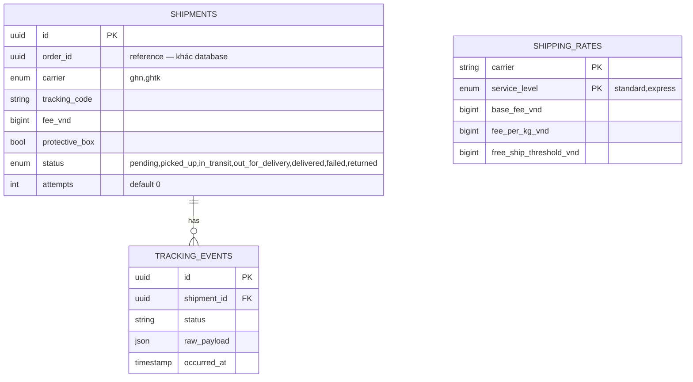

# shipping-service — Service Spec

Ngôn ngữ: Go · REST `3008` · gRPC `50058` · FR: [FR-SHIP-01..08](../10-requirements/06-shipping.md)

> **Phạm vi tenant (ADR-007/009):** `Shipment`, `ShippingRate`, `TrackingEvent` có `tenant_id` +
> RLS. Tài khoản đối tác GHN/GHTK (shop id, token) và địa chỉ lấy hàng là **theo tenant**
> (secret manager khoá theo `tenant_id`). Ngưỡng freeship (FR-SHIP-07) là `settings` theo tenant.
> Webhook tracking phân giải `tenant_id` từ mã vận đơn trước khi xử lý.

## 1. Trách nhiệm & ranh giới

- Bounded context: **Shipping**.
- Sở hữu: `Shipment`, `TrackingEvent`, biểu phí (`ShippingRate`). **Không** sở hữu địa chỉ khách
  (nhận `addressSnapshot` từ order-service trong request tạo vận đơn) hay kích thước sản phẩm
  (đọc từ `product.GetVariantsBySku`, xem [product-service.md](product-service.md)).
- FR cover: toàn bộ FR-SHIP.

## 2. API

### REST (qua Kong)

| Method | Path | Mô tả | Auth |
| --- | --- | --- | --- |
| POST | /v1/shipping/quote | Ước tính phí ship theo địa chỉ + giỏ hàng (FR-SHIP-01) | customer (dùng ở checkout) |
| GET | /v1/orders/{orderId}/shipment | Theo dõi vận đơn (FR-SHIP-05) | customer |
| POST | /v1/shipping/ghn/webhook | Webhook tracking GHN | public (whitelist IP/signature GHN) |
| POST | /v1/shipping/ghtk/webhook | Webhook tracking GHTK | public |
| GET | /v1/admin/shipments | Danh sách vận đơn, in phiếu gửi | staff, admin |

### gRPC (nội bộ)

| RPC | Request → Response | Ai gọi |
| --- | --- | --- |
| `QuoteShippingFee` | `{addressSnapshot, lines[]: {sku, qty}}` → `{options[]: {method, feeVnd, etaDays}}` | cart-service (hiển thị lựa chọn ở checkout, FR-CART-04) |
| `CreateShipment` | `{orderId, addressSnapshot, lines[], protectiveBox bool}` → `{shipmentId, trackingCode}` | order-service (saga bước 3) |
| `CreateReverseShipment` | `{returnRequestId, addressSnapshot}` → `{shipmentId, trackingCode}` | order-service (đổi trả được duyệt, FR-SHIP-06) |

### Events

| Phát (topic) | Payload | Khi nào |
| --- | --- | --- |
| `shipping.shipment_created` | `{shipmentId, orderId, carrier, trackingCode}` | Ngay sau `CreateShipment` |
| `shipment.status_changed` | `{shipmentId, orderId, status, attempt}` | Mỗi lần webhook carrier cập nhật trạng thái |

| Tiêu thụ (topic) | Xử lý | Idempotency |
| --- | --- | --- |
| — | shipping-service không tiêu thụ event của service khác (nhận lệnh qua gRPC trực tiếp) | — |

## 3. Data model

## 4. Nghiệp vụ cốt lõi

- **Tính phí** (FR-SHIP-01, gap so với FE mock — mock dùng phí cố định vì `Product`/`Variant` FE
  chưa có `weight_grams`/`box_dimensions`): tổng khối lượng đơn = Σ `weight_grams * qty`; tra
  `shipping_rates` theo carrier + service level + khối lượng; áp `free_ship_threshold_vnd` (đọc từ
  config service này sở hữu, xem [30-domain/04-data-models.md](../30-domain/04-data-models.md))
  nếu `subtotal >= threshold` thì `feeVnd = 0` cho gói `standard` (không áp cho `express`).
- **Webhook mapping** (FR-SHIP-03): mỗi carrier có bộ mã trạng thái riêng — map về enum nội bộ
  `pending|picked_up|in_transit|out_for_delivery|delivered|failed|returned` ngay tại
  `interface/event/` (adapter), domain chỉ biết enum nội bộ, không biết mã carrier gốc.
- **Giao thất bại tối đa 3 lần** (FR-SHIP-04, chưa có logic thật ở FE mock): mỗi webhook
  `status=failed` tăng `attempts`; `attempts >= 3` → `status=returned`, publish
  `shipment.status_changed{status=returned}` để order-service chuyển đơn `returned` (COD không
  ghi doanh thu).
- **Đổi trả chiều ngược** (FR-SHIP-06): `CreateReverseShipment` tạo vận đơn mới `direction=return`
  (thêm cột `direction enum(outbound,return)` vào `shipments` nếu cần phân biệt trong danh sách
  admin) — carrier tới lấy hàng tại địa chỉ khách, giao về kho shop.
- **Gói bảo vệ hộp** (FR-SHIP-08): `protectiveBox=true` cộng thêm phí cố định vào `feeVnd` lúc
  `CreateShipment`, lưu flag để nhân viên đóng gói biết cần double-box.

## 5. Config (env)

| Biến | Bắt buộc | Mặc định | Ghi chú |
| --- | --- | --- | --- |
| `DB_URL` | có | — | |
| `GHN_API_TOKEN` / `GHN_SHOP_ID` | có (bật GHN) | — | Sandbox trước |
| `GHTK_API_TOKEN` | có (bật GHTK) | — | |
| `FREE_SHIP_THRESHOLD_VND` | không | `500000` | FR-SHIP-07 — service này sở hữu khoá này |
| `MAX_DELIVERY_ATTEMPTS` | không | `3` | FR-SHIP-04 |
| `PROTECTIVE_BOX_FEE_VND` | không | `15000` | FR-SHIP-08 |

## 6. Kiểm thử

- Unit: tính phí theo khối lượng + ngưỡng freeship (table-driven), map mã trạng thái carrier →
  enum nội bộ (mọi mã đã biết của GHN/GHTK), tăng `attempts` và chuyển `returned` đúng ở lần thứ 3.
- Integration: webhook nhận trùng (idempotent theo `raw_payload` hash hoặc mã sự kiện carrier nếu
  có) không tạo `tracking_events` trùng.

## 7. Observability

- Span: `CreateShipment`, `HandleWebhook{carrier}`. Metric:
  `shipping_delivery_attempts_total{carrier}`, `shipping_returned_total{carrier}`. Log milestone:
  tạo vận đơn, chuyển `returned`.
