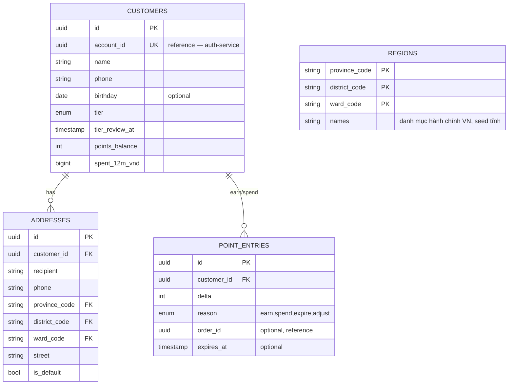

# user-service — Service Spec

Ngôn ngữ: **TypeScript/NestJS** (ADR-011 — chia sẻ concern account/tenant-membership với
tenant-service; `class-validator` cho DTO hồ sơ/địa chỉ; **không** CQRS/ES/Saga — CRUD thường) ·
REST `3002` · gRPC `50052` ·
style [coding-conventions.md](../../.claude/conventions/coding-conventions.md) ·
FR: [FR-AUTH-06..08](../10-requirements/11-auth-users.md), [FR-LOY-01..07](../10-requirements/08-loyalty.md)

> **Phạm vi tenant (ADR-007/009):** `Customer`, `Address`, `PointLedger`, `Tier` có `tenant_id` +
> RLS. Một người mua ở hai tenant có **hai hồ sơ khách, hai số dư điểm** tách biệt (credential
> chung ở auth-service, hồ sơ thì không). Tham số tích/tiêu điểm (`pointEarnRate`,
> `pointValueVnd`, `maxPointPercent`) là `settings` theo tenant. Consumer `tenant.provisioned`
> seed `settings` mặc định.

## 1. Trách nhiệm & ranh giới

- Bounded context: **Customer** ([30-domain/01-bounded-contexts.md](../30-domain/01-bounded-contexts.md)).
- Sở hữu: `Customer` (hồ sơ, tier, points_balance), `Address[]`, `PointEntry` (ledger append-only).
  **Không** sở hữu credential đăng nhập — đó là `auth-service`; `Customer.account_id` chỉ là
  tham chiếu.
- FR cover: FR-AUTH-06/07/08 (hồ sơ, địa chỉ, admin xem khách), FR-LOY-01..07 (điểm, hạng).

## 2. API

### REST (qua Kong)

| Method | Path | Mô tả | Auth |
| --- | --- | --- | --- |
| GET | /v1/me | Hồ sơ khách hiện tại (tên, tier, points, addresses) | customer |
| PATCH | /v1/me | Sửa tên/điện thoại/ngày sinh | customer |
| GET | /v1/me/addresses | Danh sách địa chỉ | customer |
| POST | /v1/me/addresses | Thêm địa chỉ (FR-AUTH-06) | customer |
| PATCH | /v1/me/addresses/{id} | Sửa địa chỉ | customer |
| DELETE | /v1/me/addresses/{id} | Xoá địa chỉ | customer |
| POST | /v1/me/addresses/{id}/default | Đặt làm mặc định | customer |
| GET | /v1/me/points | Lịch sử điểm (FR-LOY-04) | customer |
| GET | /v1/admin/customers | Danh sách khách, lọc tên/hạng (FR-AUTH-08) | admin, staff |
| GET | /v1/admin/customers/{id} | Chi tiết khách + lịch sử mua (gọi order-service) | admin, staff |
| POST | /v1/admin/customers/{id}/lock | Khoá/mở khoá tài khoản (gọi auth-service) | admin |
| POST | /v1/admin/customers/{id}/points-adjustment | Cộng/trừ điểm thủ công kèm lý do (FR-LOY-06) | admin |
| GET | /v1/admin/regions | Danh mục tỉnh/quận/phường chuẩn hoá (FR-AUTH-06) | public |

### gRPC (nội bộ)

| RPC | Request → Response | Ai gọi |
| --- | --- | --- |
| `GetTier` | `{customerId}` → `{tier, earlyAccessMinutes}` | promotion-service (`CheckDropEligibility`, [05-key-flows.md](../20-architecture/05-key-flows.md) mục 2) |
| `GetPointsBalance` | `{customerId}` → `{balance}` | cart-service (hiển thị điểm khả dụng ở checkout) |
| `ReservePoints` / `CommitPointsSpend` / `ReleasePoints` | `{customerId, points, refId}` → `{}` | order-service (FR-CART-07, giữ điểm trong lúc checkout tương tự reservation tồn kho) |
| `EarnPoints` | `{customerId, orderId, subtotalVnd}` → `{pointsEarned}` | order-service (khi `order.completed`, hoặc consume event trực tiếp — xem mục 4) |

### Events

| Phát (topic) | Payload | Khi nào |
| --- | --- | --- |
| `customer.tier_changed` | `{customerId, oldTier, newTier}` | Job xét hạng lại hằng ngày đổi tier |
| `customer.points_earned` / `customer.points_adjusted` | `{customerId, delta, reason}` | Sau mỗi thay đổi điểm |

| Tiêu thụ (topic) | Xử lý | Idempotency |
| --- | --- | --- |
| `auth.account_registered` | Tạo `Customer` mới ứng với `accountId` (tier=standard, points=0) | Unique constraint `customers.account_id` |
| `order.completed` | Cộng điểm theo `tierMeta` multiplier, cộng `spent12m` | Lưu `processed_events(eventId)`, bỏ qua nếu đã xử lý |
| `order.cancelled` / `order.returned` | Trừ lại điểm đã cộng cho đơn đó (nếu đã `completed` trước khi huỷ/trả) | Idem theo `eventId` |

## 3. Data model

Index: `point_entries(customer_id, created_at)` cho lịch sử; `point_entries(customer_id,
expires_at) WHERE reason='earn'` cho job hết hạn điểm FIFO.

## 4. Nghiệp vụ cốt lõi

- **Tích điểm (FR-LOY-01)**: `points = floor((subtotal - discount) / pointEarnRate * tierMultiplier)`
  — `pointEarnRate = 10_000`, multiplier Standard `1`/Silver `1.2`/Gold `1.5`/Collector `2` (đã
  đồng bộ với FE mock, xem ghi chú trong [08-loyalty.md](../10-requirements/08-loyalty.md)).
- **Xét hạng lại (FR-LOY-02 — gap thật so với FE mock, phải cài đúng ở đây)**: job chạy hằng ngày,
  tính tổng `subtotal - discount` của mọi đơn `completed` trong 12 tháng gần nhất (rolling window,
  không phải cộng dồn vô hạn), so ngưỡng Silver `5tr`/Gold `12tr`/Collector `20tr`; **lên hạng
  ngay**, **rớt hạng chỉ có hiệu lực đầu chu kỳ 12 tháng kế tiếp** (lưu `tier_review_at` để biết
  khi nào áp dụng rớt hạng) — publish `customer.tier_changed`.
- **Tiêu điểm (FR-LOY-03)**: `1 điểm = 100đ`, tối đa 50% giá trị đơn sau giảm giá voucher; giữ
  bằng `ReservePoints` lúc checkout (tương tự reservation tồn kho — tránh double-spend nếu khách
  mở hai tab), `CommitPointsSpend` khi đơn xác nhận, `ReleasePoints` khi checkout huỷ/hết hạn.
- **Hết hạn điểm**: FIFO theo `point_entries.expires_at` (12 tháng kể từ lúc `earn`) — job quét
  hằng ngày, sinh `point_entries` mới `reason=expire` (không xoá dòng cũ, ledger append-only).
- **Địa chỉ**: `is_default` chỉ một địa chỉ/khách — set default thì bỏ default của địa chỉ khác
  trong cùng transaction. `province_code/district_code/ward_code` validate theo bảng `regions`.

## 5. Config (env)

| Biến | Bắt buộc | Mặc định | Ghi chú |
| --- | --- | --- | --- |
| `DB_URL` | có | — | |
| `POINT_EARN_RATE_VND` | không | `10000` | FR-LOY-01 |
| `POINT_VALUE_VND` | không | `100` | FR-LOY-03 |
| `MAX_POINT_REDEEM_PERCENT` | không | `50` | FR-LOY-03 |
| `TIER_THRESHOLDS_VND` | không | `5000000,12000000,20000000` | Silver,Gold,Collector |
| `TIER_MULTIPLIERS` | không | `1,1.2,1.5,2` | Standard,Silver,Gold,Collector |
| `POINTS_EXPIRY_MONTHS` | không | `12` | |

## 6. Kiểm thử

- Unit: công thức tích/tiêu điểm, invariant xét hạng (lên ngay/rớt trễ chu kỳ), FIFO hết hạn điểm,
  ràng buộc `is_default` duy nhất.
- Integration: consumer `order.completed` idempotent khi nhận trùng event; job xét hạng chạy trên
  dataset seed nhiều mốc chi tiêu.

## 7. Observability

- Span: `EarnPoints`, `RecalculateTier` (batch). Metric: `user_tier_changes_total{from,to}`,
  `user_points_expired_total`. Log milestone: đổi hạng, admin điều chỉnh điểm (kèm actor + lý do,
  không log PII thừa).
