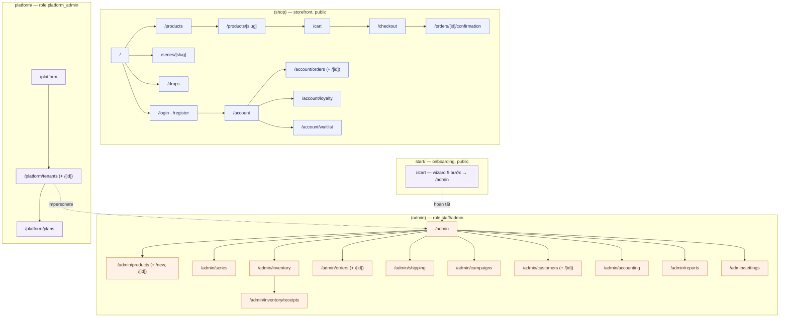

# Sitemap — Storefront, Admin & Platform

Một Next.js App Router app: route group `(shop)` cho storefront, segment `admin/` cho `/admin/*`
(tenant), segment `platform/` cho `/platform/*` (nền tảng), segment `start/` cho wizard onboarding.
Dữ liệu từ tầng mock repository (ADR-006) — các zone chia sẻ cùng store.

**Đa tenant (ADR-007):** storefront + admin hoạt động trong phạm vi một tenant (`currentTenant`):
tenant của user đang đăng nhập, hoặc tenant đang được Platform Operator *impersonate*, mặc định
là tenant tham chiếu **VICI Saigon**. Dữ liệu nghiệp vụ mock (catalog, đơn, kho…) thuộc tenant
tham chiếu — tenant mới tạo qua `/start` bắt đầu ở trạng thái trống về nghiệp vụ.

## Storefront `(shop)`

| Route | Trang | Nội dung chính |
| --- | --- | --- |
| `/` | Trang chủ | Hero, drop đang/sắp diễn ra (đếm ngược), hàng mới, series nổi bật, flash sale |
| `/products` | Cửa hàng | Chip lọc hãng + loại, toggle "chỉ hàng có sẵn", sort, search từ header |
| `/products/[slug]` | Chi tiết sản phẩm | Gallery, variant, giá, blind-box lineup + tỉ lệ secret, trạng thái drop/pre-order, giới hạn mua, review, sản phẩm cùng series |
| `/series/[slug]` | Trang series blind box | Lineup đầy đủ, tỉ lệ, mua 1 hộp / nguyên set |
| `/drops` | Lịch drop | Đang mở / sắp mở (đếm ngược + nút nhắc) / đã kết thúc |
| `/cart` | Giỏ hàng | Item, khả dụng realtime, ràng buộc drop, tổng tạm tính |
| `/checkout` | Checkout | 4 bước: địa chỉ → vận chuyển → thanh toán → xem lại; đồng hồ giữ hàng; voucher + điểm |
| `/orders/[id]/confirmation` | Xác nhận đơn | Điểm sẽ tích + lộ trình hạng; blind box có nghi thức "lắc hộp" 3 bước; pre-order có mini progress Cọc → Chờ hàng → Trả nốt → Giao |
| `/account` | Tài khoản | Hồ sơ, địa chỉ |
| `/account/orders` (+`/[id]`) | Đơn của tôi | Danh sách + chi tiết, timeline vận chuyển, tiến độ pre-order, nút huỷ/đổi trả |
| `/account/loyalty` | Điểm & hạng | Số dư điểm, lịch sử, tiến độ lên hạng, quyền lợi |
| `/account/waitlist` | Waitlist | Các mục đã đăng ký nhận thông báo |
| `/login`, `/register` | Auth | Màn gộp 2 tab Đăng nhập/Đăng ký + social (mock) + persona demo (khách/staff/admin) |

## Admin `(admin)` — yêu cầu role `staff`/`admin`

| Route | Trang | Nội dung chính |
| --- | --- | --- |
| `/admin` | Dashboard | KPI (doanh thu, đơn chờ, sắp hết hàng, drop sắp tới), biểu đồ doanh thu 30 ngày, đơn mới nhất |
| `/admin/products` (+`/new`, `/[id]`) | Sản phẩm | DataTable + CRUD, trạng thái draft/active/archived |
| `/admin/series` | Series & blind box | Lineup editor (dialog): figure, tỉ lệ, secret |
| `/admin/inventory` | Tồn kho | Stock theo SKU + thanh mức độ, cảnh báo, panel điều chỉnh inline có lý do bắt buộc |
| `/admin/inventory/receipts` | Phiếu nhập | Form tạo phiếu inline (NCC + dòng SKU + giá vốn) + danh sách phiếu gần đây |
| `/admin/orders` (+`/[id]`) | Đơn hàng | Filter theo trạng thái/loại, chi tiết + timeline, chuyển trạng thái hợp lệ, đổi trả |
| `/admin/shipping` | Giao vận | Kanban 4 cột: chờ lấy hàng / đang giao / giao lỗi / đã giao, kèm cảnh báo phát lỗi |
| `/admin/campaigns` | Chiến dịch | Tab: Voucher / Flash sale / **Drop scheduler** (form + preview storefront) / Pre-order |
| `/admin/customers` (+`/[id]`) | Khách hàng | Danh sách + hạng, chi tiết lịch sử mua, điều chỉnh điểm có lý do, khoá tài khoản |
| `/admin/accounting` | Sổ sách | KPI thu/chi/lãi, P&L 30 ngày, sổ cái, chi phí + form ghi chi phí luôn hiện |
| `/admin/reports` | Báo cáo | Doanh thu theo ngày (7/30/90), lưới 2×2: bán chạy / tồn chậm / phân khúc khách / hiệu quả campaign |
| `/admin/settings` | Cài đặt | 3 tab: **Cửa hàng & thương hiệu** (tên, logo, màu nhấn, subdomain, tên miền riêng), **Gói dịch vụ** (gói hiện tại + lượng dùng vs hạn mức + đổi gói), **Vận hành** (freeship, TTL giữ hàng, tích điểm — theo tenant) |

## Onboarding `start/` — công khai

| Route | Trang | Nội dung chính |
| --- | --- | --- |
| `/start` | Mở cửa hàng (wizard 5 bước) | 1 Cửa hàng (tên, slogan, chủ shop) · 2 Địa chỉ web `{sub}.vici.shop` + kiểm trùng + logo + màu nhấn · 3 Chọn gói · 4 Seed dữ liệu mẫu · 5 Provisioning (stepper saga chạy) → "Vào trang quản trị" |

## Platform Console `platform/` — role `platform_admin`

| Route | Trang | Nội dung chính |
| --- | --- | --- |
| `/platform` | Tổng quan | KPI (tổng tenant, active, tạm ngưng/quá hạn, MRR, đang provisioning), đăng ký gần đây |
| `/platform/tenants` | Cửa hàng | Bảng tenant lọc theo trạng thái + tìm; cột địa chỉ web, chủ shop, gói, MRR, lượng dùng, trạng thái |
| `/platform/tenants/[id]` | Chi tiết tenant | Trạng thái + hành động vòng đời (tạm ngưng/khôi phục/lưu trữ), **impersonate** (mở `/admin`), gói + lượng dùng (bar), checklist provisioning |
| `/platform/plans` | Gói dịch vụ | Card 3 gói (hạn mức + tính năng + giá), số shop mỗi gói |

## Điều hướng & guard

- Storefront: header (logo + tên tenant, search, Drops, Series, giỏ + đếm), footer (Admin /
  Mở cửa hàng / Platform); nếu tenant `suspended`/`archived` → trang "cửa hàng tạm ngưng".
- Admin: `AdminShell` sidebar cố định nhóm theo nghiệp vụ; topbar có **chip tenant hiện tại**;
  khi Operator impersonate có **banner "Đang xem với tư cách {tenant} — Thoát"**. Guard mock theo
  role (`admin`/`staff`/`tenant_admin`, hoặc `platform_admin` khi đang impersonate).
- Platform: shell riêng, accent `viol`, guard `platform_admin`. Login giả cho phép chuyển nhanh
  persona (thêm **Ngân — Platform Operator**).
