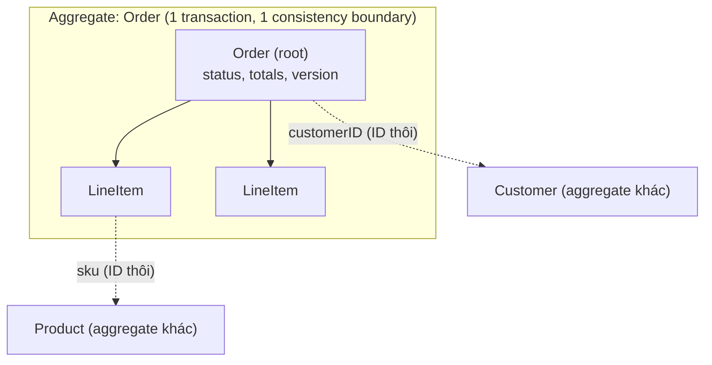
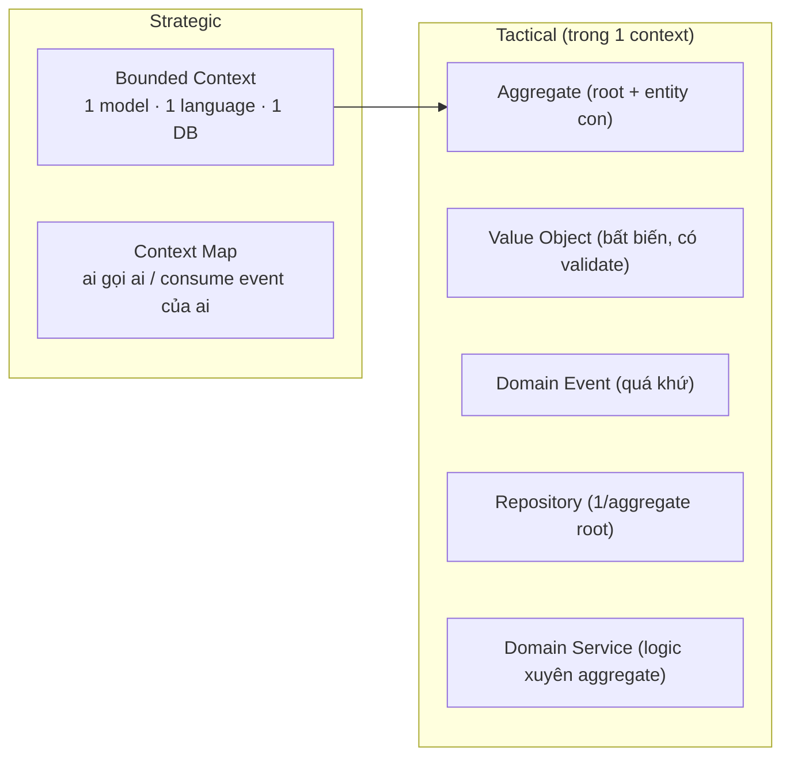

# DDD — Cơ chế

## 1. Tìm bounded context

Không có công thức tự động; đây là các tín hiệu để **đặt đường biên**:

1. **Ngôn ngữ đổi nghĩa.** Cùng một từ mà hai nhóm hiểu khác nhau → hai context. "Product"
   với người làm catalog là mô tả + variant + ảnh; với inventory chỉ là một `sku` có số lượng.
2. **Nhịp thay đổi khác nhau.** Catalog đổi hằng ngày (thêm sản phẩm), sổ cái kế toán gần như
   không đổi quy tắc. Ghép chung → mỗi lần đổi catalog phải regression cả kế toán.
3. **Đội sở hữu khác nhau / tải khác nhau.** Drop là điểm nóng concurrency; tách Promotion ra
   để scale riêng mà không kéo theo phần còn lại.
4. **Consistency requirement khác nhau.** Trừ tồn kho phải atomic *ngay*; cộng điểm thưởng thì
   eventual (vài giây sau) là chấp nhận được → khác context, nối bằng event.

> Hệ quả production: đặt biên sai kiểu "quá mịn" → một thao tác nghiệp vụ phải gọi 5 service
> đồng bộ, P99 xấu và một service chết là cả luồng chết. "Quá thô" → deploy một tính năng nhỏ
> phải build lại khối to, và một bug làm sập nhiều nghiệp vụ.

## 2. Context map — quan hệ giữa context

Các kiểu quan hệ hay gặp:

- **Customer/Supplier**: downstream phụ thuộc upstream; upstream có nghĩa vụ giữ contract ổn định.
- **Conformist**: downstream chấp nhận nguyên model của upstream (không đủ sức thương lượng).
- **Anti-corruption layer**: downstream dựng một lớp dịch để model bẩn của upstream không lọt
  vào domain của mình — dùng khi tích hợp hệ thống ngoài (VNPay, GHN).
- **Published language**: hai bên thống nhất một schema trung lập (với Vici: proto + Avro).

## 3. Thiết kế aggregate — các quy tắc

1. **Bảo vệ invariant, không phải "gom cho tiện".** Aggregate chứa đúng những gì phải nhất quán
   *trong cùng một transaction*. `Order` + `LineItem` cùng aggregate vì tổng tiền phải khớp
   dòng. `Order` và `Customer` **không** — điểm thưởng của customer không cần nhất quán tức thì
   với việc đặt đơn.
2. **Tham chiếu aggregate khác bằng ID, không bằng object.** `Order` giữ `customerID`, không
   giữ con trỏ `*Customer`. Ngăn việc vô tình load + sửa hai aggregate trong một transaction.
3. **Một transaction chỉ sửa một aggregate instance.** Cần đổi nhiều → phát event, aggregate
   kia phản ứng sau (eventual consistency). Đây là nền của Saga và Outbox.
4. **Aggregate nhỏ.** To thì: (a) contention khi nhiều request cùng sửa, (b) load chậm, (c)
   optimistic-lock conflict nhiều. Nghi ngờ thì chẻ nhỏ.
5. **Chỉ root có repository.** `Address` load/save qua `Customer`, không có `AddressRepository`.

## 4. Value Object — vì sao đáng công

VO thay cho "primitive obsession" (`amount float64`, `userID string` khắp nơi):

- **Validation một chỗ.** `NewMoney(-1, "VND")` trả lỗi; không thể tạo `Money` âm. Không cần
  check `if amount < 0` rải rác.
- **Chống nhầm loại ID.** `TenantId` và `CustomerId` đều là UUID nhưng khác type → compiler
  chặn khi truyền nhầm. Với hệ đa tenant, nhầm ID = rò rỉ dữ liệu.
- **Mang ý nghĩa + đơn vị.** `Money{amount int64 /* cents */}` nói rõ đơn vị; `float` không.

> Hệ quả production: bug tiền tệ do float, hoặc bug bảo mật do nhầm ID tenant, là loại bug đắt
> nhất — mất tiền thật hoặc lộ dữ liệu khách. VO đẩy loại bug này về *compile time*.

## 5. Domain event — sự thật đã xảy ra

- Đặt tên **quá khứ**: `OrderPlaced`, `StockReserved`, `TenantSuspended`. Không phải mệnh lệnh
  (`PlaceOrder` là command).
- Bất biến. Chứa **snapshot** dữ liệu cần thiết tại thời điểm đó (tên sản phẩm, giá) — consumer
  không được giả định aggidx gốc còn tồn tại nguyên trạng.
- Aggregate *tạo ra* event; **infrastructure** publish qua Outbox (xem thư mục `06-outbox`).
  Không publish inline trong domain.

## Tóm tắt để ôn nhanh

> 🗣️ Nói thành lời: "Tôi tìm bounded context bằng bốn tín hiệu: ngôn ngữ đổi nghĩa, nhịp thay
> đổi khác, đội/tải khác, và consistency requirement khác. Trong một context, tôi thiết kế
> aggregate quanh invariant chứ không gom cho tiện — aggregate nhỏ, tham chiếu aggregate khác
> bằng ID, một transaction chỉ đụng một instance. Muốn đổi nhiều aggregate thì phát domain
> event và để bên kia phản ứng sau — đó là lý do có Outbox và Saga."
