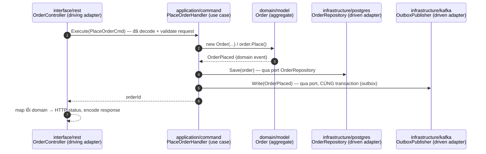
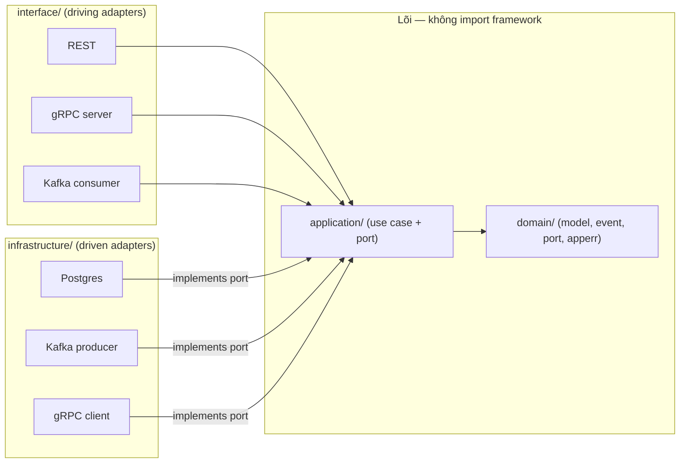

# Hexagonal — Cơ chế

## 1. Bốn lớp và hướng phụ thuộc

| Lớp | Chứa gì | Được import gì |
| --- | --- | --- |
| `domain/` | Aggregate, entity, value object, domain event, **driven port** (interface), typed error | Chỉ standard library |
| `application/` | Use case (command/query handler), DTO, đôi khi thêm port | Chỉ `domain/` |
| `infrastructure/` | Adapter driven: Postgres repo, Redis, Kafka producer/consumer, gRPC client, config (`os.Getenv`) | `domain/`, `application/`, framework/SDK |
| `interface/` | Adapter driving: REST handler, gRPC server, Kafka consumer handler | `application/`, `domain/`, framework |

Mũi tên phụ thuộc: `interface → application → domain ← infrastructure`. Domain là đáy, không
trỏ ra ngoài.

> Hệ quả production: vì `domain/` + `application/` không import I/O, **unit test của chúng chạy
> mili-giây, không cần Docker** → CI nhanh, dev chạy test liên tục khi code. Đây là điều kiện để
> "mọi thay đổi hành vi kèm test" khả thi (Article VI của CONSTITUTION).

## 2. Ai định nghĩa port — phía *tiêu thụ*

Nguyên tắc: **interface được định nghĩa ở nơi nó được dùng, không phải nơi nó được implement.**

- `application/command/place_order` cần lưu Order → nó (hoặc `domain/port`) khai báo
  `type OrderRepository interface { Save(ctx, *Order) error; ... }`.
- `infrastructure/postgres` *implement* interface đó. Postgres package **import** domain, không
  phải ngược lại.

Hệ quả: `domain/` khai báo cái nó *cần* bằng ngôn ngữ của mình (`FindByID`, không `SELECT`).
Nếu port trông giống API của một thư viện cụ thể (`Query(sql string)`) → định nghĩa sai phía.

## 3. "Accept interfaces, return structs"

Hàm nhận **interface hẹp nhất** nó cần (dễ fake trong test), trả về **struct cụ thể**. Ưu tiên
interface một method kiểu `-er` (`StockReserver`), interface nhiều method chỉ khi mô tả một vai
trò (`OrderRepository`).

## 4. Wiring — nơi duy nhất biết mọi thứ

Composition root ráp adapter cụ thể vào use case:

- **Go**: `cmd/server/main.go`, constructor injection thủ công, **không** DI container, **không**
  global var, **không** `init()` có side effect.

  ```go
  db := postgres.Connect(cfg.DBURL)
  repo := postgres.NewOrderRepository(db)        // implement domain port
  pub  := kafka.NewOutboxPublisher(db, brokers) // implement domain port
  h    := command.NewPlaceOrderHandler(repo, pub)
  srv  := grpcserver.New(h)                     // driving adapter
  ```

- **NestJS** (auth, user, order, tenant, billing): file module bind token → class:
  `{ provide: ORDER_REPOSITORY, useClass: PostgresOrderRepository }`. Handler inject **token +
  interface**, không `new` adapter, không import class infrastructure.

## 5. Luồng một request (order-service, ví dụ)



Controller **mỏng**: decode + validate → gọi đúng một use case → map kết quả. Không có business
logic trong controller. Map lỗi domain → status code xảy ra ở `interface/`, domain không import
`net/http` hay `grpc/codes`.

## 6. Biến thể & nhầm lẫn thường gặp

- **Hexagonal vs Layered**: layered là "trên gọi dưới"; hexagonal là "ngoài phụ thuộc trong,
  qua interface". Điểm khác then chốt: ai sở hữu interface repository — layered thường để ở
  tầng data, hexagonal để ở tầng dùng.
- **Hexagonal vs Onion vs Clean**: gần như cùng một ý (dependency rule hướng tâm). Hexagonal
  nhấn "port/adapter" và "nhiều loại cổng ngang hàng".
- **Application layer có bắt buộc không?** Với use case đơn giản, một số team gộp vào domain.
  Vici tách rõ vì có CQRS (command/query folder riêng) và saga.

## Tóm tắt để ôn nhanh



> 🗣️ Nói thành lời: "Bốn thư mục: domain chỉ stdlib, application chỉ phụ thuộc domain,
> infrastructure và interface phụ thuộc vào trong. Port là interface do phía tiêu thụ định
> nghĩa — application nói `OrderRepository`, Postgres package implement nó và import domain chứ
> không ngược lại. Wiring nằm một chỗ: `main.go` với Go, module file với Nest. Controller mỏng,
> chỉ decode–gọi use case–map lỗi."
