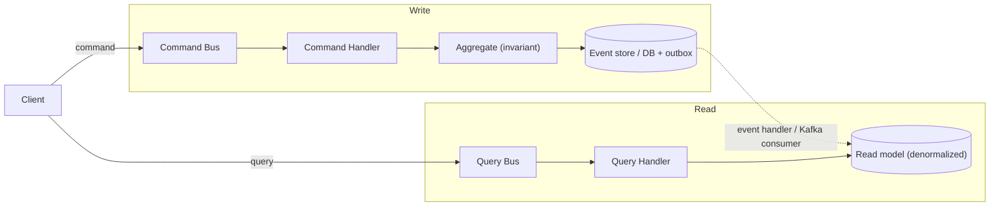

# CQRS — Cơ chế

## 1. Đường command

1. `interface/` nhận request (REST/gRPC), decode + validate cú pháp, dựng một **command object**
   (`PlaceOrderCommand{ tenantID, customerID, lines }`).
2. Gửi vào **command bus** (`@nestjs/cqrs` `CommandBus.execute(cmd)`), bus định tuyến tới đúng
   một **command handler**.
3. Handler: load aggregate (từ repository hoặc replay event stream nếu ES), gọi method domain
   (`order.Place()`), aggregate kiểm invariant + trả **domain event**.
4. Handler lưu: append event (ES) hoặc `repo.Save(aggregate)` (CRUD), **cùng transaction** ghi
   vào `outbox`.
5. Trả về tối thiểu: `orderId` hoặc void. **Không** trả DTO để hiển thị.

> Hệ quả production: command handler nhỏ, khoá ít, transaction ngắn → throughput ghi cao, ít
> lock contention lúc drop.

## 2. Đường query

1. `interface/` dựng **query object** (`GetOrderQuery{ tenantID, orderID }`).
2. **Query bus** định tuyến tới **query handler**.
3. Handler đọc thẳng từ **read model** (một hoặc vài bảng denormalized), map sang DTO, trả về.
4. **Không** load aggregate, **không** transaction ghi, **không** side effect.

Read model được thiết kế theo **truy vấn**, không theo domain: nếu màn "chi tiết đơn" cần tên
sản phẩm + trạng thái ship + timeline, thì bảng `order_read_model` chứa sẵn cả ba (đã join/tính
lúc ghi), query chỉ `SELECT ... WHERE id = ?`.

## 3. Projection cập nhật thế nào

Ba kiểu, từ đơn giản đến mạnh:

| Kiểu | Cách làm | Consistency | Khi nào |
| --- | --- | --- | --- |
| **Inline, cùng transaction** | Command handler ghi cả aggregate lẫn read model trong 1 transaction | Strong (đọc thấy ngay) | Read model đơn giản, cùng DB, cùng service |
| **Event handler nội bộ** | Aggregate phát event → handler trong cùng service update read model | Eventual, thường < vài ms | ES; read model phức tạp hơn |
| **Consume event từ service khác** | Kafka event → consumer → update read model của mình | Eventual, ms–giây | Read model cần dữ liệu chéo context (finance MRR cần cả billing lẫn order) |

## 4. Consistency giữa write và read

Với projection bất đồng bộ, có **cửa sổ** giữa "ghi xong" và "read model bắt kịp". Xử lý:

- **Chấp nhận + UI lạc quan**: sau khi POST, FE hiển thị luôn từ dữ liệu client có, không đợi
  refetch. (Mock của Vici làm đúng vậy — `store.ts` clone → sửa → notify.)
- **Đọc từ write side cho ngay-sau-khi-ghi**: query "đơn tôi vừa tạo" có thể đọc aggregate trực
  tiếp; các query list thì đọc projection.
- **Version/etag**: trả version của read model, client biết mình đang xem bản cũ.

> Hệ quả production: quên cửa sổ này → bug "tạo xong không thấy trong danh sách", support ticket.
> Phải quyết định *có chủ đích* mỗi query là strong hay eventual.

## 5. Biến thể

- **CQRS một store, một model đọc denormalized**: nhẹ nhất; projection là vài bảng/materialized
  view trong cùng Postgres. Đây là mặc định nên bắt đầu.
- **CQRS + read store riêng** (Elasticsearch cho search, Redis cho counter): khi query có yêu
  cầu store-chuyên-dụng. Vici cố ý **không** làm (ADR-003) — Postgres full-text đủ.
- **CQRS + Event Sourcing**: write side là event store; projection replay từ event. Xem
  [`04-event-sourcing`](../04-event-sourcing/README.md).

## Tóm tắt để ôn nhanh

> 🗣️ Nói thành lời: "Đường command dựng command object, đẩy qua command bus tới handler; handler
> load aggregate, gọi method domain, append/save cùng transaction với outbox, trả về id thôi.
> Đường query đọc thẳng read model đã denormalize theo màn hình, không đụng aggregate. Điểm phải
> chú ý là độ trễ projection — tôi quyết định từng query là strong hay eventual, và với eventual
> thì UI lạc quan hoặc cho query 'cái tôi vừa tạo' đọc write side."
