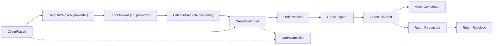

# Event Sourcing — Áp dụng trong Vici

Nguồn chuẩn: [`40-services/order-service.md`](../../40-services/order-service.md) §3,
[`30-domain/02-order-lifecycle.md`](../../30-domain/02-order-lifecycle.md),
[`30-domain/04-data-models.md`](../../30-domain/04-data-models.md) (mục "Ordering").

## `Order` là aggregate event-sourced duy nhất (nghiệp vụ)

Từ [`04-data-models.md`](../../30-domain/04-data-models.md): *"`Order` là aggregate
**event-sourced** — bảng ER là hình chiếu (projection) đọc được từ chuỗi event, không phải nguồn
sự thật."*

Chuỗi event vòng đời đơn (từ [`04-data-models.md`](../../30-domain/04-data-models.md)):



State machine + các bước hợp lệ: [`02-order-lifecycle.md`](../../30-domain/02-order-lifecycle.md);
map nhãn trạng thái ↔ màu ở `frontend/src/lib/labels.ts` (`orderStatusMeta`, `orderTransitions`).

## Đa tenant: stream id = `(tenant_id, order_id)`

Từ [`order-service.md`](../../40-services/order-service.md) mục "Phạm vi tenant": *mỗi event
trong event store mang `tenant_id`; stream id = `(tenant_id, order_id)`; projection + outbox
scoped RLS.* Mã đơn (`VC-1001`) chỉ unique **trong một tenant**.

Xem [`knowledge/10-multi-tenancy-rls`](../10-multi-tenancy-rls/README.md) và
[ADR-009](../../20-architecture/adrs/ADR-009-tenant-context-propagation.md): consumer đọc header
Kafka `tenant-id` → `SET app.tenant_id` trước khi ghi projection.

## Optimistic concurrency

Từ [`04-data-models.md`](../../30-domain/04-data-models.md) (ER Ordering): `ORDER` có cột
`version "optimistic concurrency"`. Từ ADR-002: *"event store trên PostgreSQL, optimistic
concurrency bằng cột `version`"*.

## Layout (NestJS, `order-service`)

```
src/domain/model/order.ts          # aggregate: command method + apply(event)
src/domain/event/                  # OrderPlaced, DepositPaid, ... (struct/class)
src/infrastructure/persistence/
├── order-event-store.ts           # append + optimistic concurrency + outbox (1 transaction)
└── order-read-model.repo.ts       # projection cho query
src/application/
├── command/                       # PlaceOrder, CancelOrder, PayBalance...
├── query/                         # GetOrder, ListUserOrders (đọc read model)
└── saga/checkout.saga.ts          # process manager (xem knowledge/05-saga)
```

Sketch 4 lớp đầy đủ: [`03-clean-architecture-ddd.md`](../../20-architecture/03-clean-architecture-ddd.md) §3.

## Chỗ Vici **KHÔNG** dùng ES (quan trọng)

- **`inventory-service`**: có `stock_movement` (append-only audit log) nhưng state là
  `stock_item` cập nhật bằng `UPDATE ... WHERE on_hand - reserved >= $qty`. Đây là **CRUD +
  log**, không phải Event Sourcing. Đừng nhầm.
- **`finance-service`**: sổ cái `JournalEntry` append-only, bút toán không sửa/xoá (NFR-04) —
  gần tinh thần ES nhưng không replay để dựng state; đây là **immutable ledger**.
- **`tenant-service`**: event store cho **lịch sử vòng đời** tenant + `impersonation_audit`
  (append-only), nhưng `Tenant` state đơn giản, không nhất thiết rehydrate bằng replay — quyết
  định khi code (spec [`tenant-service.md`](../../40-services/tenant-service.md) §3 để mở).
- **8 service Go + `auth-service` + `user-service`** (NestJS, ADR-011): repository + CRUD thường,
  không event store.

## Đọc tiếp

- Query từ projection → [`03-cqrs`](../03-cqrs/README.md)
- Publish event ra Kafka an toàn → [`06-outbox`](../06-outbox/README.md)
- Điều phối checkout đa bước → [`05-saga`](../05-saga/README.md)
- Schema evolution của event trên Kafka → [`07-event-driven-kafka`](../07-event-driven-kafka/README.md)
