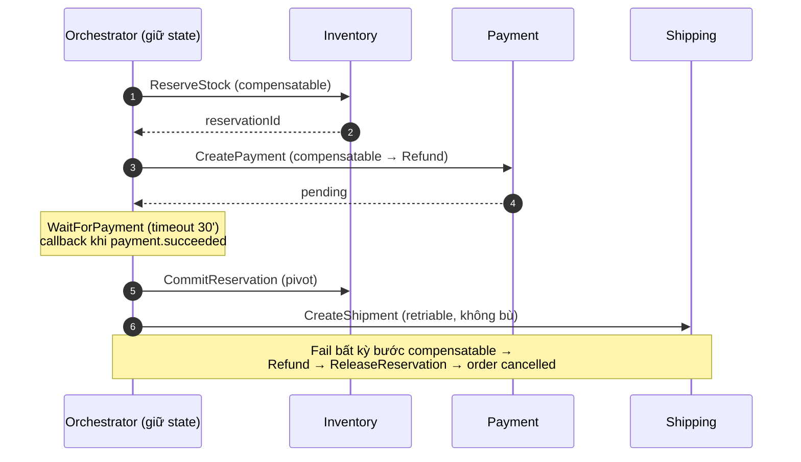

# Saga — Cơ chế

## 1. Cấu trúc một saga

- Danh sách **bước (step)** theo thứ tự, mỗi bước:
  - *forward action*: gọi một service (gRPC / command / Lambda invoke), chờ kết quả.
  - *compensation*: hành động đảo, chạy khi một bước **sau** thất bại.
- **State của saga**: đang ở bước nào, bước nào đã xong, dữ liệu tích luỹ (reservationId,
  paymentRef). Orchestrator lưu state này (bảng, event store, hoặc engine như Step Functions).

## 2. Luồng chạy (happy + fail)

```
for step in steps:
    result = step.forward()
    if result.ok:
        saga.mark(step, done); saga.persist()
    else:
        for done_step in reverse(saga.done_steps):
            done_step.compensate()      # lùi theo THỨ TỰ NGƯỢC
        saga.mark_failed(); return
saga.mark_completed()
```

Điểm mấu chốt: compensation chạy **theo thứ tự ngược** với forward. Nếu forward là
Reserve → Charge → Ship, thì bù là (Ship đã xong?) → Refund → Release.

## 3. Bước không compensation được — "pivot step"

Chia saga thành hai vùng:

- **Compensatable steps** (trước pivot): mọi bước đều có hành động đảo.
- **Pivot step**: bước mà sau nó, không quay lại được nữa (vd. "hàng đã giao cho shipper").
- **Retriable steps** (sau pivot): không bù, chỉ **retry tới khi thành công** (vd. gửi email
  xác nhận, cộng điểm).

Thiết kế: đặt bước dễ fail + bù được **trước**, bước không đảo được **sau**. `ChargePayment`
(bù được: refund) trước `CreateShipment`. Việc "gửi hàng thật" là sau cùng.

> Hệ quả production: nếu lỡ đặt bước không-đảo trước bước hay-fail, bạn kẹt ở trạng thái không
> nhất quán không xử lý tự động được → phải can thiệp tay, on-call bị gọi.

## 4. Chờ kết quả bất đồng bộ

Nhiều bước không trả lời ngay: `CreatePayment` trả `payUrl`, khách thanh toán sau, IPN về qua
Kafka `payment.succeeded`. Saga phải **tạm dừng và chờ**:

- **`@nestjs/cqrs` Saga**: lắng nghe event `PaymentSucceeded` để tiếp bước sau.
- **Step Functions**: task với **callback task token** — bước "WaitForPayment" giữ token; khi
  event về, một Lambda gọi `SendTaskSuccess(token)` để saga đi tiếp. Kèm `TimeoutSeconds`.

Luôn có **timeout**: chờ thanh toán 30' không thấy → `payment.expired` → compensation.

## 5. Idempotency — bắt buộc

Message delivery là at-least-once; saga có thể retry một bước. Mỗi forward action + mỗi
compensation phải **idempotent**:

- `ReserveStock(orderId)` gọi hai lần → chỉ giữ một reservation (key theo `orderId`).
- `Refund(paymentId)` gọi hai lần → chỉ hoàn một lần.
- Cách làm: service nhận `Idempotency-Key` (hoặc dùng `orderId`/`sagaId` làm khoá), lưu kết quả,
  request lặp trả kết quả cũ.

## 6. Semantic lock thay cho khoá DB

Trong lúc saga chạy (đã trừ tồn nhưng chưa charge), dữ liệu ở trạng thái "chưa chốt". Đánh dấu
bằng **semantic lock**: `reservation.status = 'held'`, `order.status = 'pending_payment'`. Các
thao tác khác thấy trạng thái này và xử lý phù hợp (không cho sửa, hoặc coi như đã bán). Khi
saga xong: `held → committed`; khi bù: `held → released`.

## 7. Retry & backoff

- Bước fail do lỗi **tạm thời** (timeout, 503) → retry với exponential backoff, giới hạn số lần.
- Bước fail do lỗi **nghiệp vụ** (`INSUFFICIENT_STOCK`) → **không retry**, đi thẳng compensation.
- Phân biệt hai loại lỗi này ở contract (mã lỗi domain vs lỗi hạ tầng).

## Tóm tắt để ôn nhanh



> 🗣️ Nói thành lời: "Saga chạy các bước tuần tự, mỗi bước lưu state. Bước fail thì compensation
> chạy theo thứ tự ngược. Tôi chia saga thành vùng compensatable trước pivot và vùng retriable
> sau pivot, và đặt bước không đảo được ở cuối. Mọi bước và mọi compensation phải idempotent vì
> delivery là at-least-once. Bước chờ async như thanh toán thì dùng callback token có timeout.
> Lỗi tạm thời thì retry backoff, lỗi nghiệp vụ thì đi thẳng compensation."
