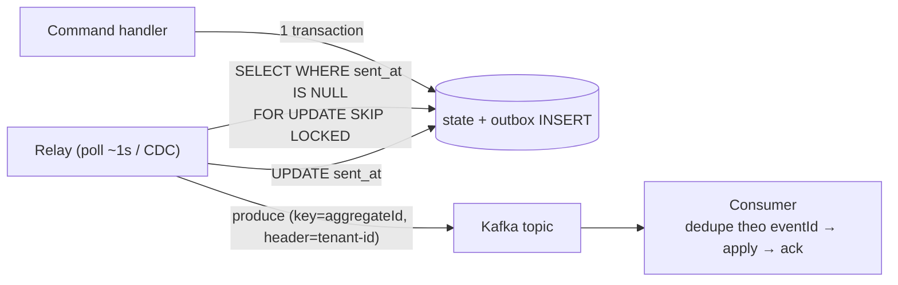

# Outbox — Cơ chế

## 1. Bảng outbox

| Cột | Vai trò |
| --- | --- |
| `id` (bigserial) | Thứ tự ghi — relay đọc theo `id` tăng dần |
| `aggregate_type` / `aggregate_id` | Nguồn event (để routing / ordering theo aggregate) |
| `tenant_id` | Tenant (ADR-009) — relay copy sang header Kafka |
| `event_type` | `order.completed`, `tenant.provisioned`… |
| `payload` | JSON/Avro của event (đã gồm envelope) |
| `created_at` | Thời điểm ghi |
| `sent_at` (nullable) | NULL = chưa gửi; set khi relay publish xong |

Index: `(sent_at) WHERE sent_at IS NULL` (partial index — relay chỉ quét hàng chưa gửi, rất nhanh).

## 2. Ghi — cùng transaction với state

Trong command handler / repository:

```
BEGIN
  -- thay đổi state (CRUD hoặc append event store)
  INSERT INTO orders_projection ...      hoặc   INSERT INTO event_store ...
  -- event, CÙNG transaction
  INSERT INTO outbox (tenant_id, event_type, payload, aggregate_id) VALUES (...)
COMMIT
```

Aggregate raise domain event → application/infrastructure ghi vào outbox. Domain **không** biết
outbox tồn tại (đó là chi tiết hạ tầng).

## 3. Relay — hai kiểu

### a) Polling publisher (đơn giản, Vici mặc định)

Tiến trình riêng (goroutine trong service, hoặc Lambda theo lịch — ADR-010):

```
every ~1s:
  BEGIN
    rows = SELECT * FROM outbox
           WHERE sent_at IS NULL
           ORDER BY id
           LIMIT 100
           FOR UPDATE SKIP LOCKED      -- nhiều relay instance không giẫm nhau
    for row in rows:
      produce(row.event_type, row.payload, headers={tenant-id: row.tenant_id})
      UPDATE outbox SET sent_at = now() WHERE id = row.id
  COMMIT
```

- `FOR UPDATE SKIP LOCKED`: cho phép chạy nhiều relay instance song song an toàn.
- Đánh đổi: độ trễ ~ chu kỳ polling (giây); tải DB do quét (nhỏ với partial index).

### b) CDC (Debezium đọc WAL)

Relay đọc **write-ahead log** của Postgres, không quét bảng. Độ trễ thấp hơn (ms), không tải
query. Đổi lại: thêm Debezium + Kafka Connect để vận hành. ADR-004 để mở ("Debezium — quyết
định ở ADR nếu đổi").

> Hệ quả production: chọn polling khi độ trễ giây chấp nhận được và muốn ít thành phần vận hành.
> Chọn CDC khi cần độ trễ ms hoặc outbox ghi rất nhiều (quét bảng thành nút cổ chai).

## 4. Đánh dấu sent — và vì sao có thể trùng

Relay produce **trước**, update `sent_at` **sau**. Nếu crash giữa hai bước:

- Event đã lên Kafka, nhưng `sent_at` vẫn NULL → lần sau relay produce lại → **trùng**.
- Chấp nhận được (at-least-once). Không đảo thứ tự (update trước, produce sau) vì khi đó
  produce fail → event **mất**.

Dọn dẹp: job xoá hàng `sent_at < now() - 7 days` (giữ vài ngày để điều tra).

## 5. Consumer idempotency — nửa còn lại

Vì at-least-once, consumer phải dedupe:

```
on message(event):
  if exists(processed_events, event.eventId):   -- đã xử lý
      ack; return
  BEGIN
    apply(event)                                 -- cập nhật read model / ghi sổ
    INSERT INTO processed_events (event_id, tenant_id)
  COMMIT
  ack
```

Hoặc dùng unique constraint tự nhiên: `INSERT INTO journal (..., source_event_id) ON CONFLICT DO NOTHING`.

## 6. Ordering

- **Trong một aggregate**: cần thứ tự (OrderPlaced trước OrderShipped). Kafka giữ thứ tự
  **trong một partition** → dùng `aggregate_id` (hoặc `orderId`) làm **partition key**.
- **Giữa các aggregate**: thường không cần thứ tự toàn cục — đừng ép, nó giết throughput.
- Relay produce theo `id` tăng dần giúp thứ tự ghi ≈ thứ tự publish, nhưng partition key mới là
  cái đảm bảo thật.

## Tóm tắt để ôn nhanh



> 🗣️ Nói thành lời: "Bảng outbox có partial index trên hàng chưa gửi. Handler ghi state và
> INSERT outbox trong cùng transaction. Relay — polling với `FOR UPDATE SKIP LOCKED` để chạy
> nhiều instance, hoặc CDC nếu cần độ trễ ms — produce trước rồi update `sent_at` sau, nên có
> thể trùng khi crash giữa chừng, đó là lý do consumer phải dedupe theo eventId. Thứ tự trong
> một aggregate đảm bảo bằng partition key, không ép thứ tự toàn cục."
