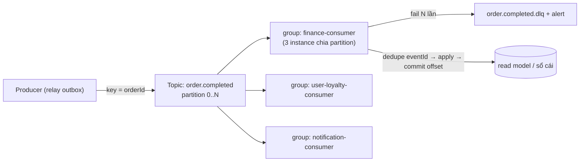

# Kafka — Cơ chế

## 1. Topic, partition, offset

- **Topic** = tên kênh. **Partition** = shard của topic; message trong một partition có thứ tự
  tuyệt đối (offset tăng dần). Giữa partition: **không** có thứ tự.
- **Partition key** quyết định message vào partition nào (`hash(key) % numPartitions`). Cùng
  key → cùng partition → giữ thứ tự. Vici: key = `orderId` / `aggregate_id`.
- **Số partition** = trần song song của một consumer group (N partition → tối đa N instance
  xử lý song song). Chọn dư một chút; tăng partition sau khó (đổi phân bố key).

## 2. Consumer group

- Nhiều instance cùng `group.id` → Kafka chia partition cho chúng, mỗi partition đúng **một**
  consumer trong nhóm tại một thời điểm.
- Nhóm khác `group.id` → nhận **bản sao đầy đủ** của mọi message (fan-out). Vici:
  `finance-consumer`, `notification-consumer`, `provisioning-consumer` là các group độc lập,
  mỗi group thấy hết event nó đăng ký.
- Consumer commit **offset** đã xử lý xong. Restart → đọc tiếp từ offset đã commit.

## 3. Ordering — chỉ trong partition

- Cần thứ tự `OrderPlaced` trước `OrderShipped` → cùng `orderId` làm key → cùng partition.
- **Không** cần (và không nên ép) thứ tự giữa các đơn khác nhau → chúng ở partition khác nhau,
  xử lý song song.
- Ép thứ tự toàn cục = 1 partition = 1 consumer = throughput trần thấp.

## 4. Delivery: at-least-once (mặc định thực dụng)

- Consumer xử lý message → **rồi** commit offset. Crash giữa hai bước → message xử lý lại → trùng.
- Đảo (commit trước, xử lý sau) = at-most-once = có thể mất. Không dùng cho nghiệp vụ.
- → **consumer idempotent**: dedupe theo `eventId` (bảng `processed_events` hoặc unique
  constraint tự nhiên) *trước khi* apply.

## 5. Retry & DLQ

Consumer fail xử lý một message:

- **Lỗi tạm thời** (DB timeout): retry tại chỗ với backoff, giới hạn số lần.
- **Poison message** (payload hỏng, lỗi logic không tự khỏi): sau N lần → đẩy vào
  **`<topic>.dlq`** kèm lỗi gốc + metadata, **commit offset** (để không chặn partition), **bắn alert**.
- Người/xử lý sau đọc DLQ, sửa, replay thủ công.

> Hệ quả production: không có DLQ → một message hỏng chặn cả partition, consumer lag tăng vô
> hạn, mọi event sau nó không được xử lý. Đây là sự cố kinh điển.

## 6. Rebalance

Khi consumer vào/ra nhóm (deploy, crash, scale), Kafka **rebalance** — dừng mọi consumer, phân
lại partition, chạy lại.

- Rebalance thường xuyên (consumer chết vì OOM/timeout liên tục) = **rebalance storm** → nhóm
  dành phần lớn thời gian rebalance thay vì xử lý.
- Giảm: xử lý message nhanh (đừng giữ lâu), tăng `max.poll.interval.ms` hợp lý, cooperative
  rebalancing, consumer healthy.

## 7. Avro schema evolution

Schema event ở Schema Registry; kiểm tương thích khi đăng ký schema mới:

| Thay đổi | Backward compat? | Ghi chú |
| --- | --- | --- |
| Thêm field **có default** | ✅ | Consumer cũ bỏ qua field mới; consumer mới đọc event cũ nhờ default |
| Xoá field **có default** | ✅ | |
| Thêm field **không default** | ❌ | Consumer cũ đọc event mới lỗi |
| Đổi kiểu field | ❌ | |
| Đổi tên field | ❌ (trừ khi có alias) | |

Quy tắc: **chỉ thêm field optional**. Breaking thật sự → topic mới hoặc `eventType` version mới
(`OrderPlacedV2`), migrate consumer.

## 8. Replay

- Consumer group mới, hoặc reset offset về `earliest` → đọc lại toàn bộ event còn trong
  retention.
- Dùng để: dựng read model mới (finance thêm báo cáo), sửa bug consumer rồi xử lý lại, onboard
  service mới.
- Điều kiện: consumer **idempotent** (replay = nhận lại mọi event) và retention đủ dài.

## Tóm tắt để ôn nhanh

> 🗣️ Nói thành lời: "Topic chia partition; thứ tự chỉ đảm bảo trong partition nên tôi đặt key
> là orderId để event của một đơn giữ thứ tự, đơn khác nhau xử lý song song. Consumer group
> chia partition để scale; group khác nhau thì fan-out. Delivery là at-least-once — xử lý xong
> mới commit offset — nên consumer dedupe theo eventId. Message hỏng thì sau N retry đẩy vào
> DLQ và commit offset để không chặn partition. Schema Avro thì chỉ thêm field optional, breaking
> thì làm topic mới."
