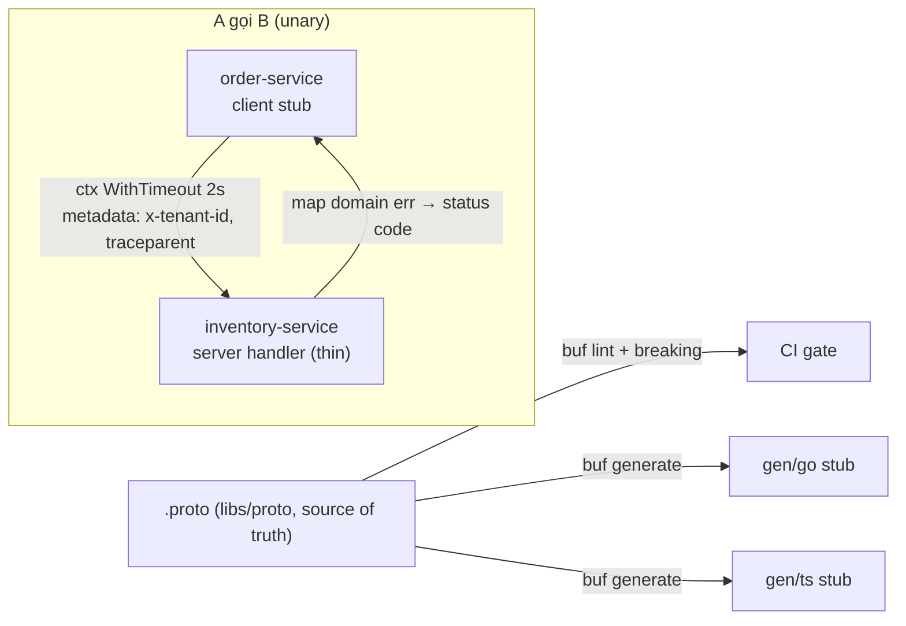

# gRPC + Buf — Cơ chế

## 1. proto3 cơ bản

```proto
syntax = "proto3";
package vici.inventory.v1;

service InventoryService {
  rpc ReserveStock (ReserveStockRequest) returns (ReserveStockResponse);
}

message ReserveStockRequest {
  string tenant_id = 1;              // field number 1 — KHÔNG BAO GIỜ đổi
  string checkout_session_id = 2;
  repeated Line lines = 3;
}
message Line { string sku = 1; int32 qty = 2; }
```

- **Field number** là định danh trên wire. Đổi số / tái dùng số cũ = breaking. Field bỏ đi →
  `reserved 4;` để không ai tái dùng.
- Field không set = zero value (`""`, `0`, `false`) — không phân biệt được "không gửi" với "gửi
  0" trừ khi dùng `optional` (proto3) hoặc wrapper.

## 2. Bốn kiểu RPC

| Kiểu | Mô tả | Vici dùng? |
| --- | --- | --- |
| Unary | 1 req → 1 res | Có, gần như tất cả |
| Server streaming | 1 req → nhiều res | Hiếm (export dữ liệu lớn) |
| Client streaming | nhiều req → 1 res | Không |
| Bidirectional | nhiều ↔ nhiều | Không |

Giữ đơn giản: unary trừ khi có lý do rõ ràng.

## 3. Code generation (Buf)

`buf.yaml` + `buf.gen.yaml` → `buf generate`:

- Go: `gen/go/<context>/v1/*.pb.go` + `*_grpc.pb.go`.
- TS: `gen/ts/...` (dùng bởi 5 service NestJS: auth, user, order, tenant, billing).

Stub sinh ra **không commit như code viết tay** — sinh lại từ `.proto`. `libs` không import từ
`services`; services import từ `libs`.

## 4. Deadline / timeout — bắt buộc

Mọi RPC phải có **deadline** (thời hạn tuyệt đối), truyền qua `context.Context`:

```go
ctx, cancel := context.WithTimeout(ctx, 2*time.Second)
defer cancel()
res, err := inventoryClient.ReserveStock(ctx, req)
```

- Không deadline → RPC treo vô hạn khi B chậm/chết → goroutine/connection tích tụ → A cạn
  tài nguyên → **cascading failure**.
- Deadline **truyền tiếp** (propagate): B gọi C với phần thời gian còn lại.
- Khuyến nghị Vici: 2s cho RPC đồng bộ trong saga (`ReserveStock`, `CreatePayment`).

## 5. Status codes — map ở `interface/grpc/`

gRPC có bộ status code chuẩn. Map lỗi domain → code **ở lớp interface**, domain không import
`google.golang.org/grpc/codes`:

| Domain error | gRPC code |
| --- | --- |
| Không tìm thấy | `NotFound` |
| Vi phạm invariant (đơn đã packing, không huỷ được) | `FailedPrecondition` |
| Hết allocation / hết tồn | `ResourceExhausted` |
| Trùng (idempotency key đã dùng khác payload) | `AlreadyExists` |
| Thiếu tenant metadata | `InvalidArgument` |

## 6. Interceptor

Middleware cho mọi RPC, đăng ký ở `main.go`:

- **OTel** (`otelgrpc`): inject/extract trace context qua metadata → trace nối liền A→B→C.
- **Tenant**: extract metadata `x-tenant-id` → đặt vào `context` để repository dùng.
- **Logging / recovery / auth nội bộ** (mTLS hoặc token service-to-service).

## 7. Retry — cẩn thận với side-effect

- RPC **đọc thuần** (`GetOrderStatus`, `GetEntitlements`): retry an toàn với backoff.
- RPC **có side-effect** (`ReserveStock`, `CreatePayment`): **không** retry tự động ở tầng gRPC.
  Retry là quyết định của **saga** (có thể cần compensation trước). Nếu RPC idempotent
  (`Idempotency-Key`) thì saga retry được an toàn.

## 8. Buf lint + breaking trong CI

```
buf lint                        # style: naming, package = vici.<ctx>.v1, field number...
buf breaking --against '.git#branch=main'   # so với main, fail nếu breaking
buf generate                    # sinh stub
```

CI chặn merge nếu `buf breaking` fail. Đổi proto breaking thật sự → thêm `v2` package, giữ `v1`,
migrate consumer.

## Tóm tắt để ôn nhanh



> 🗣️ Nói thành lời: "proto3, unary là chính, field number bất biến. Buf lo lint và chặn breaking
> change trong CI, sinh stub Go và TS. Mọi RPC có deadline truyền qua context — khoảng 2s trong
> saga — nếu không thì RPC treo khi service kia chậm và gây cascading failure. Status code map
> ở lớp interface, domain không biết gRPC. RPC đọc thì retry được, RPC có side-effect thì để
> saga quyết định retry, không auto ở tầng gRPC."
