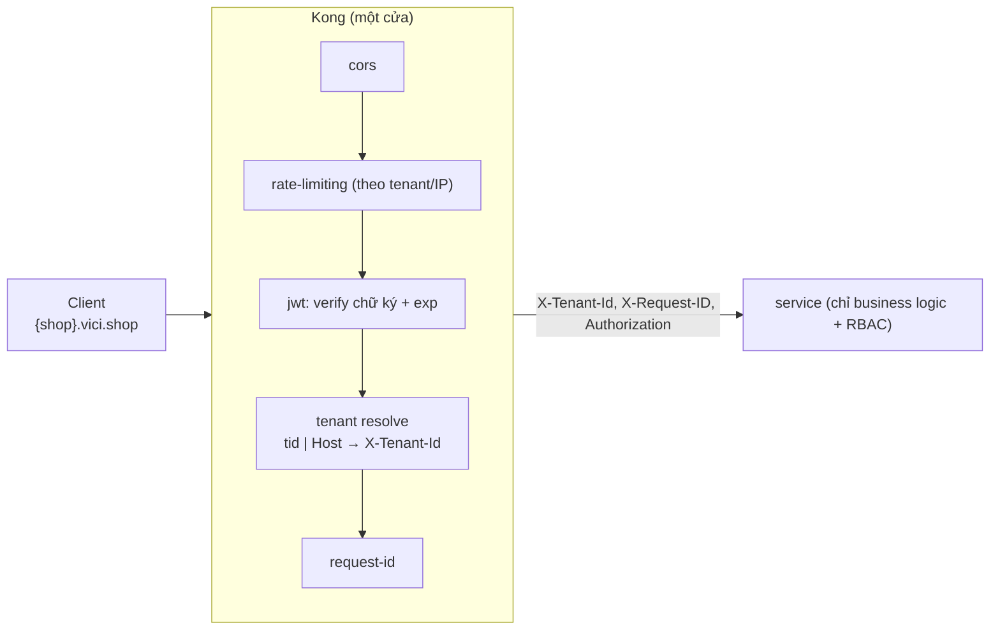

# API Gateway (Kong) — Cơ chế

## 1. Ba khái niệm: service, route, plugin

```yaml
services:
  - name: product-service
    url: http://product-service:3003        # upstream
    routes:
      - name: product-public
        paths: ["/products", "/series", "/brands"]
        methods: [GET]
        plugins:
          - name: rate-limiting
            config: { minute: 300, policy: local }
      - name: product-private
        paths: ["/products", "/series"]
        methods: [POST, PUT, PATCH, DELETE]
        plugins:
          - name: jwt
```

- **Service** = một upstream. **Route** = điều kiện (path/method/host) chọn service. **Plugin**
  = chức năng gắn ở global / service / route.
- Cùng path, khác method → route khác → plugin khác. Vici: `GET /products` public (rate limit
  cao), `POST /products` cần JWT.

## 2. DBless declarative

`KONG_DATABASE=off`, toàn bộ trong `kong.yml`. Áp thay đổi:

```
kong config parse /etc/kong/kong.yml     # validate
kong reload                              # hot reload, no downtime
# hoặc: deck sync -s gateway/kong/kong.yml
```

Ưu điểm: config trong git, diff review được, không drift giữa môi trường.

## 3. JWT plugin — verify, không authorize

- Kiểm **chữ ký** (RS256, public key), **hạn** (`exp`), optionally `nbf`/`iat`.
- **Không** kiểm role/permission — đó là việc service.
- Route public (đăng ký, đăng nhập, xem catalog) **không** gắn plugin jwt.
- Sau khi verify, Kong có thể forward claims xuống service qua header.

## 4. Rate limiting

- `policy: local` (mỗi node Kong đếm riêng) vs `redis` (đếm chung — chính xác khi nhiều node).
- Theo IP, theo consumer, hoặc — với Vici đa tenant — **theo tenant** (`X-Tenant-Id`).
- Route nhạy cảm siết chặt: `/auth/*` (chống brute-force), endpoint drop (chống bot).

## 5. Tenant resolution (Vici, ADR-009)

Kong phân giải tenant **trước khi** forward, theo thứ tự:

1. Request đã đăng nhập → JWT có claim **`tid`** → một plugin copy `tid` → header
   **`X-Tenant-Id`**, **đè** giá trị client tự đặt.
2. Route public (storefront chưa đăng nhập) → lấy tenant từ **`Host`**
   (`{sub}.vici.shop` / custom domain) qua `tenant.ResolveTenantByHost` (cache).

Service phía sau **tin** `X-Tenant-Id` từ Kong (client không tự khai tenant được).

> Hệ quả production: nếu để client gửi `tenant_id` trong body và service tin nó → bất kỳ ai đổi
> body là đọc được dữ liệu tenant khác. Phân giải ở gateway từ thứ đã xác thực là hàng rào bảo mật.

## 6. Thứ tự plugin (execution order)

Kong chạy plugin theo `priority` cố định, không theo thứ tự khai báo. Đại khái:

```
cors  →  rate-limiting  →  jwt  →  (tenant resolve)  →  request-transformer  →  proxy tới upstream
```

Điểm cần nhớ: **rate-limiting trước jwt** (chặn flood trước khi tốn CPU verify), **tenant
resolve sau jwt** (cần `tid` từ token đã verify).

## 7. Global plugins

Áp cho mọi route trừ khi override:

```yaml
plugins:
  - name: cors
    config: { origins: [...], methods: [...], credentials: true }
  - name: request-id
    config: { header_name: X-Request-ID, echo_downstream: true }
```

`X-Request-ID` được sinh nếu chưa có, propagate xuống service → dùng làm correlation id trong log/trace.

## 8. Kong không làm gì

- Không giữ state nghiệp vụ (rate counter ở Redis).
- Không aggregate nhiều service (BFF là component riêng).
- Không transform body phức tạp (chỉ header).
- Không authorize theo role.

## Tóm tắt để ôn nhanh



> 🗣️ Nói thành lời: "Kong có ba khái niệm: service là upstream, route là điều kiện path/method/host,
> plugin là chức năng cắm vào. DBless nên config là YAML trong git. Plugin jwt chỉ verify chữ ký
> và hạn, authorization để service làm. Rate limit chạy trước jwt để chặn flood sớm. Với đa
> tenant, Kong phân giải tenant từ claim `tid` hoặc từ Host rồi gắn `X-Tenant-Id`, đè giá trị
> client — đó là hàng rào để client không tự khai tenant khác."
