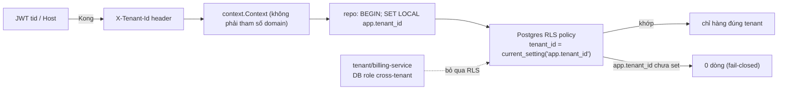

# Multi-tenancy + RLS — Cơ chế

## 1. Cột `tenant_id` trên mọi bảng nghiệp vụ

`tenant_id uuid NOT NULL` trên **mọi bảng** của service tenant-plane — kể cả `outbox`, read
model, search index. Bảng cấu hình toàn nền tảng (danh mục plan, bảng `tenants`) **không** có
`tenant_id` (đó là platform plane).

## 2. Policy RLS

```sql
ALTER TABLE <t> ENABLE ROW LEVEL SECURITY;
ALTER TABLE <t> FORCE ROW LEVEL SECURITY;   -- áp cả cho owner của bảng
CREATE POLICY tenant_isolation ON <t>
  USING      (tenant_id = current_setting('app.tenant_id')::uuid)   -- lọc khi đọc
  WITH CHECK (tenant_id = current_setting('app.tenant_id')::uuid);  -- chặn ghi sai tenant
```

- `USING`: áp cho `SELECT`, `UPDATE`, `DELETE` — chỉ thấy hàng đúng tenant.
- `WITH CHECK`: áp cho `INSERT`, `UPDATE` — không ghi được hàng có `tenant_id` khác session.
- **App role không có `BYPASSRLS`.** `FORCE ROW LEVEL SECURITY` để owner cũng bị áp.

## 3. `SET LOCAL app.tenant_id` — mỗi transaction

Repository mở transaction, câu **đầu tiên**:

```sql
BEGIN;
SET LOCAL app.tenant_id = '3f2504e0-4f89-11d3-9a0c-0305e82c3301';
-- ... mọi câu sau chỉ thấy tenant này
COMMIT;
```

- `SET LOCAL` = phạm vi **transaction** (không rò sang transaction/connection khác khi pool tái
  dùng). Dùng `SET` (session) là bug với connection pool.
- Giá trị đọc từ `context.Context` (Go) / request-scoped provider (Nest), gốc là header
  `X-Tenant-Id`.

## 4. Connection pool + RLS

Với connection pool (pgx pool, hoặc **RDS Proxy** ở serverless):

- Connection được **tái dùng** giữa các request/tenant.
- `SET LOCAL` trong transaction đảm bảo giá trị **không dính** sang lần dùng sau — hết
  transaction là biến mất.
- Nếu lỡ dùng `SET` (không `LOCAL`) → connection mang `app.tenant_id` của tenant A phục vụ
  request của tenant B → **rò rỉ chéo tenant**. Đây là bug nguy hiểm nhất của mô hình này.

## 5. Unique & index dẫn đầu bằng `tenant_id`

- Unique cũ (`slug`, `sku`, `voucher.code`, `entry_no`) đổi thành **`(tenant_id, <khoá>)`** —
  chỉ unique **trong một tenant**. Hai shop có thể cùng slug `molly`.
- Index dẫn đầu bằng `tenant_id`: `(tenant_id, status, created_at)`, `(tenant_id, sku)` — vì
  mọi query đã ngầm lọc theo tenant, planner dùng được index này hiệu quả.
- Event store: stream id = `(tenant_id, aggregate_id)`.

## 6. Lan truyền tenant context (ADR-009)

| Chặng | Mang tenant bằng |
| --- | --- |
| Biên (edge/Kong) | `tid` claim JWT, hoặc `Host` → resolve → header `X-Tenant-Id` (đè giá trị client) |
| REST vào service | Header `X-Tenant-Id` |
| Trong process | `context.Context` value / request-scoped provider — **không** phải tham số hàm domain |
| Repository → DB | `SET LOCAL app.tenant_id` |
| gRPC nội bộ | Metadata `x-tenant-id` (interceptor) |
| Kafka | Header message `tenant-id` + cột `outbox.tenant_id` |
| Consumer | Đọc header → set context → `SET LOCAL app.tenant_id` trước khi ghi |

## 7. Platform plane — thao tác cross-tenant

`tenant-service` và `billing-service` cần liệt kê **mọi** tenant, provisioning, chốt billing:

- Dùng **DB role riêng** có quyền bỏ qua RLS cho thao tác quản trị.
- API của chúng **không** nhận `X-Tenant-Id` của tenant thường; chỉ `platform_admin` (token
  không có `tid`) gọi được.
- **Impersonate**: Operator "vào" một tenant → hệ cấp token có `tid` của tenant đó, hết hạn
  ≤ 30', ghi audit. Từ lúc đó luồng chạy như tenant thường.

## 8. Domain layer — `TenantId` value object

- Aggregate có field `tenantID TenantId`, gán **một lần lúc tạo**, không setter.
- Method domain **không** nhận `tenant_id` làm tham số — nó đã ở trong aggregate.
- Repository set `app.tenant_id` từ context; **không** tự thêm `WHERE tenant_id = ...` (thừa,
  và dễ quên chỗ khác — để RLS lo).

## Tóm tắt để ôn nhanh



> 🗣️ Nói thành lời: "Mọi bảng có `tenant_id`, RLS policy lọc theo `current_setting('app.tenant_id')`,
> app role không bypass. Repository mở transaction thì câu đầu là `SET LOCAL app.tenant_id` —
> phải là `LOCAL` vì connection pool tái dùng, `SET` thường sẽ rò sang request tenant khác.
> Unique đổi thành `(tenant_id, khoá)`. Context đi từ header vào `context.Context` rồi xuống
> repo, không truyền như tham số domain. Platform plane dùng DB role riêng bỏ qua RLS."
