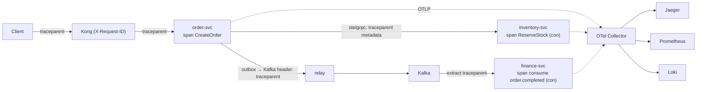

# OpenTelemetry — Cơ chế

## 1. Span & trace

- **Span** = một khoảng công việc: tên (`CreateOrder`), timestamp start/end, **attributes**
  (`order.id`, `tenant.id`), **status** (ok/error), **events** (log gắn vào span).
- **Trace** = tập span của một request, có chung `trace_id`, quan hệ cha-con (span
  `HandleHTTP` → con `CreateOrder` → con `ReserveStock` (ở service khác)).
- Span con biết cha qua **span context** (`trace_id` + `span_id` của cha).

## 2. Context propagation — nối span xuyên service

Khi service A gọi service B, A phải gửi span context của mình để B tạo span con đúng cây:

- **HTTP / gRPC**: chuẩn **W3C Trace Context** — header `traceparent`
  (`00-<trace_id>-<span_id>-<flags>`). `otelgrpc` interceptor / `otelhttp` middleware tự
  inject (bên gửi) + extract (bên nhận).
- **Kafka**: **không** tự động. Producer phải **inject** trace context vào **message header**;
  consumer **extract** ra khi nhận. Dùng `otel.GetTextMapPropagator().Inject/Extract` với một
  carrier là map header của message.

> Hệ quả production: nếu quên propagate qua Kafka, trace **đứt** ở mỗi lần qua broker — bạn thấy
> "đơn được tạo" rồi mất dấu; không nối được với "finance ghi sổ" 2 giây sau. Điều tra sự cố
> async trở nên rất khó.

## 3. Đo gì (RED / USE)

- **Auto-instrumentation** lo phần lớn RED: `otelhttp`/`otelgrpc` tự tạo span + metric duration
  cho mọi endpoint; driver DB có instrumentation cho query.
- **Manual span** cho use case quan trọng:
  ```go
  ctx, span := otel.Tracer("order").Start(ctx, "CreateOrder")
  defer span.End()
  span.SetAttributes(attribute.String("tenant.id", tid), attribute.String("order.kind", "preorder"))
  ```
- **Metric nghiệp vụ** riêng service: `tenant_provisioning_duration_seconds` (histogram),
  `billing_dunning_active` (gauge), `product_reviews_created_total` (counter).

## 4. Sampling

Giữ 100% trace ở quy mô lớn quá tốn storage + băng thông.

- **Head-based**: quyết định giữ/bỏ **ngay đầu** trace (vd. giữ 10%). Đơn giản, nhưng có thể bỏ
  lỡ trace của request lỗi.
- **Tail-based**: đợi trace xong rồi quyết định — **luôn giữ trace có lỗi hoặc chậm**, sample
  phần "bình thường". Cần OTel Collector làm việc này.
- Vici quy mô hiện tại: head-based đơn giản là đủ; chuyển tail-based khi volume lớn.

## 5. Log correlation

- Log **structured JSON** (Vici: zap cho Go, shared logger cho NestJS).
- **Mọi dòng log kèm `trace_id`** (lấy từ span context trong `context.Context`).
- `X-Request-ID` (Kong sinh) cũng đưa vào log + span attribute — correlate cả những chỗ chưa có
  trace.
- → từ một dòng log lỗi, nhảy thẳng sang trace tương ứng trong Jaeger, thấy toàn cảnh request.

## 6. Chuẩn hoá level log

| Level | Khi nào | Ví dụ |
| --- | --- | --- |
| `error` | Cần điều tra; kèm `zap.Error(err)` | saga compensation fail |
| `warn` | Hồi phục được, hệ vẫn chạy | retry lần 2 của một RPC |
| `info` | Cột mốc nghiệp vụ (1–2/request) | order placed, payment received, tenant provisioned |
| `debug` | Nội bộ, tắt ở production | giá trị trung gian |

Không log mỗi lần gọi hàm — noise che tín hiệu, tốn tiền lưu.

## 7. OTel Collector

Tiến trình đứng giữa app và backend:

- **Nhận** OTLP từ mọi service (app không cần biết Jaeger/Prometheus ở đâu — chỉ biết Collector).
- **Xử lý**: batch (giảm request), lọc thuộc tính nhạy cảm, tail-based sampling, thêm resource
  attribute.
- **Xuất** tới nhiều backend (Jaeger cho trace, Prometheus cho metric, Loki cho log).
- Đổi backend = đổi config Collector, **không** deploy lại 13 service.

`backend/infra/observability/` có config cho otel-collector, jaeger, prometheus, grafana, loki.

## 8. Init một lần ở `main`

Từ conventions: khởi tạo OTel SDK **một lần** trong `cmd/server/main.go` (Go) / `main.ts`
(NestJS) — tracer provider, meter provider, log bridge, exporter (OTLP → Collector). Inject
logger/tracer qua constructor; **không** global `zap.L()` trong domain/application.

## Tóm tắt để ôn nhanh



> 🗣️ Nói thành lời: "Span là một khoảng công việc có tên và thời gian; trace là cây span của
> một request. Nối span xuyên service bằng W3C traceparent — HTTP/gRPC thì interceptor tự làm,
> Kafka thì phải tự inject/extract vào message header, quên là trace đứt ở broker. Auto-instrument
> lo RED, tôi thêm span thủ công cho use case quan trọng và vài metric nghiệp vụ. Mọi dòng log
> có trace_id để nhảy từ log sang trace. OTel Collector đứng giữa nên đổi backend chỉ đổi config
> Collector."
