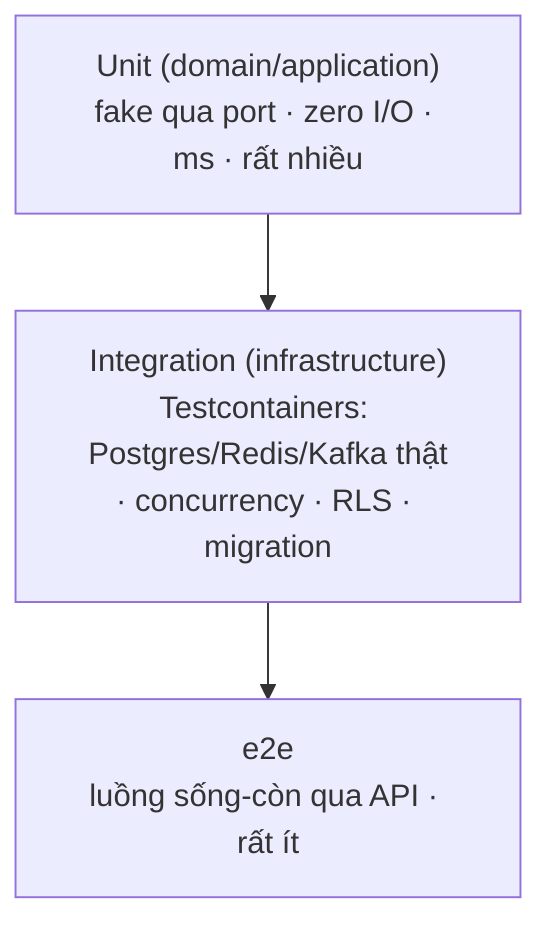

# Testing & Testcontainers — Cơ chế

## 1. Unit test — fake qua port

```go
// fake implement domain/port.OrderRepository — in-memory
type fakeOrderRepo struct{ orders map[string]*model.Order }
func (f *fakeOrderRepo) Save(_ context.Context, o *model.Order) error { f.orders[o.ID()] = o; return nil }
func (f *fakeOrderRepo) FindByID(_ context.Context, id string) (*model.Order, error) { ... }

func TestPlaceOrder_ReservesStockThenSaves(t *testing.T) {
    repo := &fakeOrderRepo{orders: map[string]*model.Order{}}
    inv  := &fakeInventory{available: 5}
    h := command.NewPlaceOrderHandler(repo, inv, &fakeOutbox{})
    _, err := h.Execute(ctx, cmd)
    assert.NoError(t, err)
    assert.Len(t, repo.orders, 1)
    assert.Equal(t, 3, inv.reserved)   // đã gọi ReserveStock
}
```

Fake nhỏ để inline trong test, hoặc gom vào `internal/domain/port/fake/`.

## 2. Table-driven test

```go
tests := []struct {
    name    string
    amount  int64
    wantErr error
}{
    {"positive", 100, nil},
    {"zero",     0,   nil},
    {"negative", -1,  apperr.ErrNegativeAmount},
}
for _, tt := range tests {
    t.Run(tt.name, func(t *testing.T) {
        _, err := model.NewMoney(tt.amount)
        assert.ErrorIs(t, err, tt.wantErr)
    })
}
```

Tên test mô tả **hành vi**: `TestOrder_CannotBePaidTwice`, không `TestOrderPay2`.

## 3. Testcontainers lifecycle

```go
func TestMain(m *testing.M) {
    ctx := context.Background()
    pg, _ := postgres.RunContainer(ctx,
        testcontainers.WithImage("postgres:16"),
        postgres.WithDatabase("order_test"),
    )
    dsn, _ := pg.ConnectionString(ctx)
    runMigrations(dsn)          // migration THẬT
    testDB = connect(dsn)
    code := m.Run()
    pg.Terminate(ctx)
    os.Exit(code)
}
```

- Một container cho cả package (nhanh hơn container/test).
- Chạy migration thật → schema đúng như production.

## 4. Cô lập state giữa test

Hai cách:

- **Transaction rollback**: mỗi test chạy trong một transaction, `defer tx.Rollback()`. Nhanh,
  sạch tuyệt đối. Nhược: không test được cái cần commit (trigger, RLS với `SET LOCAL` per-tx).
- **Truncate**: `TRUNCATE table1, table2 CASCADE` trong `t.Cleanup()` hoặc đầu mỗi test. Chậm
  hơn chút, nhưng test được hành vi commit.

Với RLS: cần `SET LOCAL app.tenant_id` trong transaction thật → thường dùng truncate.

## 5. Test concurrency (NFR-05)

Cái quan trọng nhất integration test bắt: race condition.

```go
func TestReserveStock_NoOversell(t *testing.T) {
    seed(testDB, "SKU-1", onHand: 10)
    var wg sync.WaitGroup
    var success atomic.Int32
    for i := 0; i < 50; i++ {           // 50 goroutine cùng reserve 1
        wg.Add(1)
        go func() {
            defer wg.Done()
            if repo.Reserve(ctx, "SKU-1", 1) == nil { success.Add(1) }
        }()
    }
    wg.Wait()
    assert.Equal(t, int32(10), success.Load())   // đúng 10 thành công, không 11+
    assertOnHand(t, "SKU-1", 10)                  // không âm
}
```

Chỉ chạy được với Postgres thật (`UPDATE ... WHERE available >= qty` atomic). Fake repo không
tái hiện race.

## 6. Test RLS / cross-tenant (NFR-13)

```go
func TestProductRepo_CrossTenantReadReturnsEmpty(t *testing.T) {
    withTenant(testDB, tenantA, func(tx) { insertProduct(tx, "molly") })
    // đọc với tenant B
    got := withTenant(testDB, tenantB, func(tx) { return repo.List(tx) })
    assert.Empty(t, got)                          // RLS chặn — 0 dòng
    // đọc thiếu app.tenant_id
    gotNoCtx := repo.ListRaw(testDB)               // không SET LOCAL
    assert.Empty(t, gotNoCtx)                      // fail-closed
}
```

Bắt buộc cho **mỗi repo tenant-plane**.

## 7. Test saga compensation

E2e/integration cho saga: giả lập bước fail, assert compensation chạy đúng + đúng thứ tự.

```
seed order, stock
stub payment → trả lỗi ở CreatePayment
run checkout saga
assert: reservation released, order status = cancelled, no charge
```

## Tóm tắt để ôn nhanh



> 🗣️ Nói thành lời: "Unit test inject fake implement port, table-driven cho nhiều case, tên
> test mô tả hành vi. Integration dùng Testcontainers khởi động Postgres thật, chạy migration
> thật, cô lập state bằng transaction rollback hoặc truncate. Case quan trọng nhất là
> concurrency — 50 goroutine cùng reserve, assert đúng N thành công không oversell — cái này
> fake repo không tái hiện được. Và mỗi repo tenant-plane có test cross-tenant read trả rỗng."
