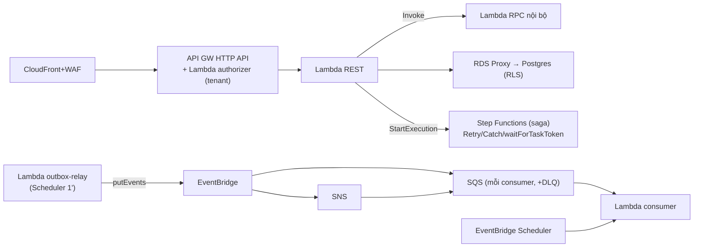

# Serverless AWS — Cơ chế

## 1. Lambda — compute

- Hàm nhận `event` (từ API GW, SQS, EventBridge, Step Functions…), chạy, trả kết quả.
- **Concurrency**: mỗi request đồng thời = một instance; AWS scale tự động tới account limit.
- **Cold vs warm**: instance mới = cold start (khởi tạo runtime + code). Instance tái dùng =
  warm (nhanh). Sau ~vài–vài chục phút không dùng, instance bị thu hồi.
- **Provisioned concurrency**: trả tiền giữ N instance luôn ấm cho hàm nhạy latency.
- Đóng gói: một hàm cho REST (proxy integration), một hàm cho mỗi RPC nội bộ / mỗi consumer.

## 2. API Gateway (HTTP API) + Lambda authorizer

Thay Kong ở edge:

- **Routes** map path/method → Lambda (proxy integration).
- **Lambda authorizer** chạy **trước** mọi request được bảo vệ: verify JWT, phân giải tenant
  (`tid` claim / `Host` → `ResolveTenantByHost`), trả `{ isAuthorized, context: { tenantId, role } }`.
  Kết quả cache theo token.
- Mọi Lambda phía sau đọc `event.requestContext.authorizer.tenantId` — **không** tin body client.
- **Throttling / usage plan** theo "API key ảo = tenant" thay `rate-limiting` plugin.

## 3. Async: EventBridge → SQS → Lambda

```
Lambda (outbox relay) --putEvents--> EventBridge default bus
     detail = { tenantId, ...payload }, source = "vici.order", detail-type = "order.completed"

EventBridge rule (match source/detail-type) --> SQS queue (một cái mỗi consumer)
     message attribute: tenant-id

SQS --> Lambda consumer (batch, ReportBatchItemFailures)
     dedupe eventId -> SET app.tenant_id (từ attribute) -> apply
     fail N lần -> redrive -> <queue>-dlq + CloudWatch alarm
```

- **EventBridge**: routing theo nội dung; nhiều rule, mỗi rule tới target khác.
- **SQS trước Lambda consumer**: buffer (Lambda không bị dội), retry tự động, **DLQ**, visibility
  timeout, batch. `ReportBatchItemFailures` = chỉ retry item fail trong batch, không cả batch.
- **FIFO SQS** khi cần thứ tự: `MessageGroupId = orderId`, `MessageDeduplicationId = eventId`.

## 4. SNS — fan-out rộng

`tenant.provisioned` cần tới ~7 context. EventBridge rule giới hạn số target; và thêm subscriber
phải sửa rule. → EventBridge → **SNS topic** → **SQS mỗi context** (SNS-to-SQS fanout). Thêm
context = thêm một SQS subscribe SNS, không đụng gì khác.

## 5. Step Functions — saga orchestrator

State machine viết bằng **ASL** (Amazon States Language, JSON khai báo):

- Mỗi **Task state** = invoke một Lambda (một bước saga).
- **`Retry`** (backoff, maxAttempts) và **`Catch`** (chuyển sang state compensation) **dựng sẵn**
  — không tự viết vòng retry.
- **Wait for callback**: Task với `.waitForTaskToken` → giữ token, pause; khi event async về
  (payment.succeeded), một Lambda gọi `SendTaskSuccess(token)` → saga tiếp. Kèm `HeartbeatSeconds`
  / `TimeoutSeconds`.
- **Execution history**: xem được saga đang/đã ở state nào — thay "query state trong service".

CQRS/ES logic của aggregate **không đổi** — Step Functions chỉ điều phối, mỗi bước vẫn gọi
Lambda chứa command handler.

## 6. Data — RDS Proxy

- 1.000 Lambda đồng thời mở connection tới Postgres → vượt `max_connections`, DB từ chối.
- **RDS Proxy** đứng giữa: Lambda kết nối Proxy; Proxy pool + tái dùng connection thật tới RDS.
- Với RLS: mỗi transaction vẫn `SET LOCAL app.tenant_id` — `LOCAL` đảm bảo không dính khi Proxy
  tái dùng connection cho tenant khác (giống pgx pool — xem
  [`10-multi-tenancy-rls/04`](../10-multi-tenancy-rls/04-pitfalls-va-thuc-hanh.md#1-dùng-set-thay-vì-set-local)).
- Hoặc **Aurora Serverless v2**: DB tự scale ACU theo tải.
- Redis: **ElastiCache Serverless** — nhưng drop counter cần INCR atomic độ trễ sub-ms → dùng
  ElastiCache (không DynamoDB).

## 7. Cron — EventBridge Scheduler

`EventBridge Scheduler` (cron/rate) → invoke Lambda: outbox relay (mỗi 1'), dunning (mỗi giờ),
quét deadline pre-order (mỗi giờ), purge tenant (hằng ngày). Thay cron trong process Go.

## Tóm tắt để ôn nhanh



> 🗣️ Nói thành lời: "Lambda cho compute; API Gateway với Lambda authorizer thay Kong và trả
> tenantId. Async: outbox relay Lambda putEvents lên EventBridge, rule route sang SQS mỗi
> consumer — SQS lo buffer, retry, DLQ, FIFO nếu cần thứ tự — rồi trigger Lambda consumer. SNS
> cho fan-out rộng. Saga chuyển sang Step Functions: Retry và Catch dựng sẵn, chờ event async
> bằng callback task token. DB thì bắt buộc RDS Proxy để không cạn connection, và vẫn `SET LOCAL`
> cho RLS. Cron là EventBridge Scheduler."
